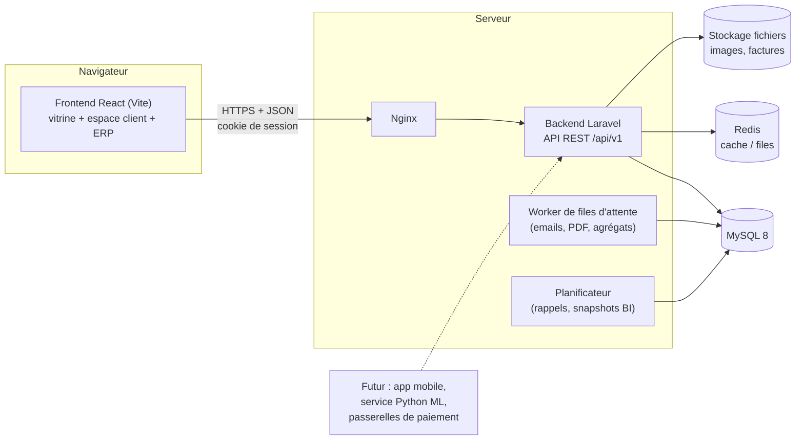
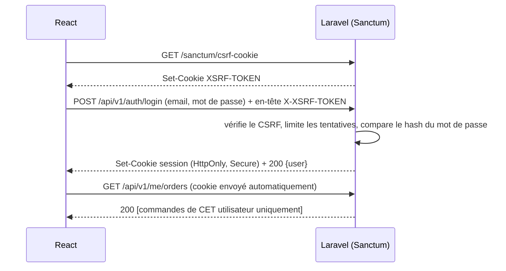
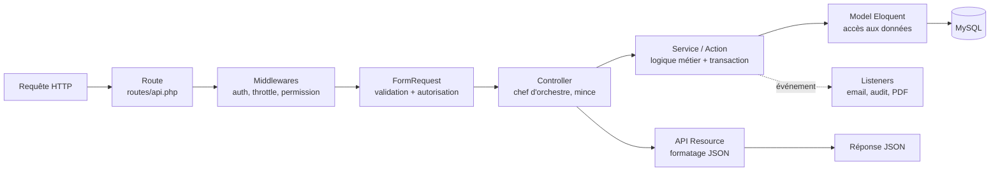
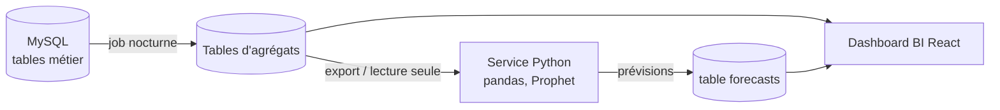

# Architecture du projet

> **Statut** : étape 2 — version 1.0
> **Prérequis de lecture** : [docs/01_ANALYSE_DU_BESOIN.md](docs/01_ANALYSE_DU_BESOIN.md)

Ce document répond à la question **« comment le système est-il construit ? »**. Chaque choix est justifié : en entreprise, un choix non justifié finit toujours par être remis en cause.

---

## 1. Vue d'ensemble

### 1.1 Le principe : une API et des clients séparés (architecture découplée)



**Explication (cours)**
- Le **frontend** (ce que voit l'utilisateur) et le **backend** (la logique et les données) sont deux applications distinctes qui communiquent en **JSON** via une **API REST**.
- **Pourquoi séparer ?**
  1. Une future application mobile réutilisera **la même API** (exigence §9 de l'analyse).
  2. Chaque partie peut évoluer, être testée et être déployée indépendamment.
  3. Les responsabilités sont claires : React affiche, Laravel décide et protège.
- **Règle d'or** : **le frontend n'est jamais digne de confiance.** Toute règle (prix, stock, droits) est revérifiée par Laravel. Le frontend peut être modifié par n'importe qui depuis son navigateur.

### 1.2 Qu'est-ce qu'une API REST ? (cours)

REST est une convention pour organiser les URLs autour de **ressources** (des noms) manipulées par des **verbes HTTP** :

| Verbe | URL | Action | Code de réponse |
|---|---|---|---|
| `GET` | `/api/v1/products` | Lister | 200 |
| `GET` | `/api/v1/products/{slug}` | Afficher un produit | 200 / 404 |
| `POST` | `/api/v1/admin/products` | Créer | 201 / 422 |
| `PUT/PATCH` | `/api/v1/admin/products/{id}` | Modifier | 200 / 422 |
| `DELETE` | `/api/v1/admin/products/{id}` | Supprimer (logiquement) | 204 |

Codes importants : `401` = non connecté, `403` = connecté mais non autorisé, `404` = introuvable, `422` = données invalides, `429` = trop de requêtes.

Le préfixe `/v1` est le **versionnement** : si on casse un jour le format, on crée `/v2` sans casser l'application mobile qui utilise `/v1`.

---

## 2. Décisions d'architecture (ADR)

> **Cours : l'ADR (Architecture Decision Record).** C'est une fiche courte qui note **une décision, son contexte, les alternatives et ses conséquences**. Dans un an, quand vous vous demanderez « pourquoi on a fait ça ? », la réponse sera ici.

### ADR-001 — Tailwind CSS + shadcn/ui, sans Bootstrap
- **Contexte** : le cahier des charges cite Bootstrap, Tailwind et shadcn.
- **Décision** : Tailwind + shadcn/ui uniquement. *(Décision provisoire, réversible si le porteur du projet l'exige.)*
- **Pourquoi** : shadcn est construit **sur** Tailwind. Bootstrap injecte son propre « reset » CSS et ses classes (`.container`, `.row`, `.btn`), qui entrent en conflit avec Tailwind. On aurait deux systèmes de grille et deux façons de faire un bouton, et un bundle plus lourd.
- **Conséquence** : un seul langage de style. Les couleurs or et noir sont définies **une fois** dans la configuration Tailwind (*design tokens*).

### ADR-002 — TypeScript côté frontend
- **Décision** : React **en TypeScript** (`.tsx`).
- **Pourquoi** : TypeScript détecte les erreurs **avant** l'exécution (ex. `order.totl` au lieu de `order.total`). Sur un projet de cette taille (ERP + BI), c'est le standard professionnel. shadcn/ui est écrit en TypeScript.
- **Pour l'apprentissage** : on démarre avec des types simples. Pour un analyste, c'est comparable aux schémas de colonnes d'un DataFrame : chaque champ a un type connu.

### ADR-003 — Authentification : Laravel Sanctum en mode SPA (cookies)
- **Alternatives** :
  - (a) jeton JWT stocké dans `localStorage` ;
  - (b) Sanctum avec **cookie de session HttpOnly** ;
  - (c) Laravel Passport (OAuth2 complet).
- **Décision** : **(b)** pour le site web. Les jetons Sanctum (*personal access tokens*) serviront plus tard à l'app mobile.
- **Pourquoi** :
  - Un jeton dans `localStorage` est **lisible par JavaScript**. En cas de faille XSS, un attaquant peut le voler.
  - Un cookie **HttpOnly** n'est **pas lisible** par JavaScript.
  - Sanctum ajoute la **protection CSRF** (cookie `XSRF-TOKEN`) et des cookies `Secure` et `SameSite=Lax`.
  - Passport (c) est surdimensionné : on ne crée pas un fournisseur OAuth pour des tiers.
- **Contrainte** : le frontend et l'API doivent partager le même domaine parent (`www.exemple.sn` et `api.exemple.sn`).



### ADR-004 — Rôles et permissions : `spatie/laravel-permission`
- **Pourquoi** : c'est la bibliothèque de référence de l'écosystème Laravel, maintenue et testée. Réécrire un RBAC soi-même est risqué (faille A01 d'OWASP).
- **Modèle** : `Utilisateur → Rôles → Permissions`. Le code vérifie des **permissions** (`orders.update`), **jamais des noms de rôle**. On peut ainsi créer un nouveau rôle depuis l'ERP sans toucher au code.

### ADR-005 — Pas de « Repository pattern » générique
- **Contexte** : beaucoup de tutoriels ajoutent une interface `ProductRepositoryInterface` au-dessus d'Eloquent.
- **Décision** : non. On utilise des **Services / Actions** pour la logique métier et des **Query classes** pour les requêtes analytiques complexes.
- **Pourquoi** : Eloquent est déjà une abstraction de la base de données. Un repository générique ajoute des fichiers sans valeur (principe **YAGNI** : *You Aren't Gonna Need It*). On garde l'abstraction là où elle sert vraiment : les **paiements** (ADR-007).

### ADR-006 — Stock géré en grand livre (*ledger*)
- **Décision** : la table `stock_movements` est la **source de vérité**. La colonne `products.stock_quantity` est un **cache** mis à jour dans la même transaction.
- **Pourquoi** : traçabilité totale (RG-STK-02), détection des pertes, et données historiques directement exploitables pour la rotation des stocks et la prévision.

### ADR-007 — Paiement : patron Strategy
- **Décision** : une interface `PaymentGateway` avec une implémentation `ManualPaymentGateway` (espèces ou mobile money saisi à la main par l'admin). Wave, Orange Money, Free Money et Stripe seront de **nouvelles classes**, sans modifier le code des commandes.
- **Principe SOLID illustré** : **O**uvert/Fermé : *ouvert à l'extension, fermé à la modification*.

```php
interface PaymentGateway {
    public function initiate(Order $order): PaymentResult;        // démarre un paiement
    public function handleWebhook(Request $request): PaymentResult; // reçoit la confirmation du fournisseur
}
// Aujourd'hui : ManualPaymentGateway
// Demain     : WavePaymentGateway, OrangeMoneyPaymentGateway, ...
```

### ADR-008 — Analytics : requêtes SQL + tables d'agrégats
- **Statut** : mis en œuvre à l'étape 8 ([docs/08_ANALYTICS.md](docs/08_ANALYTICS.md)) : `SnapshotBuilder`, job `analytics:snapshot` à 00 h 30, recalcul à la demande des jours manquants et du jour en cours (fraîcheur 5 minutes).
- **Décision** :
  1. Les KPIs temps réel (aujourd'hui) sont calculés par des requêtes SQL optimisées (index), puis mis en cache 5 minutes.
  2. Chaque nuit, un job calcule des **agrégats quotidiens** (`daily_sales_snapshots`, `daily_product_stats`). Les graphiques sur des mois ou des années lisent ces tables, ce qui est rapide.
- **Pourquoi** : recalculer un an de commandes à chaque affichage serait lent. C'est le principe d'un **entrepôt de données** (*data warehouse*) simplifié : une table de faits agrégée par jour.
- **Futur ML** : un service Python (FastAPI + pandas / scikit-learn / Prophet) pourra lire ces agrégats en **lecture seule**, ou les recevoir par export CSV / Parquet, puis renvoyer ses prévisions via une table `forecasts`.

### ADR-009 — SEO des pages publiques
- **Problème** : une SPA React envoie au navigateur une page HTML presque vide, puis la remplit en JavaScript. Les moteurs de recherche indexent moins bien ce type de page.
- **Décision par phases** :
  - **V1** : `react-helmet-async` (balises title, description, Open Graph par page) ; URLs lisibles (`/produits/huile-de-ricin-bio`) ; `sitemap.xml` généré par Laravel ; **pré-rendu statique** des pages fixes (accueil, services, contact) au build.
  - **V2** (si le SEO produit devient prioritaire) : rendu serveur (SSR) des pages catalogue via le mode SSR de Vite.
- **Pourquoi pas tout de suite** : le SSR complexifie fortement le déploiement. On l'ajoute quand le besoin est prouvé.

### ADR-010 — Environnement de développement : Docker Compose
- **Décision** : MySQL, Redis et Mailpit (faux serveur d'email pour voir les emails envoyés) tournent dans Docker. PHP et Node tournent en local ou dans Docker, au choix.
- **Pourquoi** : tous les développeurs ont exactement les mêmes versions. « Ça marche sur ma machine » n'est plus une excuse.

### ADR-012 — Format JSON de l'API : snake_case
- **Décision** : les clés JSON de l'API sont en `snake_case` (`unit_size`, `stock_status`), comme les colonnes MySQL. Les types TypeScript (`frontend/src/types/api.ts`) reprennent ce format.
- **Pourquoi** : aucune couche de conversion entre camelCase et snake_case à écrire, tester et maintenir. C'est la convention par défaut de Laravel.

### ADR-013 — Développement du frontend avec un faux serveur (MSW)
- **Décision** : tant que l'API n'existe pas, Mock Service Worker répond aux appels `/api/v1/*` dans le navigateur (`VITE_ENABLE_MOCKS=true`).
- **Pourquoi** : le frontend avance sans attendre le backend, appelle les vraies URL et gère déjà les vraies erreurs (404, 409, 422). Le contrat (`types/api.ts`) et les tests des créneaux servent de spécification à l'étape 6.

### ADR-011 — Décisions métier provisoires (questions §11 de l'analyse)
En l'absence de réponse, les hypothèses suivantes sont retenues. Elles sont **paramétrables** quand c'est possible, pour pouvoir changer d'avis sans réécrire le code.

| Question | Décision provisoire | Paramétrable ? |
|---|---|---|
| Bootstrap | Retiré (ADR-001) | — |
| Plusieurs coiffeurs | Oui, choix facultatif (« peu importe ») | Oui |
| Commande sans compte | Oui (commande invité) | Oui (interrupteur) |
| Livraison | Retrait en boutique + livraison avec frais par zone | Oui (zones et tarifs) |
| TVA | Gérée, **désactivée par défaut**, prix affichés TTC | Oui (taux et activation) |
| Pays / fuseau / devise | Sénégal, `Africa/Dakar`, XOF (montants entiers) | Oui (`.env`) |
| Moment de sortie du stock | À la **création** de la commande, restitué si annulation | Non (règle structurante) |
| Points de vente | Un seul. Le schéma n'empêche pas d'ajouter des « emplacements » plus tard | — |

---

## 3. Architecture backend (Laravel)

### 3.1 Le cycle d'une requête (cours)



**Chaque couche a une seule responsabilité** (le **S** de SOLID : *Single Responsibility*).

| Couche | Rôle | Ce qu'elle ne fait **pas** |
|---|---|---|
| **Route** | Associer une URL à un contrôleur | Aucune logique |
| **Middleware** | Filtres transverses : connecté ? trop de requêtes ? | Logique métier |
| **FormRequest** | Valider les données reçues, vérifier le droit d'agir | Écrire en base |
| **Controller** | Recevoir, déléguer au service, renvoyer la réponse | Calculs, règles métier |
| **Service / Action** | Appliquer les règles de gestion, ouvrir les transactions | Connaître le HTTP |
| **Model** | Représenter une table, ses relations, ses *casts* | Règles métier complexes |
| **Policy** | Répondre à « cet utilisateur peut-il agir sur CET objet ? » (anti-IDOR) | — |
| **API Resource** | Choisir les champs exposés en JSON (ne jamais exposer `cost_price` au public) | — |
| **Event / Listener** | Réagir après coup : email, audit, facture | Bloquer la requête |
| **Job (queue)** | Tâches lentes en arrière-plan (PDF, emails) | — |

Exemple de contrôleur « mince » :

```php
// app/Http/Controllers/Api/V1/OrderController.php
public function store(StoreOrderRequest $request, PlaceOrderAction $placeOrder): OrderResource
{
    // 1. Les données sont déjà validées par StoreOrderRequest.
    // 2. Toute la logique (stock, prix, transaction) est dans l'Action.
    $order = $placeOrder->execute($request->user(), $request->validated());

    // 3. La Resource décide des champs renvoyés au frontend.
    return new OrderResource($order);
}
```

**Pourquoi une Action et pas tout dans le contrôleur ?** Parce que la même logique « passer une commande » sera appelée depuis le site, depuis la caisse de l'ERP, et plus tard depuis l'app mobile. Elle sera aussi **testée seule**.

### 3.2 Arborescence backend

```
backend/
├── app/
│   ├── Actions/              # Une classe = un cas d'utilisation métier (PlaceOrderAction, CreateBookingAction…)
│   ├── Enums/                # Statuts typés : OrderStatus, BookingStatus, StockMovementType, PaymentMethod
│   ├── Events/ Listeners/    # OrderPlaced → envoyer email, journaliser…
│   ├── Exceptions/           # Exceptions métier (InsufficientStockException, SlotUnavailableException)
│   ├── Http/
│   │   ├── Controllers/Api/V1/          # Public & client
│   │   ├── Controllers/Api/V1/Admin/    # ERP
│   │   ├── Middleware/
│   │   ├── Requests/         # FormRequests (validation)
│   │   └── Resources/        # API Resources (format JSON)
│   ├── Jobs/                 # GenerateInvoicePdf, BuildDailySnapshots
│   ├── Models/               # Eloquent
│   ├── Notifications/        # Email aujourd'hui, SMS/WhatsApp demain
│   ├── Policies/             # Autorisations par objet
│   ├── Queries/Analytics/    # Requêtes BI complexes (RevenueQuery, CustomerRetentionQuery…)
│   └── Services/
│       ├── Booking/AvailabilityService.php   # Calcul des créneaux libres
│       ├── Inventory/StockService.php        # Seule porte d'entrée pour modifier le stock
│       ├── Invoicing/InvoiceNumberGenerator.php
│       └── Payment/          # PaymentGateway + implémentations (ADR-007)
├── config/
├── database/
│   ├── migrations/           # Historique versionné du schéma (étape 3)
│   ├── factories/            # Générateurs de fausses données pour les tests
│   └── seeders/              # Données initiales (rôles, permissions, admin, démo)
├── resources/views/pdf/      # Gabarits HTML des factures PDF
├── routes/
│   ├── api.php               # Routes de l'API
│   └── console.php           # Tâches planifiées
└── tests/
    ├── Unit/                 # Tests d'une classe isolée (calcul de créneaux…)
    └── Feature/              # Tests d'un endpoint complet (HTTP → base)
```

### 3.3 Paquets backend retenus

| Paquet | Rôle | Pourquoi lui |
|---|---|---|
| `laravel/sanctum` | Authentification SPA | Officiel, ADR-003 |
| `spatie/laravel-permission` | RBAC | ADR-004 |
| `spatie/laravel-activitylog` | Journal d'audit | Historise avant/après automatiquement |
| `barryvdh/laravel-dompdf` | Factures PDF | HTML → PDF, simple à styliser |
| `maatwebsite/excel` | Exports Excel / CSV | Exigence EF-ERP-11 |
| `knuckleswtf/scribe` | Documentation API générée depuis le code | La doc reste synchronisée avec le code |
| `phpunit/phpunit` | Tests (fourni par Laravel) | Aucune dépendance en plus ; tests sur MySQL `salon_test` (étape 6) |
| `larastan/larastan` + `laravel/pint` | Analyse statique + formatage | Qualité de code automatique |

---

## 4. Architecture frontend (React)

### 4.1 Une application, trois zones

| Zone | URL | Accès | Layout |
|---|---|---|---|
| Vitrine | `/`, `/produits`, `/services`, `/reserver`, `/contact` | Tous | Header + footer premium |
| Espace client | `/compte/*` | Client connecté | Vitrine + menu compte |
| ERP | `/admin/*` | Personnel avec permissions | Sidebar + topbar (style « dashboard ») |

Les routes `/admin` sont **chargées à la demande** (*lazy loading*). Un visiteur ne télécharge jamais le code de l'ERP, ce qui allège la vitrine. Le masquage côté React est du **confort** : **la vraie protection est côté Laravel**.

### 4.2 Les quatre types d'état (cours)

| Type d'état | Exemple | Outil |
|---|---|---|
| **État serveur** (données de l'API) | Liste des produits, commandes | **TanStack Query** (cache, rechargement, chargement / erreur) |
| **État global client** | Panier, utilisateur connecté | **Zustand** (petit et simple). Le panier est aussi **enregistré côté serveur** (`carts`) : il suit le client d'un appareil à l'autre et alimente le KPI d'abandon de panier |
| **État de formulaire** | Champs de réservation | **React Hook Form + Zod** (validation) |
| **État d'URL** | Filtres du catalogue `?categorie=huiles&page=2` | **React Router** (filtres partageables par lien) |

> **Erreur classique de débutant** : tout mettre dans un état global. Les données venant de l'API ne sont pas « à vous » : elles appartiennent au serveur, et TanStack Query se charge de les garder à jour.

La validation **Zod** côté React sert à l'**expérience utilisateur** (erreur immédiate). La validation **Laravel** côté serveur sert à la **sécurité**. Les deux existent, mais seule la seconde protège.

### 4.3 Arborescence frontend (organisation par fonctionnalité)

```
frontend/
├── public/                     # Fichiers servis tels quels (favicon, robots.txt)
├── src/
│   ├── app/
│   │   ├── router.tsx          # Déclaration de toutes les routes
│   │   ├── providers.tsx       # QueryClient, thème, toasts
│   │   └── layouts/            # PublicLayout, AccountLayout, AdminLayout
│   ├── assets/brand/           # EMPLACEMENTS RÉSERVÉS : logo, images hero, bannières
│   ├── components/
│   │   ├── ui/                 # Composants shadcn (Button, Dialog, Table…) — générés puis personnalisés
│   │   └── common/             # Composants maison partagés (PriceTag, StatusBadge, EmptyState)
│   ├── features/               # Une fonctionnalité = un dossier autonome
│   │   ├── catalog/            # api.ts, hooks.ts, components/, pages/
│   │   ├── cart/
│   │   ├── checkout/
│   │   ├── booking/
│   │   ├── auth/
│   │   ├── account/
│   │   └── admin/
│   │       ├── dashboard/  products/  inventory/  orders/
│   │       ├── bookings/   customers/ invoices/   users/
│   │       └── analytics/      # Graphiques BI (Recharts)
│   ├── lib/
│   │   ├── http.ts             # Instance axios (withCredentials, XSRF, gestion 401/419)
│   │   ├── format.ts           # Formatage XOF, dates Africa/Dakar
│   │   └── utils.ts            # Utilitaire cn() de shadcn
│   ├── types/                  # Types TypeScript partagés (Product, Order…)
│   └── main.tsx                # Point d'entrée
├── index.html
├── tailwind.config.ts          # Design tokens or et noir
└── vite.config.ts
```

**Pourquoi « par fonctionnalité » plutôt que « par type » (tous les composants ensemble, tous les hooks ensemble) ?** Pour modifier la réservation, tout ce qui la concerne est dans `features/booking/`. On ne cherche pas dans dix dossiers. C'est ce qui permet de reprendre le projet après un an.

### 4.4 Paquets frontend retenus

| Paquet | Rôle |
|---|---|
| `react-router` | Navigation entre pages |
| `@tanstack/react-query` | Appels API et cache |
| `@tanstack/react-table` | Tableaux ERP (tri, pagination, filtres) |
| `zustand` | Panier, session |
| `react-hook-form` + `zod` | Formulaires et validation |
| `axios` | Client HTTP (gère nativement le cookie XSRF de Sanctum) |
| `recharts` | Graphiques BI |
| CSS (`@keyframes`) | Animations discrètes ; framer-motion seulement si un besoin plus riche apparaît |
| `lucide-react` | Icônes SVG |
| `date-fns` | Manipulation des dates et créneaux |
| (natif React 19) | Balises `<title>` / `<meta>` par page (ADR-009), sans bibliothèque |
| `vitest` + `@testing-library/react` + `playwright` | Tests unitaires et de bout en bout |

### 4.5 Design system (tokens)

```ts
// Extrait prévu de tailwind.config.ts : les couleurs sont nommées par RÔLE, pas par valeur.
colors: {
  gold:    { DEFAULT: '#D4AF37', dark: '#B8860B', text: '#7A5A00' }, // text : or lisible sur fond clair (étape 4)
  ink:     { DEFAULT: '#0F0F0F', soft: '#1A1A1A' },
  ivory:   '#F8F8F8',
  mist:    '#D9D9D9',
}
```

> **Mise en œuvre (étape 5)** : Tailwind v4 se configure en CSS ; les tokens sont dans `frontend/src/index.css` (bloc `@theme`), y compris `gold-text` (#7A5A00) pour le texte or sur fond clair.

Typographie proposée : une **serif élégante pour les titres** (ex. *Playfair Display* / *Cormorant*) et une **sans-serif lisible pour le texte** (ex. *Inter*). Le contraste « or sur noir » sera vérifié (WCAG AA). Le texte courant en or sera réservé aux tailles moyennes et grandes.

---

## 5. Organisation du dépôt (monorepo)

```
salon-platform/          # racine du dépôt
    ├── backend/              # Laravel (étape 6)
    ├── frontend/             # React (étape 5)
    ├── analytics/            # Futur : notebooks et service Python ML
    ├── docker/               # Configs Nginx, MySQL
    ├── docker-compose.yml    # MySQL, Redis, Mailpit
    ├── docs/                 # Analyse, maquettes, formation
    └── *.md                  # Les 8 documents obligatoires
```

**Monorepo** = un seul dépôt Git pour le frontend et le backend. Une même fonctionnalité (ex. « codes promo ») touche les deux : elle tient alors en **un seul commit cohérent**.

---

## 6. Sécurité dans l'architecture (vue d'ensemble)

| Couche | Mesure |
|---|---|
| Réseau | HTTPS obligatoire (HSTS), CORS limité au domaine du frontend |
| Authentification | Sanctum + cookie HttpOnly / Secure / SameSite, CSRF, limitation des tentatives |
| Autorisation | Middleware de permission + Policies (propriété des ressources) |
| Entrées | FormRequests (validation stricte, listes blanches de champs) |
| Base de données | Eloquent / requêtes préparées (anti-injection SQL), compte MySQL aux droits minimaux |
| Sorties | API Resources (pas de fuite de champs sensibles), React échappe le HTML (anti-XSS) |
| Fichiers | Upload d'images : type MIME vérifié, renommage, stockage hors exécution |
| Traçabilité | activitylog + logs applicatifs |

Le détail sera dans [SECURITY_GUIDE.md](SECURITY_GUIDE.md).

---

## 7. Préparation Data Science / Machine Learning

1. **Aucune suppression physique** des données métier (*soft deletes*) : l'historique reste complet.
2. **Horodatage systématique** (`created_at`, `updated_at`, et dates métier : `confirmed_at`, `delivered_at`…).
3. **Snapshots** des prix (coût et vente) dans les lignes de commande.
4. **Tables d'agrégats quotidiens** (ADR-008), prêtes pour les séries temporelles.
5. **Endpoint d'export** CSV pour pandas / Power BI.
6. **Table `forecasts`** prévue pour recevoir les prédictions d'un futur modèle.



> **Cours : OLTP vs OLAP.** Les tables métier sont optimisées pour **écrire vite des petites transactions** (OLTP : une commande, une réservation). Les tables d'agrégats sont optimisées pour **lire vite de gros volumes** (OLAP : CA par mois sur 3 ans). Séparer les deux est la base de toute architecture data.
