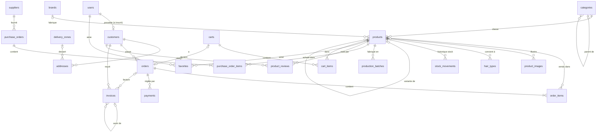
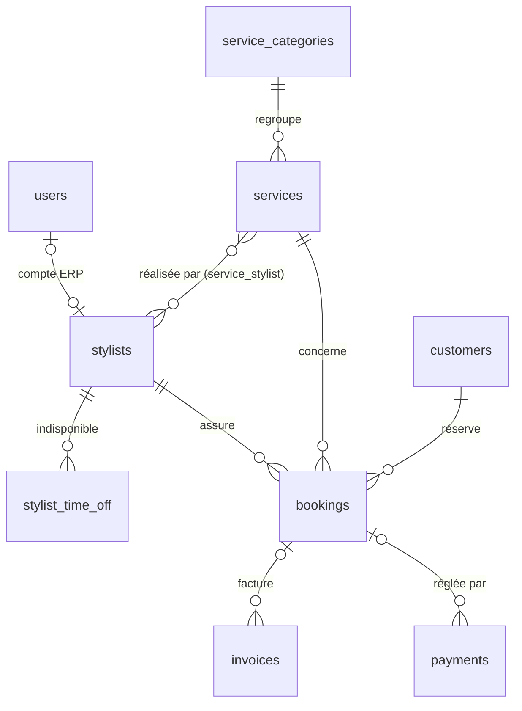
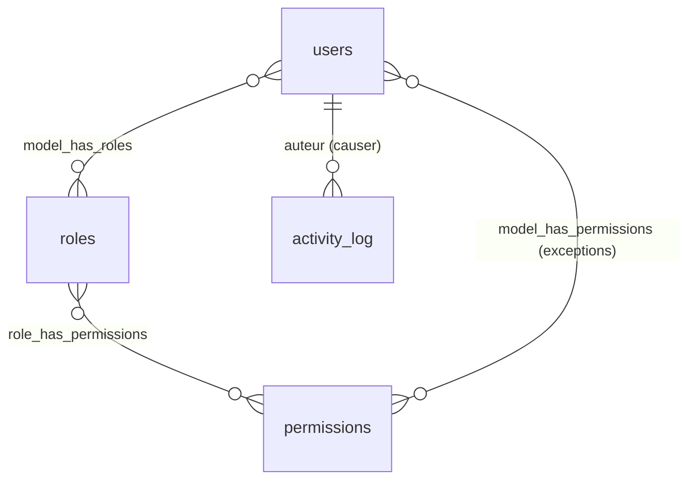
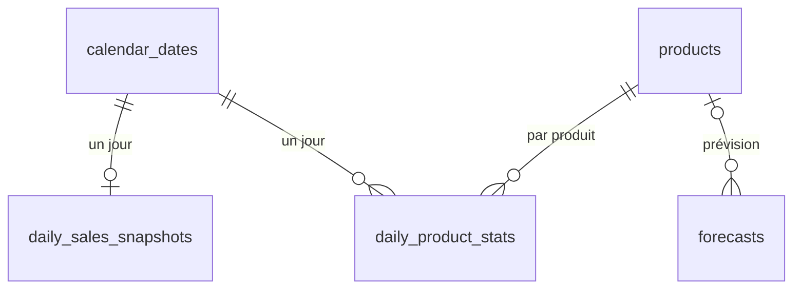

# Base de données

> **Statut** : étape 3 — version 1.1. Le modèle est testé sur MySQL 8.4 (44 tables, 25 tests d'intégrité, 17 requêtes KPI).
> **Version 1.1** : intégration du MCD Looping du porteur du projet (avis, favoris, panier) et de son catalogue réel Dabo Hair : marque **fabriquée** par l'entreprise (lots de fabrication, péremption, coût de revient, ventes en gros, variantes). Analyse détaillée : [docs/03b_ANALYSE_MCD_EXISTANT.md](docs/03b_ANALYSE_MCD_EXISTANT.md).
> **Prérequis** : [docs/01_ANALYSE_DU_BESOIN.md](docs/01_ANALYSE_DU_BESOIN.md) (règles de gestion `RG-*`, dictionnaire des KPI) et [ARCHITECTURE.md](ARCHITECTURE.md) (ADR-006 : grand livre du stock, ADR-008 : analytics).

## Fichiers de cette étape

| Fichier | Rôle |
|---|---|
| [`database/schema.sql`](database/schema.sql) | Schéma physique complet et commenté (référence) |
| [`database/sample_data.sql`](database/sample_data.sql) | Petit jeu de données de démonstration |
| [`database/analytics_queries.sql`](database/analytics_queries.sql) | 17 requêtes SQL qui implémentent les KPI |
| [`database/tests/integrity_tests.sql`](database/tests/integrity_tests.sql) | 25 instructions **qui doivent échouer** (preuve que les règles sont protégées) |
| [`database/verify.sh`](database/verify.sh) | Rejoue tout sur une base neuve : schéma, données, cohérence, tests, KPI |
| [`docker-compose.yml`](docker-compose.yml) | MySQL 8.4, Redis et Mailpit pour le développement |

> À l'étape 6, chaque table deviendra une **migration Laravel**. Les migrations seront alors la source de vérité, et `schema.sql` restera la documentation de référence.

---

## 1. Cours : les notions à connaître

### 1.1 Du besoin aux tables : MCD → MLD → MPD
| Niveau | Question | Exemple |
|---|---|---|
| **MCD** (conceptuel) | Quelles **entités** et quelles **relations** ? | « Un client passe 0 à N commandes » |
| **MLD** (logique) | Quelles **tables**, **clés primaires** et **clés étrangères** ? | `orders.customer_id → customers.id` |
| **MPD** (physique) | Quels **types**, **index** et **contraintes** pour MySQL ? | `INT UNSIGNED`, `INDEX (customer_id, placed_at)` |

### 1.2 Clés et cardinalités
- **Clé primaire (PK)** : identifiant unique d'une ligne (`id`).
- **Clé étrangère (FK)** : colonne qui pointe vers la PK d'une autre table. MySQL **refuse** une commande pour un client inexistant (test T15).
- **Cardinalités** :
  - **1-N** : un client a plusieurs commandes → la FK se trouve du côté N (`orders.customer_id`).
  - **N-N** : un coiffeur fait plusieurs prestations, et une prestation est faite par plusieurs coiffeurs → **table pivot** `service_stylist`.
  - **1-1** : un compte a au plus une fiche client → FK **unique** `customers.user_id`.
- **Que se passe-t-il quand on supprime le parent ?** (`ON DELETE`)
  - `RESTRICT` : on refuse. Exemple : supprimer un produit déjà vendu (test T11).
  - `CASCADE` : on supprime aussi les enfants. Exemple : les images d'un produit.
  - `SET NULL` : on garde l'enfant sans parent. Exemple : un mouvement de stock dont l'auteur a été supprimé.

### 1.3 Normalisation (éviter la redondance)
- **1FN** : une valeur par case. On n'écrit pas « crépus, bouclés » dans une colonne : on crée la table `hair_types` et le pivot `product_hair_type`.
- **2FN / 3FN** : chaque colonne dépend de **toute** la clé et **seulement** de la clé. Le nom de la catégorie est dans `categories`, pas recopié dans `products`.

**Dénormalisations volontaires** (et justifiées) :

| Donnée dupliquée | Pourquoi |
|---|---|
| `order_items.unit_price`, `unit_cost`, `product_name` | **Instantané historique** (RG-COM-03) : si le prix change, les anciennes commandes et les marges passées restent justes |
| Adresse recopiée dans `orders.shipping_*` | Le client peut modifier son adresse, la commande expédiée ne doit pas changer |
| `invoices.customer_name`, `company_snapshot` | Une facture est un document légal **immuable** |
| `products.stock_quantity` | **Cache** de `SUM(stock_movements.quantity)`, pour un affichage rapide. Sa cohérence est vérifiée par `verify.sh` |
| `bookings.service_name`, `price`, `duration_minutes` | Instantané de la prestation au jour de la réservation |
| Tables `daily_*` | Agrégats pré-calculés pour l'analytique (§7) |

> **Règle** : on dénormalise pour **l'historique** ou pour **la performance**, jamais par paresse. Chaque dénormalisation est documentée.

### 1.4 Types de données : les choix importants
| Choix | Raison |
|---|---|
| Argent en `INT UNSIGNED` (XOF) | Le FCFA n'a pas de centimes. Le `FLOAT` provoque des erreurs d'arrondi (`0.1 + 0.2 = 0.30000000000000004`) |
| Agrégats en `BIGINT` | Un CA annuel peut dépasser 4,29 milliards (limite d'un `INT UNSIGNED`) |
| `UNSIGNED` sur les stocks | MySQL refuse physiquement un stock négatif (test T01) |
| Dates métier en `DATETIME`, stockées en UTC | `TIMESTAMP` s'arrête en 2038 et dépend du fuseau de la session. Dakar = UTC+0 toute l'année, mais le code convertit quand même : le projet reste portable |
| `ENUM` pour les statuts | Liste courte, stable et pilotée par le code (validée aussi par les Enums PHP). Pour une liste que l'admin modifie (catégories, zones), on crée une **table** |
| `JSON` pour `settings.value` et `provider_payload` | Structure variable. Ne jamais y mettre une donnée qu'on doit filtrer ou joindre souvent |
| `utf8mb4` | Gère tous les caractères (accents, wolof, symboles). Le `utf8` historique de MySQL est incomplet |

### 1.5 Contraintes : la base comme dernier rempart
L'application valide déjà les données (FormRequests Laravel). Mais un bug, un script ou une requête manuelle peut contourner l'application. Les contraintes de la base garantissent que **même dans ce cas**, les données restent cohérentes :
- `NOT NULL` : champ obligatoire.
- `UNIQUE` : pas de doublon (référence de commande, numéro de facture, téléphone client).
- `CHECK` : règle arithmétique ou logique (ex. `total = subtotal - discount_total + shipping_fee`).
- `FOREIGN KEY` : pas de référence orpheline.

### 1.6 Transactions et verrous (ACID)
- **A**tomicité : tout ou rien.
- **C**ohérence : les contraintes sont respectées avant et après.
- **I**solation : deux transactions simultanées ne se marchent pas dessus.
- **D**urabilité : une fois validée (`COMMIT`), la donnée survit à une panne.

`SELECT ... FOR UPDATE` **verrouille** les lignes lues jusqu'à la fin de la transaction. Une autre transaction qui veut les lire avec `FOR UPDATE` **attend son tour**. C'est la base de la protection contre la double vente et la double réservation (§6).

---

## 2. Vue d'ensemble : 7 domaines, 44 tables

| Domaine | Tables |
|---|---|
| 1. Utilisateurs et RBAC | `users`, `roles`, `permissions`, `role_has_permissions`, `model_has_roles`, `model_has_permissions`, `activity_log` |
| 2. Clients | `customers`, `addresses`, `delivery_zones`, `favorites` |
| 3. Catalogue, stock et achats | `categories`, `brands`, `hair_types`, `products`, `product_hair_type`, `product_images`, `product_reviews`, `stock_movements`, `production_batches`, `suppliers`, `purchase_orders`, `purchase_order_items` |
| 4. Paniers, commandes et facturation | `carts`, `cart_items`, `orders`, `order_items`, `payments`, `invoices`, `invoice_sequences` |
| 5. Salon et réservations | `service_categories`, `services`, `stylists`, `service_stylist`, `business_hours`, `closures`, `stylist_time_off`, `bookings` |
| 6. Paramètres | `settings`, `contact_messages` |
| 7. Analytics | `calendar_dates`, `daily_sales_snapshots`, `daily_product_stats`, `forecasts` |

Les tables techniques de Laravel (`sessions`, `cache`, `jobs`, `failed_jobs`, `password_reset_tokens`, `personal_access_tokens`) seront créées automatiquement par le framework à l'étape 6.

### 2.1 Clients, commandes, stock



### 2.2 Salon et réservations



`business_hours` et `closures` sont des tables de paramétrage sans relation : elles définissent quand le salon est ouvert.

### 2.3 RBAC et audit



### 2.4 Analytics



---

## 3. Décisions de conception expliquées

### 3.1 `users` ≠ `customers`
- `users` = **qui peut se connecter** (clients inscrits + personnel).
- `customers` = **qui achète ou réserve**, avec ou sans compte.

**Pourquoi ?**
1. Un invité qui réserve doit exister quelque part (une fiche avec nom et téléphone) **sans** mot de passe.
2. Un employé n'est pas un client : il ne doit pas fausser les statistiques clients.
3. Rattachement automatique (RG-RES-08) : quand un invité crée un compte avec le même téléphone, on remplit simplement `customers.user_id`. Tout son historique le suit.
4. Les KPI (CLV, taux de retour) portent sur **tous** les clients, invités compris.

### 3.2 Le grand livre du stock (`stock_movements`)
Chaque variation est une **ligne immuable** : type, quantité **signée**, stock résultant, auteur, origine (commande n° X), motif.

```
product 1 | initial            | +40 | stock_after 40
product 1 | sale (CMD-…001)    |  -3 | stock_after 37
product 1 | sale (CMD-…005)    |  -1 | stock_after 36
product 1 | sale_cancellation  |  +1 | stock_after 37   ← commande 5 annulée
product 1 | loss "Flacons cassés" | -4 | stock_after 33   ← perte TRACÉE et valorisée
```

Bénéfices :
- les pertes sont visibles (requête Q13) ;
- l'inventaire peut être réconcilié ;
- on peut reconstruire le stock à n'importe quelle date, ce qui sert à la rotation (Q10) et au Machine Learning.

### 3.3 Paiements polymorphes (`payable_type`, `payable_id`)
Un paiement peut régler une **commande** ou une **réservation**. Plutôt que deux tables, on utilise une **relation polymorphe** (un concept natif de Laravel) : `payable_type = 'App\Models\Order'` et `payable_id = 12`.

- L'index unique `(gateway, provider_reference)` assure l'**idempotence** : si Wave envoie deux fois la même notification (webhook), le paiement n'est enregistré qu'une fois.
- *Limite* : MySQL ne peut pas poser de clé étrangère sur une relation polymorphe. L'intégrité est assurée par l'application.

### 3.4 Factures sans trou (`invoice_sequences`)
Un `AUTO_INCREMENT` ne convient pas : une transaction annulée « consomme » un numéro, ce qui crée un trou dans la numérotation, interdit en comptabilité. On utilise donc un compteur verrouillé (§6.4).

### 3.5 La colonne générée `bookings.active_slot`
MySQL ne sait pas interdire nativement le **chevauchement** de deux intervalles. Deux protections se complètent :
1. **Dans la base** : `active_slot` vaut `starts_at` si la réservation est active (`pending` ou `confirmed`), sinon `NULL`. L'index `UNIQUE (stylist_id, active_slot)` interdit deux réservations actives au même instant pour le même coiffeur (test T07). Une réservation **annulée** libère automatiquement le créneau : plusieurs `NULL` sont autorisés dans un index unique.
2. **Dans la transaction** (§6.3) : verrouillage du coiffeur, puis recherche de tout chevauchement.

### 3.6 Suppression logique (`deleted_at`)
Sur `users`, `customers`, `products`, `categories`, `services` et `stylists`, « supprimer » remplit `deleted_at`. La ligne disparaît de l'interface mais **reste dans l'historique**. Laravel gère cela automatiquement avec le trait `SoftDeletes`. Les commandes, factures et mouvements de stock, eux, ne sont **jamais** supprimés.

---

## 4. Dictionnaire des tables (résumé)

Le détail de chaque colonne est commenté dans [`schema.sql`](database/schema.sql).

| Table | Rôle | Colonnes clés |
|---|---|---|
| `users` | Comptes de connexion | `email` (unique), `phone` (unique), `password` (hash), `is_active` |
| `roles` / `permissions` / pivots | RBAC (spatie) | `name` ex. `orders.update` |
| `activity_log` | Audit : qui a modifié quoi | `causer_*`, `subject_*`, `properties` (avant/après) |
| `customers` | Client métier, inscrit ou invité | `user_id` (nullable, unique), `customer_type` (particulier / revendeur), `phone` (unique), `marketing_consent` |
| `addresses` | Adresses de livraison | `district`, `landmark` (repère), `delivery_zone_id` |
| `delivery_zones` | Zones et frais de livraison | `fee` |
| `categories` | Arborescence du catalogue | `parent_id` (auto-référence), `slug` |
| `brands`, `hair_types` | Filtres catalogue | `slug`, `is_house_brand` (marque fabriquée par l'entreprise) |
| `products` | Fiche produit | `sku`, `price`, `cost_price` (achat ou coût de revient ; `NULL` = non calculé), `stock_quantity` (cache), `low_stock_threshold`, `is_featured`, `variant_of_id` (autre contenance) |
| `product_images` | Galerie | `position`, `is_primary`, `alt_text` |
| `stock_movements` | **Grand livre du stock** | `type`, `quantity` (signée), `stock_after`, `reference_*`, `reason` |
| `production_batches` | Lots de fabrication (marque maison) | `batch_number` (unique), `quantity_produced`, `unit_cost` (coût de revient), `expires_on` |
| `suppliers` | Fournisseurs de marques revendues | `name` (unique), coordonnées |
| `purchase_orders` | Bons de commande fournisseur | `reference`, `status`, `total_cost`, `received_at` |
| `purchase_order_items` | Lignes d'achat par lots | `packs_ordered`, `units_per_pack`, `unit_cost`, `quantity_ordered` et `line_total` (**générées**), `quantity_received` |
| `product_reviews` | Avis clients modérés | `rating` (1 à 5), `status`, `order_id` (achat vérifié) |
| `favorites` | Favoris (association porteuse) | clé `(user_id, product_id)` |
| `carts` / `cart_items` | Paniers enregistrés | `token` (invité), `status`, `converted_order_id` ; clé `(cart_id, product_id)` |
| `orders` | Commande | `reference`, `status`, `payment_status`, `fulfillment_method`, montants, horodatages métier |
| `order_items` | Lignes (instantanés) | `unit_price`, `unit_cost`, `quantity`, `line_total` |
| `payments` | Encaissements, multi-fournisseurs | `gateway`, `method`, `status`, `provider_reference` |
| `invoices` | Factures et avoirs immuables | `number`, `type`, `company_snapshot`, `credited_invoice_id` |
| `invoice_sequences` | Compteur sans trou | `(year, type)`, `last_number` |
| `services` | Prestations | `duration_minutes`, `buffer_minutes`, `price` |
| `stylists` | Coiffeurs | `user_id` (compte ERP facultatif) |
| `business_hours` | Horaires hebdomadaires | `day_of_week` (1 = lundi), pause |
| `closures` | Fermetures exceptionnelles | `starts_on`, `ends_on` |
| `stylist_time_off` | Congés des coiffeurs | `starts_at`, `ends_at` |
| `bookings` | Réservations | `reference`, `status`, `starts_at`, `ends_at`, `active_slot` (générée) |
| `settings` | Paramètres clé/valeur | `key`, `value` (JSON) |
| `contact_messages` | Formulaire de contact | `ip_address` (anti-spam), `read_at` |
| `calendar_dates` | Dimension temps | `year`, `month`, `iso_week`, `day_of_week` |
| `daily_sales_snapshots` | Faits quotidiens globaux | CA, marge, réservations, nouveaux clients |
| `daily_product_stats` | Faits quotidiens par produit | ventes, revenu, coût, stock de fin de journée |
| `forecasts` | Prévisions (moyenne mobile, puis ML) | `metric`, `target_date`, `predicted_value`, `model_name` |

### Statuts (cycles de vie)
| Entité | Valeurs |
|---|---|
| `orders.status` | `pending` → `confirmed` → `preparing` → `ready` / `shipped` → `delivered` ; ou `cancelled` |
| `orders.payment_status` | `unpaid`, `paid`, `refunded` |
| `bookings.status` | `pending` → `confirmed` → `completed` ; ou `cancelled` ; ou `no_show` |
| `payments.status` | `pending`, `succeeded`, `failed`, `refunded` |
| `stock_movements.type` | `initial`, `production`, `purchase`, `sale`, `sale_cancellation`, `customer_return`, `loss`, `adjustment` |
| `purchase_orders.status` | `draft` → `ordered` → `partially_received` → `received` ; ou `cancelled` |
| `product_reviews.status` | `pending` → `approved` ou `rejected` |
| `carts.status` | `active` → `converted` ; ou `abandoned` (24 h sans activité) |

---

## 5. Index : pourquoi et comment

### 5.1 Cours
Un **index** fonctionne comme l'index alphabétique d'un livre : sans lui, MySQL lit **toute** la table (*full table scan*) ; avec lui, il va directement aux bonnes lignes (arbre B+).

Un index a un coût : il ralentit légèrement les écritures et occupe de l'espace. On indexe donc **les colonnes réellement utilisées** dans les `WHERE`, `JOIN` et `ORDER BY`.

**Règle du préfixe gauche** : l'index composite `(status, placed_at)` sert pour :
- `WHERE status = 'pending'` ;
- `WHERE status = 'pending' AND placed_at >= '2026-03-01'`.

Il ne sert **pas** pour `WHERE placed_at >= ...` seul. **L'ordre des colonnes compte** : on met d'abord la colonne filtrée par égalité, puis la colonne filtrée par intervalle.

Pour vérifier qu'une requête utilise un index : `EXPLAIN SELECT ...;` (la colonne `key` indique l'index choisi).

### 5.2 Index du projet et requête servie
| Index | Requête servie |
|---|---|
| `products (is_active, category_id, price)` | Catalogue filtré par catégorie, trié par prix |
| `products FULLTEXT (name, short_description)` | Recherche par mot-clé (`MATCH ... AGAINST`) |
| `stock_movements (product_id, created_at)` | Historique d'un produit, stock à une date |
| `stock_movements (type, created_at)` | Pertes sur une période, ventes sur 90 jours |
| `orders (status, placed_at)` | Liste ERP filtrée par statut |
| `orders (customer_id, placed_at)` | « Mes commandes », fiche client |
| `orders (payment_status, paid_at)` | **Calcul du CA** |
| `bookings (stylist_id, starts_at, ends_at)` | **Calcul des disponibilités** |
| `bookings (status, starts_at)` | Planning du jour, statistiques |
| `UNIQUE (stylist_id, active_slot)` | Anti double réservation |
| `payments UNIQUE (gateway, provider_reference)` | Idempotence des webhooks |

---

## 6. Règles d'intégrité : qui protège quoi ?

### 6.1 Correspondance règle de gestion → mécanisme
| Règle | Base de données | Application (Laravel) | Test |
|---|---|---|---|
| RG-STK-01 Stock jamais négatif | `UNSIGNED` | Vérification + verrou dans `StockService` | T01 |
| RG-STK-02 Toute variation passe par un mouvement | `CHECK quantity <> 0` | Seul `StockService` modifie le stock | `verify.sh` étape 4 |
| RG-STK-05 Pas de suppression d'un produit vendu | FK `RESTRICT` | `SoftDeletes` | T11 |
| RG-COM-03 Prix figés | Colonnes d'instantané | Copie à la création | — |
| RG-COM-04 Total cohérent | `CHECK` sur `orders` et `order_items` | Recalcul serveur | T03, T05 |
| RG-FAC-02 Numéros uniques sans trou | `UNIQUE number` | Compteur verrouillé (§6.4) | T10 |
| RG-FAC-03 Facture immuable | — | Aucune route de modification ; avoirs | — |
| RG-RES-01/02 Pas de chevauchement | `UNIQUE (stylist_id, active_slot)` | Transaction + `FOR UPDATE` (§6.3) | T07 |
| RG-CLI-01 Téléphone unique | `UNIQUE phone` | Validation `unique:customers,phone` | T12 |
| Avis : note de 1 à 5, un avis par client et par produit | `CHECK`, `UNIQUE` | Validation + modération | T16, T17 |
| Favori unique | Clé primaire composée | — | T18 |
| Achats : réception ≤ commande, total calculé | `CHECK`, colonnes générées | `ReceivePurchaseOrderAction` | T19 à T21, `verify.sh` étape 4b |
| Lots : quantité > 0, péremption après fabrication, numéro unique | `CHECK`, `UNIQUE` | `RecordProductionBatchAction` | T23 à T25 |

### 6.2 Passer une commande (transaction)
```sql
START TRANSACTION;
  -- 1. Verrouiller les produits commandés (une autre commande simultanée attendra)
  SELECT id, price, cost_price, stock_quantity FROM products WHERE id IN (1, 3) FOR UPDATE;
  -- 2. L'application vérifie le stock et recalcule les montants à partir de CES valeurs
  INSERT INTO orders (...)      VALUES (...);
  INSERT INTO order_items (...) VALUES (...), (...);
  -- 3. Mouvements de stock + mise à jour du cache
  INSERT INTO stock_movements (product_id, type, quantity, stock_after, reference_type, reference_id) VALUES (1, 'sale', -2, 29, 'App\\Models\\Order', 9);
  UPDATE products SET stock_quantity = stock_quantity - 2 WHERE id = 1;
COMMIT;   -- en cas d'erreur à n'importe quelle étape : ROLLBACK, rien n'est enregistré
```
En Laravel, ce sera `DB::transaction(function () { ... })` avec `Product::lockForUpdate()`.

### 6.3 Réserver un créneau sans chevauchement
```sql
START TRANSACTION;
  -- 1. Verrouiller le coiffeur : deux réservations simultanées pour lui passent l'une après l'autre
  SELECT id FROM stylists WHERE id = 1 FOR UPDATE;
  -- 2. Chercher un chevauchement : deux intervalles [A,B[ et [C,D[ se chevauchent si A < D ET C < B
  SELECT COUNT(*) FROM bookings
   WHERE stylist_id = 1
     AND status IN ('pending', 'confirmed')
     AND starts_at < '2026-03-28 12:45:00'      -- fin demandée
     AND ends_at   > '2026-03-28 11:00:00';     -- début demandé
  -- 3. Si 0 : INSERT INTO bookings ... ; sinon : refus « créneau indisponible »
COMMIT;
```
> **La formule du chevauchement** `début1 < fin2 ET début2 < fin1` est à retenir : elle sert partout (plannings, locations, réservations de salles).

### 6.4 Numéro de facture sans trou
```sql
START TRANSACTION;
  INSERT IGNORE INTO invoice_sequences (year, type, last_number) VALUES (2026, 'invoice', 0);
  SELECT last_number FROM invoice_sequences WHERE year = 2026 AND type = 'invoice' FOR UPDATE;  -- ex. 41
  UPDATE invoice_sequences SET last_number = 42 WHERE year = 2026 AND type = 'invoice';
  INSERT INTO invoices (number, ...) VALUES ('FAC-2026-000042', ...);
COMMIT;  -- si l'insertion échoue, le ROLLBACK annule aussi l'incrément : aucun trou
```

---

## 7. Analytics : de la donnée au KPI

### 7.1 Deux couches
1. **Tables métier (OLTP)** : les requêtes de [`analytics_queries.sql`](database/analytics_queries.sql) y lisent directement. C'est parfait pour « aujourd'hui » et pour des volumes modestes.
2. **Tables d'agrégats (OLAP)** : chaque nuit, un job Laravel remplit `daily_sales_snapshots` et `daily_product_stats`. Les graphiques sur plusieurs mois ou années lisent ces petites tables, ce qui est instantané.

La **dimension calendrier** `calendar_dates` est une notion clé de la BI. En faisant un `LEFT JOIN` depuis le calendrier, les jours **sans vente** apparaissent avec `0` au lieu de disparaître du graphique, ce qui fausserait les moyennes et les courbes.

### 7.2 KPI → requête
| KPI (dictionnaire §5 de l'analyse) | Requête |
|---|---|
| CA mensuel, cumul | Q01 |
| CA jour / semaine / mois / année + comparaison | Q02 |
| Panier moyen | Q03 |
| Produits les plus vendus et les plus rentables | Q04 |
| Nouveaux clients | Q05 |
| Taux de retour client | Q06 |
| Top clients, CLV, récence | Q07 |
| Jours et heures les plus demandés (heatmap) | Q08 |
| Taux de no-show | Q09 |
| Rotation des stocks | Q10 |
| Proches de la rupture, prévision (couverture) | Q11 |
| Produits à faible rotation, valeur immobilisée | Q12 |
| Pertes de stock valorisées | Q13 |
| Achats par fournisseur | Q14 |
| Note moyenne par produit | Q15 |
| Taux d'abandon de panier | Q16 |
| Lots proches de la péremption | Q17 |

### 7.3 Exemple de résultat (données de démonstration)
Q01 — CA mensuel en XOF :

| Mois | Produits | Prestations | Total | Cumul |
|---|---:|---:|---:|---:|
| 2026-01 | 28 500 | 33 000 | 61 500 | 61 500 |
| 2026-02 | 31 500 | 20 000 | 51 500 | 113 000 |
| 2026-03 | 25 500 | 33 000 | 58 500 | 171 500 |

Q04 : l'huile de baobab est à la fois **la plus vendue** (4 unités) et **la plus rentable** (15 200 XOF de marge). Le peigne a le **meilleur taux de marge** (61,4 %), mais une faible contribution en valeur.

Q11 : l'huile de baobab est **sous le seuil d'alerte** (4 en stock pour un seuil de 5).

Q12 : le shampoing clarifiant n'a fait **aucune vente** en 90 jours, ce qui représente **56 000 XOF immobilisés**.

> **Lecture d'analyste** : un produit très rentable (taux de marge élevé) n'est pas forcément celui qui rapporte le plus (marge totale). Il faut toujours regarder **les deux** indicateurs.

### 7.4 Préparation au Machine Learning
- **Séries temporelles** prêtes : `daily_product_stats` contient une ligne par produit et par jour.
- **Variables explicatives** disponibles : jour de la semaine, week-end, mois (`calendar_dates`), prix, promotion (`compare_at_price`).
- **Sortie** : table `forecasts`, avec `model_name` et `model_version` pour comparer les modèles (moyenne mobile, puis Prophet ou régression).

---

## 8. Données de test (seeders)
- **Aujourd'hui** : `sample_data.sql`, soit 6 clients, 5 produits, 8 commandes et 10 réservations. Le jeu est volontairement petit pour qu'on puisse **vérifier les résultats à la main**.
- **Étape 6** : `RolesAndPermissionsSeeder`, `SettingsSeeder`, `CatalogSeeder`, et des Factories capables de générer 12 mois d'activité réaliste (saisonnalité, pics de Tabaski et de fin d'année) pour tester le tableau de bord.

---

## 9. Vérifier le modèle soi-même

```bash
docker compose up -d
```

```bash
bash database/verify.sh
```

Le script utilise par défaut le conteneur `salon-mysql` créé par `docker compose`. Il lit le mot de passe root directement dans le conteneur. Guide pas à pas, y compris sous Windows : [docs/TESTER_LE_PROJET.md](docs/TESTER_LE_PROJET.md).

Le script recrée une base neuve `salon_verify`, puis charge le schéma et les données. Il contrôle ensuite la cohérence du stock, lance les 15 tests d'intégrité et affiche les 13 KPI. Il s'arrête avec une erreur si une seule vérification échoue.

---

## 10. Aperçu : du SQL à la migration Laravel (étape 6)

```php
// database/migrations/2026_11_01_000010_create_stock_movements_table.php
Schema::create('stock_movements', function (Blueprint $table) {
    $table->id();                                                     // BIGINT UNSIGNED AUTO_INCREMENT PK
    $table->foreignId('product_id')->constrained()->restrictOnDelete();
    $table->enum('type', StockMovementType::values());                // valeurs issues d'un Enum PHP
    $table->integer('quantity');                                      // signée
    $table->unsignedInteger('stock_after');
    $table->unsignedInteger('unit_cost')->nullable();
    $table->nullableMorphs('reference');                              // reference_type + reference_id + index
    $table->string('reason')->nullable();
    $table->foreignId('user_id')->nullable()->constrained()->nullOnDelete();
    $table->timestamp('created_at')->nullable();
    $table->index(['product_id', 'created_at']);
    $table->index(['type', 'created_at']);
});
DB::statement('ALTER TABLE stock_movements ADD CONSTRAINT stock_movements_quantity_chk CHECK (quantity <> 0)');
```

**Avantages des migrations** : le schéma est **versionné dans Git**, rejouable sur n'importe quelle machine (`php artisan migrate`) et réversible (`migrate:rollback`).

---

## 11. Évolutions prévues
| Évolution | Impact sur le schéma |
|---|---|
| Plusieurs boutiques ou dépôts | Table `locations` + `location_id` sur `stock_movements` (stock par emplacement) |
| Codes promo | Tables `coupons`, `coupon_redemptions` (`orders.discount_total` existe déjà) |
| Programme de fidélité | Table `loyalty_transactions` (même principe de grand livre que le stock) |
| Paiement en ligne | Aucun changement de schéma : `payments` est prête |
| Volume important | Partitionnement de `stock_movements` / `activity_log` par année, réplique MySQL en lecture pour la BI |
