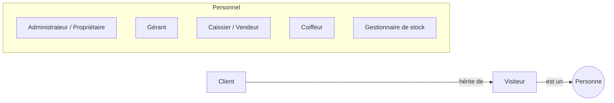
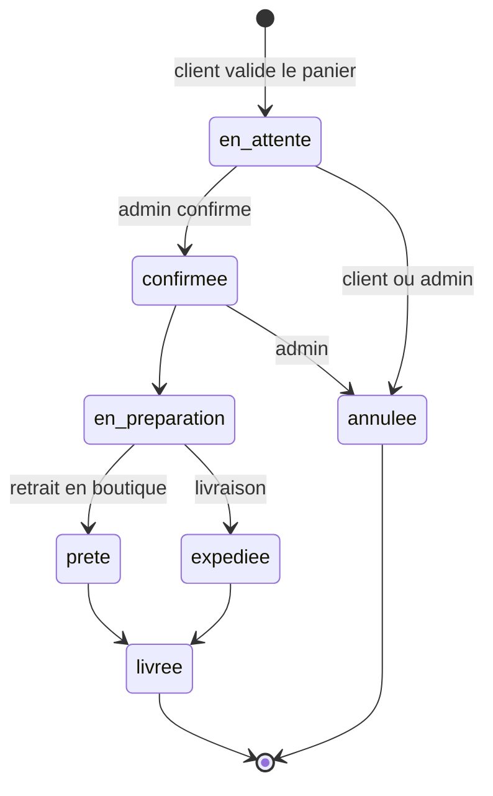
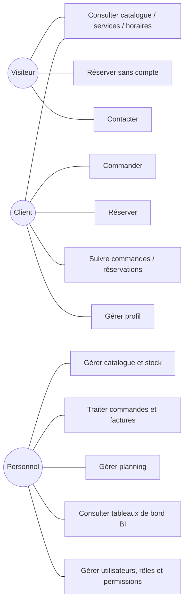

# ÉTAPE 1 — Analyse détaillée du besoin

> **Statut** : version 1.0 — à valider par le porteur du projet
> **Rôle de ce document** : décrire **ce que** le système doit faire, sans dire encore **comment** (ça, c'est l'étape 2 : architecture).

---

## 0. Pourquoi commencer par une analyse ? (cours)

Dans un projet réel, **80 % des échecs viennent d'un besoin mal compris**, pas d'un mauvais code.
Corriger une erreur coûte à peu près :

| Moment où l'erreur est découverte | Coût relatif |
|---|---|
| Pendant l'analyse | 1 |
| Pendant le développement | 10 |
| Après la mise en production | 100 |

Une analyse de besoin produit quatre choses :

1. **Les acteurs** : qui utilise le système ?
2. **Les exigences fonctionnelles** : que doit faire le système ? (ex. « réserver une prestation »)
3. **Les exigences non fonctionnelles** : avec quelle qualité ? (ex. « page chargée en moins de 2 s », « mots de passe hachés »)
4. **Les règles de gestion** : quelles règles métier faut-il respecter ? (ex. « on ne peut pas vendre un produit en rupture de stock »)

Les **règles de gestion** sont le cœur du projet : elles deviendront des validations Laravel, des contraintes MySQL et des tests.

---

## 1. Contexte et objectifs métier

### 1.1 L'entreprise
- Vend des produits capillaires (boutique physique + vente en ligne).
- Possède un salon de coiffure (prestations sur rendez-vous).
- Contexte d'Afrique de l'Ouest (moyens de paiement prévus : Wave, Orange Money, Free Money). **Hypothèse : devise XOF (FCFA)**, langue française.

### 1.2 Problèmes actuels → objectifs mesurables

| Problème actuel | Objectif | Indicateur de réussite (KPI) |
|---|---|---|
| Erreurs humaines (calculs, saisies) | Calculs automatiques (totaux, factures, stock) | 0 facture calculée à la main |
| Oublis de rendez-vous | Planning centralisé, rappels | Taux de « no-show » en baisse |
| Pertes de stock | Traçabilité de chaque mouvement de stock | Écart inventaire physique / théorique < 2 % |
| Manque de suivi client | Fiche client + historique | 100 % des ventes rattachées à un client ou à un invité identifié |
| Manque de visibilité | Tableau de bord décisionnel | Le propriétaire consulte ses KPIs sans demander à personne |

> **Leçon** : un objectif sans indicateur n'est pas vérifiable. Pensez toujours « comment saurai-je que c'est réussi ? ».

---

## 2. Acteurs (qui utilise le système ?)

| Acteur | Description | Authentifié ? |
|---|---|---|
| **Visiteur** | Internaute anonyme | Non |
| **Client** | Visiteur inscrit | Oui (espace client) |
| **Super administrateur** | Propriétaire : accès total, statistiques financières | Oui (ERP) |
| **Gérant** *(proposé)* | Gère commandes, réservations, stock, clients | Oui (ERP) |
| **Caissier / Vendeur** *(proposé)* | Crée et valide des commandes en boutique | Oui (ERP) |
| **Coiffeur** *(proposé)* | Voit son planning, marque une prestation terminée | Oui (ERP) |
| **Gestionnaire de stock** *(proposé)* | Entrées et ajustements de stock | Oui (ERP) |

> **Pourquoi proposer des rôles en plus d'« Administrateur » ?** Votre cahier des charges demande la « gestion des rôles et permissions » (RBAC). Le principe de sécurité du **moindre privilège** dit que chacun ne doit avoir accès qu'à ce dont il a besoin : un coiffeur n'a pas à voir le chiffre d'affaires. Ces rôles seront **paramétrables** depuis l'ERP : ce sont des exemples, pas une liste figée.

---

## 3. Exigences fonctionnelles

Codification : `EF-<MODULE>-<numéro>`. Priorité selon la méthode **MoSCoW** :
- **M** (Must) : indispensable à la première version
- **S** (Should) : important, mais le produit fonctionne sans
- **C** (Could) : bonus si on a le temps
- **W** (Won't, pour l'instant) : explicitement hors périmètre, mais à anticiper

### 3.1 Vitrine publique (Visiteur)

| Code | Exigence | Priorité |
|---|---|---|
| EF-PUB-01 | Consulter la page d'accueil (hero, bannières promotionnelles, produits phares) | M |
| EF-PUB-02 | Consulter le catalogue produits paginé | M |
| EF-PUB-03 | Filtrer les produits (catégorie, prix, marque, type de cheveux, disponibilité) | M |
| EF-PUB-04 | Rechercher un produit par mot-clé | M |
| EF-PUB-05 | Consulter la fiche détaillée d'un produit (images, prix, description, stock disponible / rupture) | M |
| EF-PUB-06 | Consulter la liste des prestations (prix, durée) | M |
| EF-PUB-07 | Consulter les horaires d'ouverture et les fermetures exceptionnelles | M |
| EF-PUB-08 | Réserver une prestation **sans compte** (nom, téléphone, email facultatif) | M |
| EF-PUB-09 | Envoyer un message via un formulaire de contact | M |
| EF-PUB-10 | Commander **sans compte** (achat « invité ») | S — *à confirmer* |
| EF-PUB-11 | Retrouver une réservation invité via un code de référence et le téléphone | S |

### 3.2 Espace client

| Code | Exigence | Priorité |
|---|---|---|
| EF-CLI-01 | S'inscrire (nom, email, téléphone, mot de passe) | M |
| EF-CLI-02 | Se connecter / se déconnecter | M |
| EF-CLI-03 | Réinitialiser son mot de passe par email | M |
| EF-CLI-04 | Gérer un panier (ajouter, modifier les quantités, retirer) | M |
| EF-CLI-05 | Passer une commande (retrait en boutique ou livraison, paiement à la réception) | M |
| EF-CLI-06 | Suivre le statut de ses commandes | M |
| EF-CLI-07 | Télécharger la facture PDF d'une commande | M |
| EF-CLI-08 | Réserver une prestation (rattachée à son compte) | M |
| EF-CLI-09 | Suivre et annuler ses réservations (dans le délai autorisé) | M |
| EF-CLI-10 | Consulter son historique (commandes + réservations) | M |
| EF-CLI-11 | Mettre à jour son profil et son mot de passe | M |
| EF-CLI-12 | Gérer plusieurs adresses de livraison | S |
| EF-CLI-13 | Liste de favoris | C |
| EF-CLI-14 | Supprimer son compte / exporter ses données (protection des données personnelles) | S |

### 3.3 Module Réservation

| Code | Exigence | Priorité |
|---|---|---|
| EF-RES-01 | Choisir une prestation | M |
| EF-RES-02 | Choisir une date dans un calendrier qui n'affiche que les jours ouverts | M |
| EF-RES-03 | Choisir une heure parmi les **créneaux réellement disponibles** | M |
| EF-RES-04 | Choisir un coiffeur précis ou « peu importe » | S — *à confirmer* |
| EF-RES-05 | Recevoir une confirmation (écran + email) avec un code de référence | M |
| EF-RES-06 | L'administrateur valide, refuse ou annule une réservation | M |
| EF-RES-07 | L'administrateur marque une réservation « terminée » ou « absent (no-show) » | M |
| EF-RES-08 | Paramétrer les horaires d'ouverture, pauses et jours de fermeture | M |
| EF-RES-09 | Paramétrer les disponibilités / congés de chaque coiffeur | S |
| EF-RES-10 | Vue planning (jour / semaine) dans l'ERP | M |
| EF-RES-11 | Rappel automatique la veille (email, puis SMS/WhatsApp plus tard) | S |

### 3.4 Module E-commerce et stock

| Code | Exigence | Priorité |
|---|---|---|
| EF-COM-01 | CRUD produits (nom, slug, description, prix de vente, **prix d'achat**, images, catégorie, marque, SKU) | M |
| EF-COM-02 | CRUD catégories (avec sous-catégories) | M |
| EF-COM-03 | Le stock est mis à jour automatiquement à chaque vente et à chaque annulation | M |
| EF-COM-04 | Chaque mouvement de stock est enregistré (entrée, vente, retour, perte, ajustement d'inventaire) | M |
| EF-COM-05 | Alerte de stock bas (seuil paramétrable par produit) | M |
| EF-COM-06 | Gestion du cycle de vie d'une commande (voir RG-COM) | M |
| EF-COM-07 | Génération d'une facture PDF numérotée | M |
| EF-COM-08 | Saisie d'une vente en boutique depuis l'ERP (mini-caisse) | S |
| EF-COM-09 | Gestion des fournisseurs et des bons de réception | C |
| EF-COM-10 | Codes promo | C |
| EF-COM-11 | **Paiement en ligne** (Wave, Orange Money, Free Money, carte) | **W** (architecture prête) |

### 3.5 ERP administrateur

| Code | Exigence | Priorité |
|---|---|---|
| EF-ERP-01 | Tableau de bord : CA, commandes du jour, réservations du jour, nouveaux clients, top produits vendus, top produits rentables | M |
| EF-ERP-02 | Gestion produits / catégories / stock | M |
| EF-ERP-03 | Gestion commandes (liste, filtres, détail, changement de statut) | M |
| EF-ERP-04 | Gestion réservations (liste + planning) | M |
| EF-ERP-05 | Gestion clients (fiche, historique, total dépensé) | M |
| EF-ERP-06 | Gestion des factures (liste, réimpression, avoir) | M |
| EF-ERP-07 | Gestion des utilisateurs du personnel | M |
| EF-ERP-08 | Gestion des rôles et permissions | M |
| EF-ERP-09 | Journal d'audit des actions administrateur (qui, quoi, quand, avant/après) | M |
| EF-ERP-10 | Paramètres de l'entreprise (logo, coordonnées, horaires, mentions des factures) | M |
| EF-ERP-11 | Export CSV / Excel des listes | S |

### 3.6 Module Data Analytics & BI

| Code | Exigence | Priorité |
|---|---|---|
| EF-BI-01 | CA journalier, hebdomadaire, mensuel, annuel, avec comparaison à la période précédente | M |
| EF-BI-02 | Nombre de commandes, de réservations, de nouveaux clients par période | M |
| EF-BI-03 | Panier moyen | M |
| EF-BI-04 | Produits les plus vendus / les plus rentables | M |
| EF-BI-05 | Top clients | M |
| EF-BI-06 | Taux de retour client (clients qui reviennent) | M |
| EF-BI-07 | Valeur vie client (CLV) | S |
| EF-BI-08 | Heatmap des heures et jours de réservation les plus demandés | M |
| EF-BI-09 | Évolution des ventes (courbe) | M |
| EF-BI-10 | Rotation des stocks, produits à faible rotation, produits proches de la rupture | M |
| EF-BI-11 | Prévision de stock simple (consommation moyenne → date estimée de rupture) | S |
| EF-BI-12 | Filtre de période global (aujourd'hui, 7 j, 30 j, mois, année, personnalisé) | M |
| EF-BI-13 | Export des données (CSV) pour analyse externe (Python, Power BI) | S |
| EF-BI-14 | Prévision des ventes par Machine Learning | W (données préparées) |

---

## 4. Règles de gestion (le cœur métier)

> **Leçon** : une règle de gestion doit être **précise et vérifiable**. « Le stock doit être bien géré » n'est pas une règle. « Une commande ne peut pas être validée si la quantité demandée dépasse le stock disponible » en est une, et on peut la tester.

### 4.1 Produits et stock
- **RG-STK-01** : le stock d'un produit n'est **jamais négatif** (vérifié par l'application et par une contrainte en base).
- **RG-STK-02** : le stock **n'est jamais modifié directement** : toute variation passe par un **mouvement de stock** (type, quantité, motif, auteur, date). Le stock courant est la somme des mouvements. C'est ce qui garantit la traçabilité et permet de détecter les pertes.
- **RG-STK-03** : un produit dont le stock est inférieur ou égal à son **seuil d'alerte** apparaît dans les alertes.
- **RG-STK-04** : un produit en rupture reste visible dans le catalogue mais ne peut pas être ajouté au panier.
- **RG-STK-05** : un produit déjà vendu n'est pas supprimé physiquement (**suppression logique** / archivage), pour ne pas casser l'historique et les statistiques.
- **RG-STK-06** : le **prix d'achat** est obligatoire : sans lui, impossible de calculer la rentabilité.

### 4.2 Commandes
- **RG-COM-01** : cycle de vie d'une commande :

- **RG-COM-02** : le stock est **réservé (décrémenté) dès la création** de la commande et **restitué** si elle est annulée. *(Alternative possible : décrémenter seulement à la confirmation. À valider.)*
- **RG-COM-03** : le **prix unitaire est copié** dans la ligne de commande au moment de l'achat. Si le prix du produit change demain, l'ancienne commande garde son prix d'origine. Le prix d'achat est copié lui aussi, pour calculer la marge historique.
- **RG-COM-04** : le total d'une commande est **toujours recalculé côté serveur**. On ne fait jamais confiance au total envoyé par le navigateur (règle de sécurité).
- **RG-COM-05** : un client ne peut annuler sa commande que tant qu'elle est `en_attente`.
- **RG-COM-06** : chaque commande a une **référence lisible** unique (ex. `CMD-2026-000123`).
- **RG-COM-07** : pas de paiement en ligne. Statut de paiement : `non_payee`, `payee`, `remboursee`. Moyen enregistré : espèces, Wave, Orange Money, Free Money, carte (saisi par l'admin à la réception).

### 4.3 Factures
- **RG-FAC-01** : une facture est générée quand la commande est **payée** (ou livrée, *à valider*).
- **RG-FAC-02** : la numérotation est **séquentielle, unique et sans trou** (`FAC-2026-000001`). C'est une exigence comptable.
- **RG-FAC-03** : une facture émise est **immuable**. Pour corriger une erreur, on émet un **avoir**, on ne modifie pas la facture.
- **RG-FAC-04** : la facture reprend les informations légales de l'entreprise (raison sociale, NINEA/RCCM, adresse) depuis les paramètres.

### 4.4 Réservations
- **RG-RES-01** : un créneau est disponible si : le salon est ouvert, le coiffeur est disponible, et **aucune réservation active ne chevauche** l'intervalle `[début, début + durée de la prestation]`.
- **RG-RES-02** : deux réservations ne peuvent pas occuper le même coiffeur au même moment. Le contrôle est fait **côté serveur, dans une transaction**, pour éviter que deux personnes réservent le même créneau à la même seconde (*race condition*).
- **RG-RES-03** : délai minimal de réservation : **2 h** avant le créneau *(paramétrable)*. Horizon maximal : **60 jours** *(paramétrable)*.
- **RG-RES-04** : un client peut annuler jusqu'à **24 h** avant *(paramétrable)*. Au-delà, il doit contacter le salon.
- **RG-RES-05** : cycle de vie : `en_attente → confirmee → terminee` ; ou `annulee` ; ou `absent` (no-show).
- **RG-RES-06** : une réservation invité exige un nom et un **téléphone valide**. Elle reçoit un code de référence unique.
- **RG-RES-07** : anti-abus : nombre limité de réservations invité par téléphone ou par adresse IP et par jour.
- **RG-RES-08** : si un invité crée ensuite un compte avec le même téléphone ou email, ses réservations passées peuvent lui être rattachées.

### 4.5 Clients et comptes
- **RG-CLI-01** : l'email et le téléphone sont uniques par compte.
- **RG-CLI-02** : mot de passe d'au moins 8 caractères, haché (bcrypt/argon2), **jamais stocké en clair**.
- **RG-CLI-03** : un « nouveau client » est un client dont la **première commande ou réservation** tombe dans la période analysée. *(Définition analytique à valider : voir §5.)*

### 4.6 Sécurité et administration
- **RG-SEC-01** : toute action d'écriture dans l'ERP est journalisée (utilisateur, action, entité, valeurs avant/après, IP, date).
- **RG-SEC-02** : verrouillage temporaire après 5 tentatives de connexion échouées.
- **RG-SEC-03** : chaque route de l'ERP vérifie une **permission** précise (ex. `products.update`), pas seulement « est admin ».

---

## 5. Dictionnaire des indicateurs (KPI)

> **Pourquoi c'est crucial pour un analyste ?** Deux personnes qui calculent « le chiffre d'affaires » différemment obtiennent deux chiffres différents, et le propriétaire perd confiance dans le tableau de bord. Chaque KPI doit avoir **une définition unique, écrite et validée**. C'est la base de la *data governance*.

| KPI | Définition / formule | Source |
|---|---|---|
| **CA (chiffre d'affaires)** | Σ `total TTC` des commandes **payées** (non annulées, non remboursées) + Σ prix des réservations **terminées**, sur la période. Présenté aussi séparément : **CA produits** et **CA prestations** | orders, bookings |
| **Nombre de commandes** | Nombre de commandes créées sur la période, hors annulées | orders |
| **Panier moyen** | CA produits ÷ nombre de commandes payées | orders |
| **Marge brute produit** | Σ (prix de vente unitaire − prix d'achat unitaire) × quantité | order_items |
| **Produits les plus vendus** | Classement par Σ quantités vendues | order_items |
| **Produits les plus rentables** | Classement par Σ marge brute | order_items |
| **Nouveaux clients** | Clients dont le 1er achat ou la 1re réservation tombe dans la période | orders, bookings |
| **Taux de retour client** | Clients ayant ≥ 2 achats ou réservations (sur la période ou sur 12 mois glissants) ÷ clients actifs | orders, bookings |
| **CLV (valeur vie client)** | Version simple : panier moyen × fréquence d'achat annuelle × durée de vie moyenne (en années). Version historique : Σ dépensé par client depuis son premier achat | orders |
| **Top clients** | Classement par Σ dépensé (produits + prestations) | orders, bookings |
| **Heures / jours les plus demandés** | Nombre de réservations par heure de début × jour de la semaine (heatmap) | bookings |
| **Taux de no-show** | Réservations `absent` ÷ réservations passées confirmées | bookings |
| **Rotation des stocks** | Coût des marchandises vendues ÷ valeur moyenne du stock (au prix d'achat) sur la période | order_items, stock_movements |
| **Produits à faible rotation** | Produits en stock dont les ventes sur 90 j sont inférieures à un seuil (ou nulles) | stock_movements |
| **Proches de la rupture** | Stock ≤ seuil d'alerte **ou** couverture < 7 jours | products |
| **Couverture de stock (prévision)** | Stock actuel ÷ ventes moyennes journalières (sur 30 j) = nombre de jours avant rupture | stock_movements |

**Conventions** : montants en XOF entiers (le FCFA n'a pas de centimes), dates stockées en UTC et affichées dans le fuseau `Africa/Dakar` *(à confirmer)*, semaine du lundi au dimanche.

---

## 6. Exigences non fonctionnelles

| Code | Catégorie | Exigence |
|---|---|---|
| ENF-01 | Performance | Pages publiques interactives en moins de 2,5 s en 4G ; API < 300 ms pour 95 % des requêtes courantes |
| ENF-02 | Responsive | Mobile d'abord (*mobile first*) : 360 px → 1920 px |
| ENF-03 | Sécurité | Conformité OWASP Top 10 (détaillée dans SECURITY_GUIDE.md) |
| ENF-04 | Données personnelles | Conformité à la loi sénégalaise n° 2008-12 (CDP) et aux principes du RGPD : consentement, minimisation, droit d'accès et de suppression *(à confirmer selon le pays)* |
| ENF-05 | Disponibilité | 99,5 % ; sauvegarde quotidienne de la base, restauration testée |
| ENF-06 | Maintenabilité | Principes SOLID, code commenté, tests automatisés sur les règles métier, documentation à jour |
| ENF-07 | Évolutivité | Ajouter un moyen de paiement **sans modifier le code des commandes** (patron *Strategy*) |
| ENF-08 | Accessibilité | Contrastes suffisants (or sur noir à vérifier), navigation au clavier, textes alternatifs |
| ENF-09 | SEO | Pages produits indexables (titre, méta-description, URLs lisibles). Point d'attention : une application React classique (SPA) est mal référencée, une solution sera proposée à l'étape 2 |
| ENF-10 | Traçabilité | Journal d'audit conservé au moins 12 mois |
| ENF-11 | Données analytiques | Données horodatées et historisées (aucune suppression physique), pour permettre plus tard la data science et le ML |
| ENF-12 | Design | Identité premium (palette or et noir), aucun emoji, icônes SVG (Lucide / Heroicons) |

---

## 7. Cas d'utilisation principaux

### Scénario détaillé : « Réserver une prestation sans compte » (UC2)
1. Le visiteur choisit une prestation (ex. *Tresses africaines, 3 h, 25 000 XOF*).
2. Il choisit éventuellement un coiffeur.
3. Le système affiche un calendrier où les jours fermés sont grisés.
4. Il choisit une date. Le système calcule et affiche les créneaux libres (RG-RES-01).
5. Il choisit une heure, puis saisit son nom, son téléphone et éventuellement son email.
6. Le système **revérifie** la disponibilité (le créneau a pu être pris entre-temps), puis crée la réservation `en_attente`.
7. Le système affiche le code de référence et envoie un email si une adresse est fournie.

**Scénarios alternatifs** : 6a, le créneau vient d'être pris : message clair et retour à l'étape 4. 5a, le téléphone est invalide : erreur affichée sur le champ.

### Scénario détaillé : « Passer une commande » (UC4)
1. Le client valide son panier.
2. Il choisit le mode de réception (retrait ou livraison) et l'adresse.
3. Le serveur, **dans une transaction** : verrouille les lignes produits, vérifie le stock, recalcule les prix, crée la commande et ses lignes, enregistre les mouvements de stock « vente ».
4. Si une étape échoue, **tout est annulé** (*rollback*) : aucune commande à moitié créée, aucun stock faux.
5. Confirmation affichée, email envoyé, commande visible dans l'ERP.

> **Leçon : la transaction.** C'est un « tout ou rien ». Sans elle, si le serveur plante entre « créer la commande » et « décrémenter le stock », vous avez une commande sans mouvement de stock, donc une perte invisible. C'est exactement le problème que l'entreprise veut éliminer.

---

## 8. User stories (format agile)

Format : *En tant que [acteur], je veux [action] afin de [bénéfice].* Chaque story a des **critères d'acceptation** qui deviendront des tests.

- **US-01** : En tant que visiteur, je veux voir uniquement les créneaux libres, afin de ne pas réserver un horaire impossible.
  - *Critères* : aucun créneau dans le passé ni à moins de 2 h ; aucun créneau qui chevauche une réservation active ; un jour fermé n'affiche aucun créneau.
- **US-02** : En tant que propriétaire, je veux voir mon CA du mois comparé au mois précédent, afin de savoir si mon activité progresse.
  - *Critères* : affichage du montant et de la variation en % ; seules les commandes payées sont comptées.
- **US-03** : En tant que gestionnaire de stock, je veux être alerté quand un produit approche de la rupture, afin de recommander à temps.
- **US-04** : En tant que client, je veux télécharger ma facture en PDF, afin de garder une preuve d'achat.
  - *Critères* : seul le propriétaire de la commande (ou un admin autorisé) peut la télécharger. Sinon, réponse 403 (protection contre l'IDOR, une faille OWASP).
- **US-05** : En tant que propriétaire, je veux savoir qui a modifié un prix et quand, afin de détecter les erreurs ou les fraudes.

---

## 9. Hors périmètre de la V1 (mais anticipé)

| Élément | Comment on l'anticipe dès maintenant |
|---|---|
| Paiement en ligne (Wave, OM, Free Money, carte) | Table `payments` séparée des commandes + interface `PaymentGateway` (patron Strategy) |
| SMS / WhatsApp | Système de notifications Laravel multi-canal |
| Machine Learning (prévision des ventes) | Historique complet, horodaté, jamais supprimé ; export CSV ; possible microservice Python ultérieur |
| Application mobile | API REST découplée du frontend : une app mobile pourra réutiliser la même API |
| Programme de fidélité | Historique client complet |

---

## 10. Risques identifiés

| Risque | Impact | Mitigation |
|---|---|---|
| Double réservation simultanée | Fort | Transaction + verrou + contrainte en base |
| Stock incohérent | Fort | Grand livre des mouvements de stock + transactions |
| Faux comptes ou spam de réservations | Moyen | Limitation de débit (*rate limiting*), validation du téléphone, honeypot / captcha |
| KPIs mal définis → décisions faussées | Fort | Dictionnaire des KPI validé (§5) + tests des calculs |
| Stack frontend surchargée (voir §11) | Moyen | Décision d'architecture à l'étape 2 |
| Référencement d'une SPA React | Moyen | Pré-rendu ou rendu serveur des pages publiques (étape 2) |

---

## 11. Points à valider avec le porteur du projet

1. **Bootstrap + Tailwind + Shadcn ensemble** : recommandation de l'architecte : **Tailwind + shadcn/ui uniquement**. Shadcn est construit sur Tailwind. Bootstrap a son propre système de grille, ses classes et son CSS de base, qui entrent en conflit avec Tailwind (styles écrasés, bundle alourdi, deux façons de faire la même chose). Tout ce que fait Bootstrap (grille, responsive, composants) est couvert par Tailwind + shadcn.
2. Plusieurs coiffeurs, avec choix du coiffeur par le client ?
3. Commande possible **sans compte** (invité), ou seulement la réservation ?
4. Livraison à domicile ? Si oui : frais fixes, frais par zone, ou gratuit au-delà d'un montant ?
5. TVA applicable sur les factures (18 % au Sénégal) ? Prix affichés TTC ?
6. Pays / fuseau horaire / devise : Sénégal, `Africa/Dakar`, XOF ?
7. Stock décrémenté **à la création** de la commande ou **à la confirmation** ?
8. Une seule boutique, ou plusieurs points de vente / dépôts ?

> **Décisions provisoires (étape 2)** : sans réponse, les hypothèses ont été retenues et rendues paramétrables autant que possible. Voir [ARCHITECTURE.md — ADR-011](../ARCHITECTURE.md).

---

## 12. Glossaire du cours

| Terme | Explication simple |
|---|---|
| **Exigence fonctionnelle** | Ce que le système fait (« réserver ») |
| **Exigence non fonctionnelle** | Comment il le fait (vite, sûr, accessible) |
| **Règle de gestion** | Règle métier vérifiable (« stock jamais négatif ») |
| **MoSCoW** | Méthode de priorisation : Must / Should / Could / Won't |
| **User story** | Besoin exprimé du point de vue de l'utilisateur, avec critères d'acceptation |
| **Cas d'utilisation** | Interaction complète acteur ↔ système, avec scénario nominal et alternatifs |
| **RBAC** | *Role-Based Access Control* : permissions attribuées à des rôles, rôles attribués aux utilisateurs |
| **Transaction** | Groupe d'opérations en base exécutées en « tout ou rien » |
| **Race condition** | Deux actions simultanées qui produisent un résultat incohérent |
| **Suppression logique** | On marque une ligne « supprimée » (`deleted_at`) au lieu de l'effacer |
| **IDOR** | Faille où l'on accède à la ressource d'un autre en changeant un identifiant dans l'URL |
| **KPI** | *Key Performance Indicator* : indicateur clé de performance |
| **CLV** | *Customer Lifetime Value* : ce que rapporte un client sur toute sa relation avec l'entreprise |
| **Rotation des stocks** | Combien de fois le stock est « renouvelé » sur une période |
