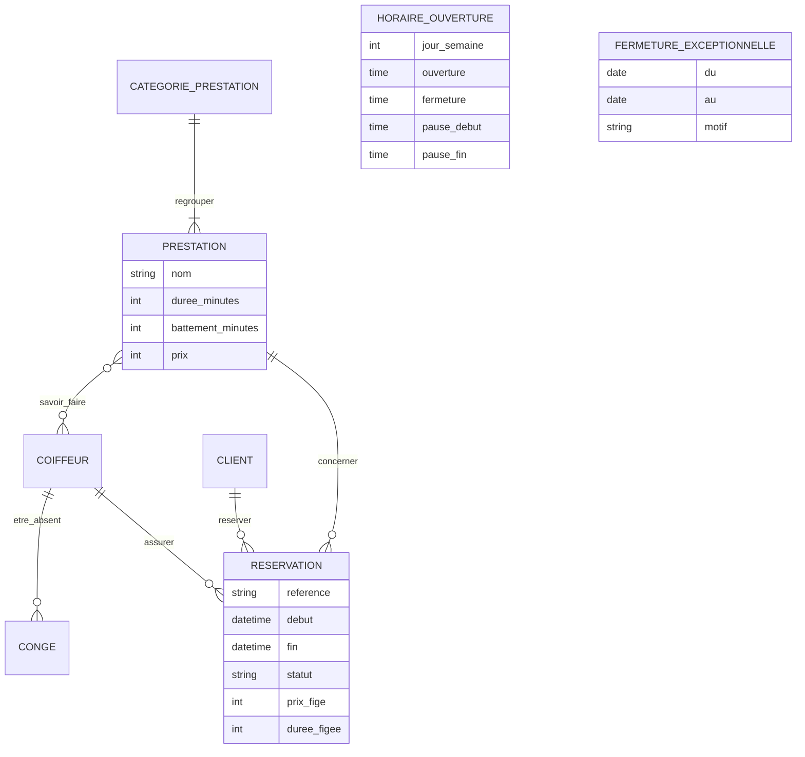

# ÉTAPE 3 bis — Analyse et amélioration du MCD existant

> **Source** : [`docs/mcd/modele_mcd_original.loo`](mcd/modele_mcd_original.loo) (Looping), fourni par le porteur du projet, et la commande fournisseur Dabo Hair.
> **Résultat** : le modèle final passe de 36 à **43 tables**. Il est testé sur MySQL 8.4 avec 22 tests d'intégrité et 16 requêtes KPI. Voir [DATABASE.md](../DATABASE.md).

---

## 0. Rappel de cours : la méthode Merise

Votre fichier est un **MCD** (Modèle Conceptuel de Données) réalisé avec Looping, selon la méthode **Merise**.

| Notion Merise | Définition | Dans votre MCD |
|---|---|---|
| **Entité** | Un objet du métier qui a une existence propre et un identifiant | `produit`, `commande`, `utilisateur` |
| **Attribut** | Une propriété d'une entité | `prix`, `stock`, `email` |
| **Identifiant** | L'attribut qui distingue chaque occurrence (souligné) | `id_produit` |
| **Association** | Un lien entre entités, nommé par un **verbe** | `passer`, `classer`, `contenir` |
| **Association porteuse** | Une association qui a ses propres attributs | (voir §3.2 : c'est le point clé) |
| **Cardinalités** `(min,max)` | Pour UNE occurrence de l'entité : combien de fois au minimum et au maximum participe-t-elle à l'association ? | `utilisateur (0,n) passer (1,1) commande` |

**Comment lire une cardinalité.** On part toujours de l'entité :
- « Un utilisateur passe **0 à n** commandes » → `(0,n)` côté utilisateur.
- « Une commande est passée par **1 et 1 seul** utilisateur » → `(1,1)` côté commande.

**Du MCD aux tables (passage au MLD).**
- Une association **`(1,1)` — `(x,n)`** disparaît : la clé de l'entité du côté `n` devient une **clé étrangère** dans l'entité du côté `(1,1)`. Exemple : `commande.id_user`.
- Une association **`(x,n)` — `(x,n)`** devient une **table** dont la clé primaire est composée des deux clés. Exemple : `favoris(id_user, id_produit)`.

---

## 1. Votre MCD, reconstitué

> Le fichier Looping est binaire. J'en ai extrait les entités, les attributs et les noms d'associations. Les **cardinalités** ne sont pas lisibles en dehors de Looping : celles ci-dessous sont **déduites** du sens des associations. Vérifiez-les en ouvrant votre fichier.


---

## 2. Ce qui est déjà très bien

| Point fort | Pourquoi c'est un bon réflexe |
|---|---|
| `prix_unitaire_au_moment_achat` dans `ligne_commande` | C'est **la** règle la plus importante d'un e-commerce : si le prix change, les anciennes commandes restent justes. Beaucoup d'étudiants l'oublient. |
| Catégorie réflexive `parent` / `enfant` | Elle permet des sous-catégories illimitées (Soins → Sérums). Notre modèle fait exactement pareil (`categories.parent_id`). |
| `imageProduit` avec `ordre_affichage` | Plusieurs photos par produit, dans un ordre maîtrisé. |
| `Avis`, `favoris`, `panier` | Trois fonctionnalités que **mon** modèle n'avait pas. Elles sont intégrées (§4). |
| Noms d'associations sous forme de verbes | C'est la convention Merise, respectée. |

---

## 3. Ce qu'on améliore, et pourquoi

### 3.1 Tableau de synthèse

| # | Constat dans votre MCD | Problème concret | Amélioration |
|---|---|---|---|
| 1 | `role` et `statut` sont des textes dans `utilisateur` | Impossible de donner des droits fins (un caissier ne doit pas voir le CA). Une faute de frappe (« admn ») crée un rôle fantôme | Tables `roles`, `permissions` et pivots (RBAC) |
| 2 | Une commande exige un `utilisateur` | Un client **sans compte** ne peut ni commander ni réserver (exigence EF-PUB-08) | Entité `customers` (client métier, avec ou sans compte), séparée de `users` (connexion) |
| 3 | `adresse` est un seul texte dans `utilisateur` | Une seule adresse possible, pas de zone de livraison, donc pas de calcul des frais | Table `addresses` (quartier, point de repère, zone) + adresse **recopiée** dans la commande |
| 4 | `stock` est un simple nombre dans `produit` | On voit que le stock baisse, sans savoir **pourquoi** (vente ? casse ? vol ?). C'est la cause des « pertes de stock » que l'entreprise veut éliminer | Grand livre `stock_movements` : chaque entrée et sortie est tracée |
| 5 | Pas de **prix d'achat** | Impossible de calculer la marge et les produits les plus rentables (KPI demandés) | `products.cost_price` + `order_items.unit_cost` figé |
| 6 | `commande.total` seul | On ne sait pas ce qui compose le total (frais de livraison ? remise ?). Pas de statut de paiement | `subtotal`, `discount_total`, `shipping_fee`, `total` + `CHECK` de cohérence, `payment_status` |
| 7 | Pas de paiement ni de facture | Rien n'est prévu pour Wave, Orange Money, Free Money, ni pour les factures PDF | Tables `payments`, `invoices`, `invoice_sequences` |
| 8 | `favoris`, `ligne_panier`, `ligne_commande` ont un identifiant propre | Rien n'empêche d'ajouter **deux fois** le même produit aux favoris | Voir §3.2 : ce sont des associations porteuses |
| 9 | `Avis` sans contrôle | Note 12 sur 5 possible, avis multiples d'un même client, publication sans modération | `CHECK rating BETWEEN 1 AND 5`, `UNIQUE (produit, client)`, statut de modération, « achat vérifié » |
| 10 | Pas de fournisseurs ni d'achats | Votre commande Dabo Hair (à la douzaine) n'a nulle part où être enregistrée | `suppliers`, `purchase_orders`, `purchase_order_items` (§5) |
| 11 | Pas de module réservation | Le salon ne peut pas gérer ses rendez-vous | 8 tables : prestations, coiffeurs, horaires, fermetures, congés, réservations (§6) |
| 12 | Noms mélangés (`imageProduit`, `Avis`, `id_user`) | Une convention irrégulière cause des erreurs dans le code | Convention Laravel : anglais, `snake_case`, pluriel (`product_images`) |

### 3.2 La leçon Merise : entité ou association porteuse ?

Prenons `favoris`. Dans votre MCD, c'est une **entité** avec un identifiant `id_favoris`. Posons la question Merise : **un favori existe-t-il sans un utilisateur ET un produit ?** Non. Un favori n'est que le **lien** entre les deux, avec une date.

C'est donc une **association porteuse** :

```
utilisateur (0,n) ──── AIMER [date_ajout] ──── (0,n) produit
```

En passant au MLD, une association `(0,n)`–`(0,n)` devient une table dont la clé primaire est **composée** :

```sql
favorites (user_id, product_id, created_at)   PRIMARY KEY (user_id, product_id)
```

Bénéfice : MySQL **refuse** d'ajouter deux fois le même favori (test T18). Avec un `id_favoris`, ce doublon passait.

Même raisonnement pour `ligne_panier` : c'est l'association « panier CONTIENT produit [quantité] », d'où `cart_items` avec la clé `(cart_id, product_id)`.

> **Et `ligne_commande` ?** C'est aussi conceptuellement une association porteuse (commande CONTIENT produit [quantité, prix]). On lui garde pourtant un `id` dans la base : une même commande peut contenir le même produit à deux prix différents (une promotion sur une seule unité, par exemple), et les avoirs ou retours pointeront vers une ligne précise. **Le MCD décrit le métier, le modèle physique s'adapte aux contraintes réelles.**

### 3.3 Le prix du panier n'est pas figé

Dans `cart_items`, il n'y a **pas** de colonne prix : un panier affiche toujours le prix **actuel**. Le prix n'est figé qu'au moment de la commande, dans `order_items`. Si le prix baisse pendant que l'article attend dans le panier, le client profite de la baisse. S'il augmente, le client le voit avant de valider.

---

## 4. Ce que votre MCD apporte au modèle final

| Votre entité | Table finale | Enrichissements |
|---|---|---|
| `Avis` | `product_reviews` | Note de 1 à 5 contrôlée, un avis par client et par produit, modération (`pending`, `approved`, `rejected`), lien vers la commande (« achat vérifié ») |
| `favoris` | `favorites` | Clé composée, pas de doublon possible |
| `panier` + `ligne_panier` | `carts` + `cart_items` | Panier invité (jeton dans un cookie), statut `active` / `converted` / `abandoned`, lien vers la commande issue du panier |

**Bonus data analytics** : le panier enregistré permet un nouveau KPI, le **taux d'abandon de panier** (requête Q16). La note moyenne par produit devient la requête Q15.

---

## 5. Votre catalogue réel : Dabo Hair

### 5.1 Ce que révèle votre commande
| Observation | Conséquence sur le modèle |
|---|---|
| Vous achetez **à la douzaine** et vendez **à l'unité** | Deux unités différentes : le lot d'achat (12) et l'unité de vente. D'où `packs_ordered`, `units_per_pack` et `quantity_ordered` (calculée) |
| Le même sérum existe en **30 ml** et en **15 ml** | Deux références (SKU) distinctes, chacune avec son prix et son stock, reliées par `variant_of_id` pour afficher « Autres contenances » sur la fiche produit |
| Les prix sont des **prix d'achat** | Ils vont dans `cost_price`. Le **prix de vente** reste à définir |

### 5.2 Les colonnes générées : MySQL fait le calcul

```sql
quantity_ordered INT AS (packs_ordered * units_per_pack) STORED,               -- 4 × 12 = 48
line_total       BIGINT AS (packs_ordered * units_per_pack * unit_cost) STORED  -- 48 × 3 000 = 144 000
```

On ne peut pas saisir ces colonnes à la main (test T21). Une erreur de calcul est donc impossible. La vérification confirme que MySQL retrouve **exactement votre total : 1 374 000 F CFA** (36 douzaines, 432 unités, requête Q14).

### 5.3 Les 9 références créées

| SKU | Produit | Catégorie | Lots × unités | Coût unitaire |
|---|---|---|---|---:|
| DAB-SHA-001 | Shampooing | Shampoings | 4 × 12 = 48 | 3 000 |
| DAB-SPH-250 | Spray hydratant 250 ml | Hydratants et crèmes | 4 × 12 = 48 | 5 000 |
| DAB-HYD-100 | Hydratant 100 ml | Hydratants et crèmes | 5 × 12 = 60 | 2 500 |
| DAB-CRE-001 | Crème capillaire | Hydratants et crèmes | 8 × 12 = 96 | 3 000 |
| DAB-SAP-030 | Sérum Activ'Pousse 30 ml | Sérums | 6 × 12 = 72 | 3 000 |
| DAB-SAP-015 | Sérum Activ'Pousse 15 ml (variante du 30 ml) | Sérums | 2 × 12 = 24 | 1 500 |
| DAB-SAC-001 | Spray anti-chute | Soins traitants | 2 × 12 = 24 | 5 000 |
| DAB-MAS-001 | Masque capillaire | Soins traitants | 2 × 12 = 24 | 3 000 |
| DAB-SBO-030 | Sérum Booster 30 ml | Sérums | 3 × 12 = 36 | 3 000 |

Les produits sont créés **inactifs** (invisibles en boutique) tant que leur **prix de vente** n'est pas fixé. Le classement en catégories est une proposition, à valider.

**Règle ajoutée** : un produit inactif n'entre pas dans les indicateurs de rotation et de rupture (Q10 à Q12). Un produit qui n'est pas encore en vente ne peut pas être « à faible rotation ».

---

## 6. Le module réservation (absent de votre MCD)

### 6.1 MCD Merise du module

```
SERVICE_CATEGORIE (1,n) ── REGROUPER ── (1,1) PRESTATION
PRESTATION        (0,n) ── SAVOIR_FAIRE ── (0,n) COIFFEUR              → table pivot service_stylist
COIFFEUR          (0,n) ── ÊTRE_ABSENT [début, fin, motif] ── (1,1) CONGÉ
CLIENT            (0,n) ── RÉSERVER ── (1,1) RÉSERVATION
PRESTATION        (0,n) ── CONCERNER ── (1,1) RÉSERVATION
COIFFEUR          (0,n) ── ASSURER ── (1,1) RÉSERVATION
HORAIRE_OUVERTURE     (entité isolée : 7 occurrences, une par jour)
FERMETURE_EXCEPTIONNELLE (entité isolée : jours fériés, Tabaski, Korité…)
```



### 6.2 Les règles qui en découlent
- Une réservation a **toujours** un coiffeur `(1,1)`. Si le client choisit « peu importe », le système en affecte un disponible.
- Prix et durée sont **figés** dans la réservation, comme dans `ligne_commande`.
- **Pas de chevauchement** pour un même coiffeur : index unique sur les créneaux actifs + transaction (voir [DATABASE.md §6.3](../DATABASE.md)).

---

## 7. Correspondance de vos noms vers les noms finaux

| Votre MCD (Looping) | Table finale | Remarque |
|---|---|---|
| `utilisateur` | `users` + `customers` + `roles` | Séparation connexion / client métier / droits |
| `utilisateur.adresse` | `addresses` | Plusieurs adresses, zones de livraison |
| `categorie` | `categories` | Inchangée sur le fond |
| `produit` | `products` | + `sku`, `cost_price`, `slug`, `variant_of_id`, seuil d'alerte |
| `produit.stock` | `products.stock_quantity` + `stock_movements` | Cache + grand livre |
| `imageProduit` | `product_images` | + `alt_text` (accessibilité), `is_primary` |
| `commande` | `orders` | + montants détaillés, statut de paiement, horodatages |
| `ligne_commande` | `order_items` | + `unit_cost`, `product_name` figés |
| `Avis` | `product_reviews` | + modération, achat vérifié |
| `panier` / `ligne_panier` | `carts` / `cart_items` | + panier invité, abandon |
| `favoris` | `favorites` | Clé composée |
| — | `suppliers`, `purchase_orders`, `purchase_order_items` | Nouveau (Dabo Hair) |
| — | `payments`, `invoices`, `invoice_sequences` | Nouveau |
| — | 8 tables de réservation | Nouveau |
| — | `activity_log`, `settings`, tables d'agrégats BI | Nouveau |

---

## 8. Pour mettre à jour votre fichier Looping (exercice conseillé)

Redessiner le modèle vous-même est le meilleur moyen de le comprendre. Dans Looping :

1. Transformez `favoris` en **association** `aimer` entre `utilisateur` et `produit`, porteuse de `date_ajout`, avec les cardinalités `(0,n)` des deux côtés.
2. Faites de même pour `ligne_panier`, qui devient l'association `contenir` entre `panier` et `produit`, porteuse de `quantite`.
3. Ajoutez l'entité `client` et l'association `correspondre` : `utilisateur (0,1)` — `(0,1) client`.
4. Ajoutez `fournisseur`, `bon_commande` et l'association `commander` entre `bon_commande` et `produit`, porteuse de `nb_lots`, `unites_par_lot` et `cout_unitaire`.
5. Ajoutez `mouvement_stock`, relié à `produit` par `(1,1)`—`(0,n)`.
6. Ajoutez le module réservation du §6.1.
7. Générez le script SQL avec Looping (menu MLD / SQL) et comparez-le à `database/schema.sql`. Les différences restantes sont les choix **physiques** expliqués dans DATABASE.md : index, `CHECK`, colonnes générées, instantanés.
