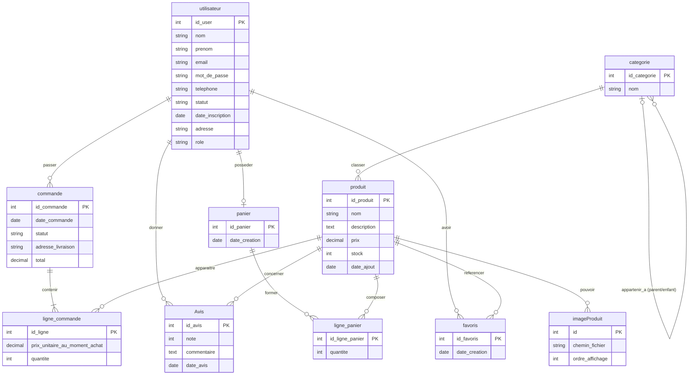
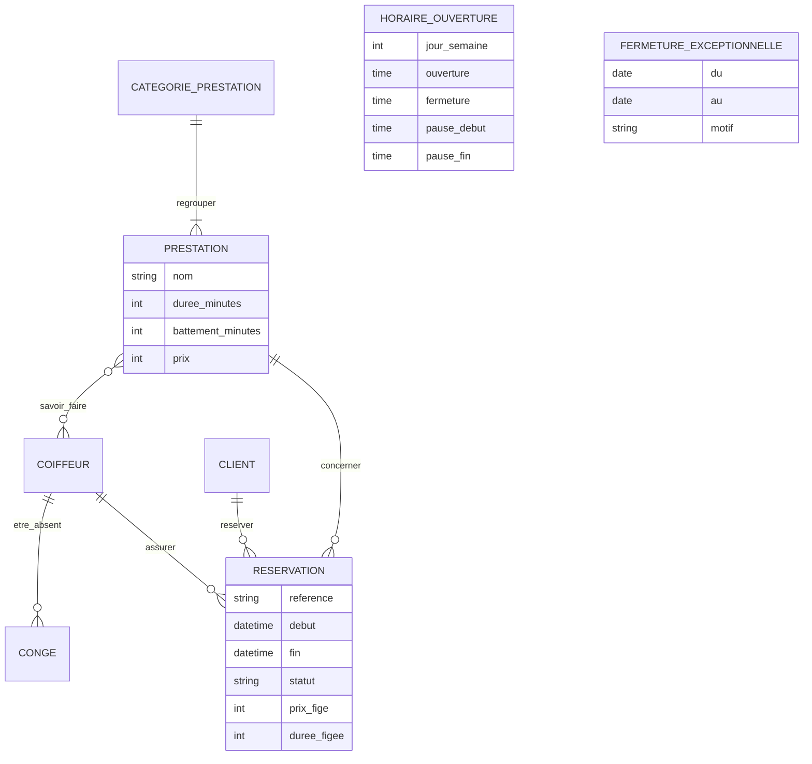

# ÉTAPE 3 bis — Analyse et amélioration du MCD existant

> **Source** : [`docs/mcd/modele_mcd_original.loo`](mcd/modele_mcd_original.loo) (Looping), fourni par le porteur du projet, et la commande fournisseur Dabo Hair.
> **Résultat** : le modèle final passe de 36 à **45 tables**. Il est testé sur MySQL 8.4 avec 27 tests d'intégrité et 18 requêtes KPI. Voir [DATABASE.md](../DATABASE.md).

---

## 0. Rappel de cours : la méthode Merise

Votre fichier est un **MCD** (Modèle Conceptuel de Données) réalisé avec Looping, selon la méthode **Merise**.

| Notion Merise | Définition | Dans votre MCD |
|---|---|---|
| **Entité** | Un objet du métier qui a une existence propre et un identifiant | `produit`, `commande`, `utilisateur` |
| **Attribut** | Une propriété d'une entité | `prix`, `stock`, `email` |
| **Identifiant** | L'attribut qui distingue chaque occurrence (souligné) | `id_produit` |
| **Association** | Un lien entre entités, nommé par un **verbe** | `passer`, `classer`, `contenir` |
| **Association porteuse** | Une association qui a ses propres attributs | (voir §3.2 : c'est le point clé) |
| **Cardinalités** `(min,max)` | Pour UNE occurrence de l'entité : combien de fois au minimum et au maximum participe-t-elle à l'association ? | `utilisateur (0,n) passer (1,1) commande` |

**Comment lire une cardinalité.** On part toujours de l'entité :
- « Un utilisateur passe **0 à n** commandes » → `(0,n)` côté utilisateur.
- « Une commande est passée par **1 et 1 seul** utilisateur » → `(1,1)` côté commande.

**Du MCD aux tables (passage au MLD).**
- Une association **`(1,1)` — `(x,n)`** disparaît : la clé de l'entité du côté `n` devient une **clé étrangère** dans l'entité du côté `(1,1)`. Exemple : `commande.id_user`.
- Une association **`(x,n)` — `(x,n)`** devient une **table** dont la clé primaire est composée des deux clés. Exemple : `favoris(id_user, id_produit)`.

---

## 1. Votre MCD, reconstitué

> Le fichier Looping est binaire. J'en ai extrait les entités, les attributs et les noms d'associations. Les **cardinalités** ne sont pas lisibles en dehors de Looping : celles ci-dessous sont **déduites** du sens des associations. Vérifiez-les en ouvrant votre fichier.



---

## 2. Ce qui est déjà très bien

| Point fort | Pourquoi c'est un bon réflexe |
|---|---|
| `prix_unitaire_au_moment_achat` dans `ligne_commande` | C'est **la** règle la plus importante d'un e-commerce : si le prix change, les anciennes commandes restent justes. Beaucoup d'étudiants l'oublient. |
| Catégorie réflexive `parent` / `enfant` | Elle permet des sous-catégories illimitées (Soins → Sérums). Notre modèle fait exactement pareil (`categories.parent_id`). |
| `imageProduit` avec `ordre_affichage` | Plusieurs photos par produit, dans un ordre maîtrisé. |
| `Avis`, `favoris`, `panier` | Trois fonctionnalités que **mon** modèle n'avait pas. Elles sont intégrées (§4). |
| Noms d'associations sous forme de verbes | C'est la convention Merise, respectée. |

---

## 3. Ce qu'on améliore, et pourquoi

### 3.1 Tableau de synthèse

| # | Constat dans votre MCD | Problème concret | Amélioration |
|---|---|---|---|
| 1 | `role` et `statut` sont des textes dans `utilisateur` | Impossible de donner des droits fins (un caissier ne doit pas voir le CA). Une faute de frappe (« admn ») crée un rôle fantôme | Tables `roles`, `permissions` et pivots (RBAC) |
| 2 | Une commande exige un `utilisateur` | Un client **sans compte** ne peut ni commander ni réserver (exigence EF-PUB-08) | Entité `customers` (client métier, avec ou sans compte), séparée de `users` (connexion) |
| 3 | `adresse` est un seul texte dans `utilisateur` | Une seule adresse possible, pas de zone de livraison, donc pas de calcul des frais | Table `addresses` (quartier, point de repère, zone) + adresse **recopiée** dans la commande |
| 4 | `stock` est un simple nombre dans `produit` | On voit que le stock baisse, sans savoir **pourquoi** (vente ? casse ? vol ?). C'est la cause des « pertes de stock » que l'entreprise veut éliminer | Grand livre `stock_movements` : chaque entrée et sortie est tracée |
| 5 | Pas de **prix d'achat** | Impossible de calculer la marge et les produits les plus rentables (KPI demandés) | `products.cost_price` + `order_items.unit_cost` figé |
| 6 | `commande.total` seul | On ne sait pas ce qui compose le total (frais de livraison ? remise ?). Pas de statut de paiement | `subtotal`, `discount_total`, `shipping_fee`, `total` + `CHECK` de cohérence, `payment_status` |
| 7 | Pas de paiement ni de facture | Rien n'est prévu pour Wave, Orange Money, Free Money, ni pour les factures PDF | Tables `payments`, `invoices`, `invoice_sequences` |
| 8 | `favoris`, `ligne_panier`, `ligne_commande` ont un identifiant propre | Rien n'empêche d'ajouter **deux fois** le même produit aux favoris | Voir §3.2 : ce sont des associations porteuses |
| 9 | `Avis` sans contrôle | Note 12 sur 5 possible, avis multiples d'un même client, publication sans modération | `CHECK rating BETWEEN 1 AND 5`, `UNIQUE (produit, client)`, statut de modération, « achat vérifié » |
| 10 | Pas de production ni de lots | L'entreprise fabrique ses produits : pas de suivi des lots, du coût de revient, ni des péremptions | `production_batches`, mouvement `production`, marque maison, clients revendeurs (§5) |
| 11 | Pas de module réservation | Le salon ne peut pas gérer ses rendez-vous | 8 tables : prestations, coiffeurs, horaires, fermetures, congés, réservations (§6) |
| 12 | Noms mélangés (`imageProduit`, `Avis`, `id_user`) | Une convention irrégulière cause des erreurs dans le code | Convention Laravel : anglais, `snake_case`, pluriel (`product_images`) |

### 3.2 La leçon Merise : entité ou association porteuse ?

Prenons `favoris`. Dans votre MCD, c'est une **entité** avec un identifiant `id_favoris`. Posons la question Merise : **un favori existe-t-il sans un utilisateur ET un produit ?** Non. Un favori n'est que le **lien** entre les deux, avec une date.

C'est donc une **association porteuse** :

```
utilisateur (0,n) ──── AIMER [date_ajout] ──── (0,n) produit
```

En passant au MLD, une association `(0,n)`–`(0,n)` devient une table dont la clé primaire est **composée** :

```sql
favorites (user_id, product_id, created_at)   PRIMARY KEY (user_id, product_id)
```

Bénéfice : MySQL **refuse** d'ajouter deux fois le même favori (test T18). Avec un `id_favoris`, ce doublon passait.

Même raisonnement pour `ligne_panier` : c'est l'association « panier CONTIENT produit [quantité] », d'où `cart_items` avec la clé `(cart_id, product_id)`.

> **Et `ligne_commande` ?** C'est aussi conceptuellement une association porteuse (commande CONTIENT produit [quantité, prix]). On lui garde pourtant un `id` dans la base : une même commande peut contenir le même produit à deux prix différents (une promotion sur une seule unité, par exemple), et les avoirs ou retours pointeront vers une ligne précise. **Le MCD décrit le métier, le modèle physique s'adapte aux contraintes réelles.**

### 3.3 Le prix du panier n'est pas figé

Dans `cart_items`, il n'y a **pas** de colonne prix : un panier affiche toujours le prix **actuel**. Le prix n'est figé qu'au moment de la commande, dans `order_items`. Si le prix baisse pendant que l'article attend dans le panier, le client profite de la baisse. S'il augmente, le client le voit avant de valider.

---

## 4. Ce que votre MCD apporte au modèle final

| Votre entité | Table finale | Enrichissements |
|---|---|---|
| `Avis` | `product_reviews` | Note de 1 à 5 contrôlée, un avis par client et par produit, modération (`pending`, `approved`, `rejected`), lien vers la commande (« achat vérifié ») |
| `favoris` | `favorites` | Clé composée, pas de doublon possible |
| `panier` + `ligne_panier` | `carts` + `cart_items` | Panier invité (jeton dans un cookie), statut `active` / `converted` / `abandoned`, lien vers la commande issue du panier |

**Bonus data analytics** : le panier enregistré permet un nouveau KPI, le **taux d'abandon de panier** (requête Q16). La note moyenne par produit devient la requête Q15.

---

## 5. Votre catalogue réel : Dabo Hair, une marque fabriquée

### 5.1 Ce que change le fait de FABRIQUER ses produits

L'entreprise fabrique ses propres produits sous la marque **Dabo Hair**. Un fabricant ne se gère pas comme un revendeur :

| Revendeur | Fabricant (votre cas) | Conséquence sur le modèle |
|---|---|---|
| Le stock entre par des **achats** | Le stock entre par la **production** | Table `production_batches` + mouvement de stock `production` |
| Le coût = le prix d'achat | Le coût = le **coût de revient** (matières premières, flacon, étiquette, temps) | `products.cost_price` peut être `NULL` tant qu'il n'est pas calculé |
| Le fournisseur gère la traçabilité | **Vous** êtes responsable de chaque lot | Numéro de lot unique et date de péremption (obligatoires pour un cosmétique) |
| — | Vous vendez aussi **en gros**, à la douzaine | `customers.customer_type` : particulier ou revendeur |
| — | Votre marque est un actif à suivre | `brands.is_house_brand` : CA de la marque maison et CA des marques revendues |

> **Pourquoi le numéro de lot est-il si important ?** Si un client signale une réaction à la crème capillaire, le numéro de lot imprimé sur le flacon permet de retrouver **tous les flacons fabriqués le même jour** et de les retirer de la vente, sans tout jeter. C'est la **traçabilité**.

### 5.2 La commande de la capture : une vente en gros

La commande de 1 374 000 F CFA est enregistrée comme une **vente** (commande n° 9) à un client **revendeur**. Les quantités sont stockées **en unités** (48 shampooings) ; l'affichage « 4 douzaines » est une simple présentation. La vérification confirme : **9 lignes, 432 unités, 1 374 000 F CFA**, et chaque ligne respecte `line_total = prix × quantité`.

### 5.3 Le coût de revient inconnu : une leçon de qualité des données

Le coût de revient n'est pas encore connu, donc on enregistre `NULL` (« inconnu ») et **surtout pas 0**.

- Avec `0`, la marge afficherait **100 %** : un chiffre faux, mais qui a l'air vrai. C'est le pire cas en analyse de données.
- Avec `NULL`, la requête Q04 affiche une marge **vide**. Le tableau de bord pourra afficher « coût de revient à renseigner ».

> **Règle d'analyste** : une donnée manquante doit **se voir**. Une valeur inventée (0, une moyenne…) pour boucher un trou fausse silencieusement toutes les décisions prises ensuite.

La rotation des stocks (Q10) est désormais calculée **en unités**. Le résultat est identique quand le coût est constant, et il reste calculable sans coût de revient.

### 5.4 Les 9 références

| SKU | Produit | Catégorie (proposée) | Prix de vente |
|---|---|---|---:|
| DAB-SHA-001 | Shampooing | Shampoings | 3 000 |
| DAB-SPH-250 | Spray hydratant 250 ml | Hydratants et crèmes | 5 000 |
| DAB-HYD-100 | Hydratant 100 ml | Hydratants et crèmes | 2 500 |
| DAB-CRE-001 | Crème capillaire | Hydratants et crèmes | 3 000 |
| DAB-SAP-030 | Sérum Activ'Pousse 30 ml | Sérums | 3 000 |
| DAB-SAP-015 | Sérum Activ'Pousse 15 ml (variante du 30 ml) | Sérums | 1 500 |
| DAB-SAC-001 | Spray anti-chute | Soins traitants | 5 000 |
| DAB-MAS-001 | Masque capillaire | Soins traitants | 3 000 |
| DAB-SBO-030 | Sérum Booster 30 ml | Sérums | 3 000 |

Les deux contenances du sérum Activ'Pousse sont deux références distinctes (prix et stock différents), reliées par `variant_of_id`. La fiche produit pourra ainsi proposer « 30 ml / 15 ml ».

**Données de démonstration (à remplacer)** : numéros de lot, dates de fabrication et de péremption, quantités fabriquées.

### 5.5 Les coûts réels de fabrication

Source : la capture « Calcul des bénéfices par produit ». MySQL la **retrouve à l'identique** avec la requête Q18 :

| Lot | Unités | Coût du lot | Coût unitaire | CA si tout est vendu | Marge potentielle | Taux |
|---|---:|---:|---:|---:|---:|---:|
| Spray hydratant | 96 | 33 600 | 350,00 | 480 000 | 446 400 | 93,0 % |
| Crème capillaire | 96 | 14 400 | 150,00 | 288 000 | 273 600 | 95,0 % |
| Sérum Activ'Pousse 30 ml | 96 | 25 600 | 266,67 | 288 000 | 262 400 | 91,1 % |
| Sérum Booster | 96 | 25 600 | 266,67 | 288 000 | 262 400 | 91,1 % |
| Shampooing sans sulfate | 96 | 38 400 | 400,00 | 288 000 | 249 600 | 86,7 % |
| Masque capillaire | 48 | 18 400 | 383,33 | 144 000 | 125 600 | 87,2 % |
| **Total (6 lots)** | | **156 000** | | **1 776 000** | **1 620 000** | |

**Trois leçons de modélisation :**

1. **On stocke le montant payé, on calcule l'unitaire.** 25 600 F ÷ 96 = 266,67 F. Si l'on stockait 267 F arrondi, on obtiendrait 267 × 96 = 25 632 F : 32 F « inventés ». La base stocke donc le **total exact** (`total_cost`, entier), et MySQL **calcule** l'unitaire (`unit_cost`, colonne générée en `DECIMAL`). Règle : l'argent réellement payé est un entier, une valeur dérivée peut avoir des décimales.
2. **Le coût est détaillé poste par poste** (table `production_batch_costs` : ingrédients, flacons, étiquettes, main-d'œuvre, autres). On sait ainsi **ce qui** coûte cher, et un coût peut être complété au fil de l'eau. `verify.sh` contrôle que le total du lot est bien égal à la somme de ses postes.
3. **Marge potentielle et marge réalisée sont deux choses différentes.** Le tableau ci-dessus suppose que **tout** le lot est vendu au **prix public**. La marge **réalisée** (Q04) ne compte que les ventes réellement payées, à leur prix réel. Et ces taux de 87 à 95 % sont calculés **avant** les autres charges : loyer, salaires, électricité, transport. Le bénéfice net sera plus bas.

**À clarifier par l'entreprise** : la capture « Dépenses » précédente (171 000 F, par exemple 80 000 F pour la crème) ne correspond pas aux montants « Achat » (156 000 F, 14 400 F pour la crème). S'il s'agit de deux postes différents (ingrédients et emballages, par exemple), il suffira de les ajouter comme deux lignes de coût de chaque lot. Le coût unitaire se recalculera automatiquement. En attendant, seuls les montants « Achat », accompagnés des quantités, sont enregistrés, dans la catégorie `other`.

**Encore inconnus** : le coût du spray anti-chute ; les lots de l'hydratant 100 ml et du sérum 15 ml.

### 5.6 Et les achats fournisseur ?

Les tables `suppliers` et `purchase_orders` restent utiles **si la boutique revend aussi des marques tierces**. La démonstration les illustre avec un fournisseur fictif. Les colonnes générées (`quantity_ordered = lots × unités par lot`, `line_total`) gardent tout leur intérêt pour les achats par douzaines.

## 6. Le module réservation (absent de votre MCD)

### 6.1 MCD Merise du module

```
SERVICE_CATEGORIE (1,n) ── REGROUPER ── (1,1) PRESTATION
PRESTATION        (0,n) ── SAVOIR_FAIRE ── (0,n) COIFFEUR              → table pivot service_stylist
COIFFEUR          (0,n) ── ÊTRE_ABSENT [début, fin, motif] ── (1,1) CONGÉ
CLIENT            (0,n) ── RÉSERVER ── (1,1) RÉSERVATION
PRESTATION        (0,n) ── CONCERNER ── (1,1) RÉSERVATION
COIFFEUR          (0,n) ── ASSURER ── (1,1) RÉSERVATION
HORAIRE_OUVERTURE     (entité isolée : 7 occurrences, une par jour)
FERMETURE_EXCEPTIONNELLE (entité isolée : jours fériés, Tabaski, Korité…)
```



### 6.2 Les règles qui en découlent
- Une réservation a **toujours** un coiffeur `(1,1)`. Si le client choisit « peu importe », le système en affecte un disponible.
- Prix et durée sont **figés** dans la réservation, comme dans `ligne_commande`.
- **Pas de chevauchement** pour un même coiffeur : index unique sur les créneaux actifs + transaction (voir [DATABASE.md §6.3](../DATABASE.md)).

---

## 7. Correspondance de vos noms vers les noms finaux

| Votre MCD (Looping) | Table finale | Remarque |
|---|---|---|
| `utilisateur` | `users` + `customers` + `roles` | Séparation connexion / client métier / droits |
| `utilisateur.adresse` | `addresses` | Plusieurs adresses, zones de livraison |
| `categorie` | `categories` | Inchangée sur le fond |
| `produit` | `products` | + `sku`, `cost_price`, `slug`, `variant_of_id`, seuil d'alerte |
| `produit.stock` | `products.stock_quantity` + `stock_movements` | Cache + grand livre |
| `imageProduit` | `product_images` | + `alt_text` (accessibilité), `is_primary` |
| `commande` | `orders` | + montants détaillés, statut de paiement, horodatages |
| `ligne_commande` | `order_items` | + `unit_cost`, `product_name` figés |
| `Avis` | `product_reviews` | + modération, achat vérifié |
| `panier` / `ligne_panier` | `carts` / `cart_items` | + panier invité, abandon |
| `favoris` | `favorites` | Clé composée |
| — | `production_batches` | Nouveau : fabrication Dabo Hair (lots, péremption) |
| — | `suppliers`, `purchase_orders`, `purchase_order_items` | Nouveau : achats de marques revendues |
| — | `payments`, `invoices`, `invoice_sequences` | Nouveau |
| — | 8 tables de réservation | Nouveau |
| — | `activity_log`, `settings`, tables d'agrégats BI | Nouveau |

---

## 8. Pour mettre à jour votre fichier Looping (exercice conseillé)

Redessiner le modèle vous-même est le meilleur moyen de le comprendre. Dans Looping :

1. Transformez `favoris` en **association** `aimer` entre `utilisateur` et `produit`, porteuse de `date_ajout`, avec les cardinalités `(0,n)` des deux côtés.
2. Faites de même pour `ligne_panier`, qui devient l'association `contenir` entre `panier` et `produit`, porteuse de `quantite`.
3. Ajoutez l'entité `client` et l'association `correspondre` : `utilisateur (0,1)` — `(0,1) client`.
4. Ajoutez l'entité `lot_fabrication` (numero_lot, quantite, date_fabrication, date_peremption, cout_revient_unitaire), reliée à `produit` par `(1,1)`—`(0,n)`.
5. Ajoutez `mouvement_stock`, relié à `produit` par `(1,1)`—`(0,n)`.
6. Ajoutez le module réservation du §6.1.
7. Générez le script SQL avec Looping (menu MLD / SQL) et comparez-le à `database/schema.sql`. Les différences restantes sont les choix **physiques** expliqués dans DATABASE.md : index, `CHECK`, colonnes générées, instantanés.
