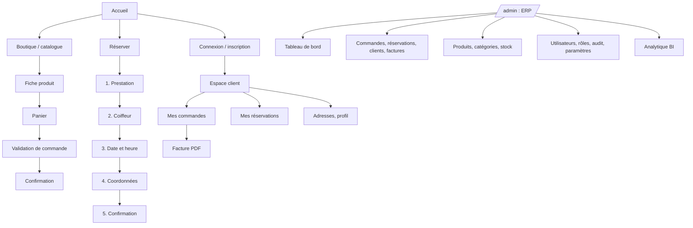

# ÉTAPE 4 — Maquettage des pages

> **Statut** : version 1.0
> **Maquettes interactives** : https://claude.ai/artifact/KUfhiWo6RP8ziNSapB9CEa (lien privé : à partager depuis le menu « Share » de la page si d'autres personnes doivent la voir)
> **Sources** : [`docs/maquettes/`](maquettes/) (copie d'archive des 9 artboards)

---

## 0. Pourquoi maquetter avant de coder ? (cours)

| Niveau | Contenu | Coût d'une modification |
|---|---|---|
| **Wireframe** | Boîtes grises : où va quoi | Quelques secondes |
| **Maquette** | Couleurs, typographies, vrais contenus | Quelques minutes |
| **Prototype** | Maquette cliquable (ici : le tunnel de réservation) | Une heure |
| **Code React** | Le produit réel | Une journée |

On valide le **parcours** et l'**apparence** avant d'écrire du code. Déplacer un bouton sur une maquette prend 10 secondes ; le déplacer dans React, avec ses tests, prend beaucoup plus longtemps.

Une maquette sert aussi de **contrat** entre le designer, le développeur et le client : tout le monde valide la même image.

---

## 1. Inventaire des maquettes

| # | Maquette | Utilisateur | Exigences couvertes |
|---|---|---|---|
| 00 | Système de design | Équipe | ENF-12 (identité premium), ENF-08 (accessibilité) |
| 01 | Accueil desktop | Visiteur | EF-PUB-01, 06, 07 |
| 01b | Accueil mobile (390 px) | Visiteur | ENF-02 (mobile first) |
| 02 | Catalogue | Visiteur, client | EF-PUB-02, 03, 04 |
| 03 | Fiche produit | Visiteur, client | EF-PUB-05, EF-CLI-04 |
| 04 | Tunnel de réservation **(interactif)** | Visiteur, client | EF-PUB-08, EF-RES-01 à 05 |
| 05 | Espace client | Client | EF-CLI-06, 07, 09, 10 |
| 06 | ERP : tableau de bord | Personnel | EF-ERP-01 |
| 07 | BI : tableau de bord décisionnel | Propriétaire | EF-BI-01 à 13 |

Les chiffres des maquettes 06 et 07 sont **exactement** ceux du jeu de démonstration et des requêtes de l'étape 3 (`database/analytics_queries.sql`). La maquette montre donc ce que la base produira réellement.

---

## 2. Plan du site (navigation)

Les écrans **panier**, **validation de commande**, **connexion** et les **listes de l'ERP** (commandes, produits…) suivent les mêmes composants. Ils seront maquettés directement en composants React à l'étape 5, à partir de ce système de design.

---

## 3. Système de design (maquette 00)

### 3.1 Couleurs (design tokens)

| Token | Valeur | Usage |
|---|---|---|
| `gold` | `#D4AF37` | Boutons principaux, accents, liens sur fond noir |
| `gold-dark` | `#B8860B` | Survol, graphiques sur fond clair |
| `gold-text` | `#7A5A00` | **Texte** or sur fond clair (contraste suffisant) |
| `ink` | `#0F0F0F` | Fond de la vitrine, texte sur fond clair |
| `ink-soft` | `#1A1A1A` | Cartes, panneaux, menu de l'ERP |
| `ivory` | `#F8F8F8` | Texte sur noir, fond des zones de données |
| `mist` | `#D9D9D9` | Séparateurs, bordures |

> **Leçon d'accessibilité : le contraste.** Les règles WCAG exigent un ratio d'au moins **4,5 : 1** entre le texte et son fond.
> - Or `#D4AF37` sur noir : **9,6 : 1**, parfait.
> - Or `#D4AF37` sur blanc : **2 : 1**, illisible pour beaucoup de personnes.
>
> C'est pourquoi on a ajouté le token `gold-text` (`#7A5A00`) : votre palette est respectée, mais jamais au détriment de la lisibilité.

### 3.2 Typographie
- **Titres** : *Playfair Display*, une serif élégante qui porte l'image haut de gamme.
- **Texte** : *Inter*, une sans-serif très lisible à petite taille, sur écran comme sur mobile.
- **Échelle** : 64 (hero) · 48 · 40 · 32 · 24 · 18 · 16 · 14 · 12 px.

### 3.3 Règles de composants
| Règle | Raison |
|---|---|
| Boutons en forme de pilule, hauteur ≥ 44 px | Taille minimale d'une cible tactile (doigt) |
| Un seul bouton or par zone | Le bouton or indique **l'action principale**. Deux boutons or = aucune hiérarchie |
| Statuts : couleur + libellé + pastille | Un daltonien distingue le libellé, pas forcément la couleur |
| Créneau indisponible : barré + bordure pointillée | Ne pas compter uniquement sur le gris |
| Icônes Lucide en trait de 2 px, jamais d'emoji | Cohérence premium (ENF-12) |
| Animations de 200 à 300 ms, désactivées si `prefers-reduced-motion` | Élégance sans gêner les personnes sensibles au mouvement |

### 3.4 Thèmes par zone
- **Vitrine et tunnel de réservation** : fond noir. C'est l'ambiance luxe, l'image de marque.
- **ERP et BI** : fond clair, avec un menu noir et des accents or. On y lit des tableaux et des chiffres pendant des heures : le texte foncé sur fond clair fatigue moins les yeux et rend les données plus lisibles. La marque reste présente par le menu et les accents.

---

## 4. Décisions UX expliquées

### 4.1 Le tunnel de réservation (maquette 04, cliquable)
- **Une étape = une décision.** Cinq étapes simples valent mieux qu'un long formulaire, qui fait peur et que l'on abandonne.
- **Le récapitulatif reste toujours visible à droite** : l'utilisateur sait à tout moment ce qu'il a choisi et combien il paiera.
- **Le bouton « Continuer » reste désactivé** tant que le choix n'est pas fait. L'erreur est évitée plutôt que signalée.
- **Les règles métier sont appliquées dans la maquette.** Essayez-la :
  - Bineta ne réalise pas les *Nattes collées*, donc elle n'est pas proposée. C'est la table `service_stylist` de l'étape 3.
  - Les dimanches sont barrés (`business_hours`).
  - Les créneaux tiennent compte de la **durée** de la prestation et de la **pause de midi**. Pour des tresses de 3 h un lundi, il n'y a pas de créneau à 11 h, car la prestation finirait pendant la pause.
- **Aucun compte exigé** (EF-PUB-08). La création de compte est proposée **après** la confirmation, au moment où l'utilisateur y voit un intérêt.

### 4.2 Catalogue
- **Les filtres actifs sont affichés sous forme d'étiquettes retirables.** On voit ce qui est filtré et on l'annule en un clic.
- **Un produit en rupture reste visible**, mais son bouton d'achat est désactivé (RG-STK-04).
- **Le badge « Stock limité »** crée de l'urgence sans mentir, car il est calculé à partir du vrai stock.
- Les filtres seront stockés dans l'URL (`?categorie=huiles&type=crepus`) : une recherche filtrée se partage par lien.

### 4.3 Mobile (maquette 01b)
- **Barre de navigation en bas de l'écran**, accessible avec le pouce : Accueil, Boutique, Réserver, Compte.
- Boutons en pleine largeur, une seule colonne, grille de 2 produits.

### 4.4 ERP et BI
- **Tableau de bord** : on y place ce qui demande une **action aujourd'hui** (planning du jour, alertes de stock, commandes à traiter).
- **BI** : on y place ce qui sert à **décider** (tendances, rentabilité, comportement des clients).
- **Chaque KPI affiche sa définition sous le chiffre.** C'est le dictionnaire des KPI rendu visible : personne ne discute de ce que signifie « panier moyen ».
- **Une phrase de lecture accompagne la heatmap** : un graphique sans interprétation laisse le propriétaire seul face aux données.

---

## 5. Responsive : points de rupture

| Nom (Tailwind) | Largeur | Comportement |
|---|---|---|
| (base) | < 640 px | 1 colonne, menu en bas, filtres dans un panneau coulissant |
| `sm` | ≥ 640 px | Grille produits sur 2 colonnes |
| `md` | ≥ 768 px | Récapitulatif de réservation sous le formulaire |
| `lg` | ≥ 1024 px | Filtres en colonne latérale, menu de l'ERP visible |
| `xl` | ≥ 1280 px | Largeur maximale du contenu : 1280 px, centré |

> **Mobile first** : on écrit d'abord le style mobile, puis on ajoute les variantes plus larges (`md:grid-cols-3`). La majorité du trafic d'un commerce local arrive depuis un téléphone.

---

## 6. Emplacements réservés (à fournir par l'entreprise)

| Emplacement | Format conseillé | Où |
|---|---|---|
| `[LOGO]` | SVG (ou PNG 2× sur fond transparent) | En-tête, pied de page, factures PDF, ERP |
| `[IMAGE HERO]` | 1200 × 1400 px (desktop), 800 × 600 px (mobile), WebP | Accueil |
| `[BANNIÈRE PROMOTIONNELLE]` | 1280 × 320 px (desktop), 750 × 280 px (mobile) | Accueil, gérée depuis l'ERP |
| `[PHOTO PRODUIT]` | 1200 × 1200 px, fond uni | Catalogue, fiche produit |
| Photos des coiffeurs | 600 × 600 px | Étape « Coiffeur » de la réservation |
| `[NOM DE L'ENTREPRISE]`, adresse, téléphone, NINEA, RCCM | Texte | Pied de page, factures (table `settings`) |
| Descriptions des produits | Texte | Fiche produit (saisie dans l'ERP) |

---

## 7. De la maquette aux composants React (préparation de l'étape 5)

Repérer les **éléments répétés** dans les maquettes donne directement la liste des composants à coder :

| Composant | Utilisé dans | Base shadcn/ui |
|---|---|---|
| `Button` (variants : gold, outline, ghost) | Partout | `button` |
| `ProductCard` | Accueil, catalogue, produits associés | `card` |
| `StatusBadge` | Espace client, ERP | `badge` |
| `PriceTag` (format XOF) | Partout | maison |
| `KpiTile` | ERP, BI | `card` |
| `FilterSidebar` | Catalogue | `checkbox`, `accordion`, `sheet` (mobile) |
| `BookingStepper`, `SlotPicker`, `CalendarGrid` | Réservation | `calendar`, `toggle-group` |
| `DataTable` | ERP, espace client | `table` + TanStack Table |
| `Heatmap`, `RevenueChart` | BI | Recharts |
| `PublicLayout`, `AccountLayout`, `AdminLayout` | Toutes les pages | maison |

---

## 8. Checklist d'accessibilité appliquée aux maquettes
- [x] Contrastes conformes (texte or uniquement sur fond foncé)
- [x] Cibles tactiles ≥ 44 px
- [x] Vrais éléments `<button>`, `<a>`, `<label>` + `<input>` (navigation au clavier possible)
- [x] `aria-label` sur les boutons qui n'ont qu'une icône (panier, recherche, compte)
- [x] `aria-current` sur la page et l'étape actives, `aria-pressed` sur les choix
- [x] Statuts jamais signalés par la couleur seule
- [x] Graphiques avec description textuelle (`role="img"` + `aria-label`)
- [x] Tableaux larges dans une zone défilante sur mobile
