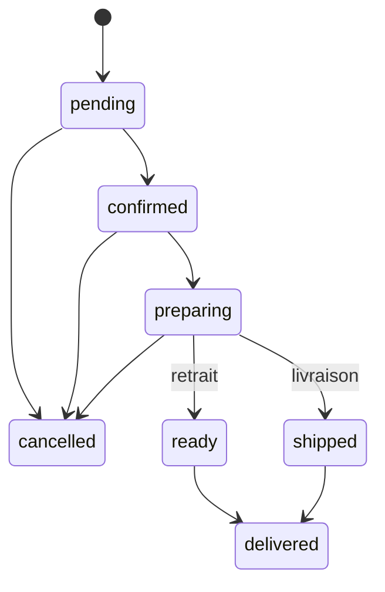

# ÉTAPE 7 — L'ERP d'administration

> **Statut** :
> - **Partie 1 terminée** : l'API d'administration (Laravel).
> - **Partie 2 terminée** : l'interface React de l'ERP (`/admin`), voir §9 à §14.
>
> **Vérification** : 66 tests backend (338 vérifications), dont 15 tests dédiés à l'ERP ; parcours navigateur de l'ERP : 25 vérifications contre la vraie API.
> **Exemple de facture générée** : [exemple-facture.pdf](exemple-facture.pdf)

---

## 1. Ce que permet l'API d'administration

| Domaine | Endpoints (`/api/v1/admin/…`) | Permission exigée |
|---|---|---|
| Tableau de bord du jour | `GET dashboard` | `orders.view` (montants : `analytics.view`) |
| Commandes | `GET orders`, `GET orders/{ref}` | `orders.view` |
| | `PATCH orders/{ref}/status`, `POST orders/{ref}/payments` | `orders.manage` |
| Factures PDF | `GET invoices/{numéro}/pdf` | `invoices.view` |
| Planning | `GET bookings?from&to`, `PATCH bookings/{ref}/status` | `bookings.view`, `bookings.manage` |
| Produits | `GET products`, `PATCH products/{id}` | `products.view`, `products.manage` |
| Stock | `GET products/{id}/movements`, `POST products/{id}/stock-adjustments` | `stock.view`, `stock.adjust` |
| Fabrication | `GET production-batches`, `POST production-batches` | `stock.view`, `production.manage` |
| Clients | `GET customers` | `customers.view` |
| Équipe | `GET/POST users`, `PATCH users/{id}`, `GET roles` | `users.manage` |
| Journal d'audit | `GET audit` | `audit.view` |

Côté client : `GET /api/v1/me/orders/{ref}/invoice` télécharge la facture de **sa** commande, une fois payée.

## 2. Qui peut faire quoi (RBAC)

| Rôle | Permissions principales |
|---|---|
| `super_admin` (propriétaire) | Tout, y compris le chiffre d'affaires, l'équipe et l'audit |
| `manager` | Tout sauf l'analytique financière, l'équipe, les rôles et l'audit |
| `cashier` | Commandes (traiter, encaisser), clients, factures ; **pas** les montants du tableau de bord ni le stock |
| `stock_keeper` | Produits, stock, pertes, fabrication |
| `stylist` | Consulter le planning |
| `customer` | Aucune permission ERP |

> **Leçon : le RBAC s'applique aussi aux DONNÉES.** Un caissier peut ouvrir le tableau de bord, mais les champs `revenue_*` et `margin` lui arrivent à `null`. Masquer un chiffre dans l'interface ne suffit pas : il ne doit **pas quitter le serveur**.

Le code vérifie toujours une **permission** (`permission:orders.manage`), jamais un nom de rôle. Ajouter demain un rôle « livreur » ne demandera aucune modification du code.

## 3. Les machines à états

Une **machine à états** liste les passages autorisés d'un statut à l'autre. Tout autre passage est refusé (422, avec un message clair).



Elles sont écrites **dans les Enums** (`OrderStatus::transitions()`, `BookingStatus::transitions()`). L'API renvoie `allowed_transitions` : l'interface n'affichera que les boutons possibles.

**Règles ajoutées :**
- **Annuler une commande** exige un motif et **remet le stock** (mouvements `sale_cancellation`).
- **Une commande payée** ne s'annule pas : il faut un avoir (RG-FAC-03).
- **Un rendez-vous** ne peut être marqué « terminé » ou « absent » qu'une fois l'heure passée.

## 4. Encaissement et factures

1. `POST orders/{ref}/payments` avec `method` = `cash`, `wave`, `orange_money`, `free_money` ou `card` (et la référence de transaction si besoin).
2. Le **montant vient de la commande**, jamais d'une saisie : impossible d'encaisser un montant faux.
3. Dans la **même transaction**, la facture est émise :
   - numéro `FAC-2026-000001` **sans trou**, grâce au compteur verrouillé `invoice_sequences` ;
   - coordonnées du client et de l'entreprise **figées** (`company_snapshot`) ;
   - la facture est **immuable**.
4. Le PDF est produit à la demande par **dompdf**, à partir d'un gabarit Blade (`resources/views/pdf/invoice.blade.php`). `{{ }}` échappe le HTML : aucune donnée saisie ne peut injecter de code dans le document.

## 5. Fabrication et stock

`POST production-batches` enregistre **en une transaction** :
- le lot (numéro unique, quantité, dates de fabrication et de péremption) ;
- ses **postes de coût** (ingrédients, flacons, étiquettes, main-d'œuvre…) ;
- l'entrée en stock (`production`) dans le grand livre ;
- le **nouveau coût de revient** du produit, calculé par MySQL : 25 000 F ÷ 96 = 260,42 F.

C'est ici que vous saisirez le coût du **spray anti-chute** et les lots de l'**hydratant 100 ml** et du **sérum 15 ml**.

`POST products/{id}/stock-adjustments` traite les pertes, les ajustements d'inventaire et les retours clients :
- un **motif** est obligatoire ;
- une perte est **toujours une sortie**, même si l'on tape « 2 » ;
- chaque opération est enregistrée dans le journal d'audit.

## 6. Le journal d'audit (RG-SEC-01)

`spatie/laravel-activitylog` enregistre automatiquement, avec l'**auteur**, la **date** et les **valeurs avant et après** :
- les modifications de produits (prix, activation, seuil) ;
- les changements de statut des commandes et des réservations ;
- les lots de fabrication ;
- la création de comptes du personnel et les changements de rôle ;
- les ajustements de stock.

Exemple réel, tiré d'un test : « Awa Ndiaye a passé le prix du Sérum Booster de 3 000 à 3 500 F ».

L'API renvoie pour chaque ligne `subject` (technique : `Product #8`) **et** `subject_label` (lisible : `Masque capillaire`, `CMD-2026-000102`, `Lot LOT-2603-SHA-001`, `Khady Fall`). `subject_label` vaut `null` si l'objet a été supprimé depuis : l'écran affiche alors l'identifiant technique.

## 7. Créer le compte du propriétaire en production

Les comptes de démonstration n'existent qu'en local. En production :

```bash
php artisan app:create-admin
```

La commande demande le prénom, le nom, l'email et le mot de passe (12 caractères minimum, avec des lettres et des chiffres). Le mot de passe n'apparaît ni à l'écran ni dans l'historique du terminal.

**Garde-fou** : un administrateur ne peut pas se retirer à lui-même ses droits, ni désactiver son propre compte. Cela évite de se retrouver sans aucun administrateur.

## 8. Bugs et corrections pendant cette partie
- Le modèle `User` n'importait pas automatiquement le trait d'audit : import ajouté.
- **Facture PDF** : les titres de colonnes chiffrées étaient alignés à gauche. La règle CSS `.items th` était plus spécifique que `.right` ; elle est devenue `.items th.right`.
- Le moyen de paiement s'affichait en minuscules (« orange money ») : ajout de `PaymentMethod::label()`.

---

# Partie 2 — L'interface React de l'ERP

## 9. Où se trouve le code

```
frontend/src/
├── features/auth/permissions.ts      # can(user, "orders.manage"), isStaff(user), useCan(), libellés des rôles
├── types/admin.ts                    # types des réponses de l'API d'administration (contrat)
└── features/admin/
    ├── api.ts                        # hooks TanStack Query : lectures + mutations avec invalidation du cache
    ├── AdminLayout.tsx               # gabarit : menu latéral filtré par permission, gardes d'accès
    ├── components/ui.tsx             # petits composants communs (carte, KPI, tableau, champ, message)
    └── pages/
        ├── AdminPages.ts             # point d'entrée unique (un seul fichier JS téléchargé pour /admin)
        ├── DashboardPage.tsx         # tableau de bord du jour
        ├── OrdersPages.tsx           # liste filtrable + détail (statuts, encaissement, facture PDF)
        ├── PlanningPage.tsx          # planning hebdomadaire du salon
        ├── CatalogPages.tsx          # produits et stock + fabrication
        └── TeamPages.tsx             # clients, équipe et rôles, journal d'audit
```

| URL | Écran | Permission demandée |
|---|---|---|
| `/admin` | Tableau de bord | `orders.view` (sinon redirection vers le premier écran autorisé) |
| `/admin/commandes` et `/admin/commandes/:reference` | Commandes | `orders.view` (actions : `orders.manage`, facture : `invoices.view`) |
| `/admin/planning` | Planning | `bookings.view` (actions : `bookings.manage`) |
| `/admin/clients` | Clients | `customers.view` |
| `/admin/produits` | Produits et stock | `products.view` (prix : `products.manage`, ajustements : `stock.adjust`) |
| `/admin/fabrication` | Fabrication | `stock.view` (formulaire de lot : `production.manage`) |
| `/admin/equipe` | Équipe et rôles | `users.manage` |
| `/admin/audit` | Journal d'audit | `audit.view` |

## 10. Concept : l'interface n'est PAS la sécurité

C'est la notion la plus importante de cette partie. Masquer un bouton ne protège rien : n'importe qui peut ouvrir les outils de développement et appeler l'API à la main. La règle est donc :

1. **Le serveur décide** : chaque route `/api/v1/admin/*` vérifie sa permission (403 sinon). C'est la vraie barrière, testée par les tests PHPUnit.
2. **L'interface s'adapte** : elle masque ce que l'utilisateur ne peut pas faire, uniquement pour le confort (pas de bouton qui mène à une erreur).

Pour que l'interface sache quoi masquer, l'API renvoie la liste des permissions dans `GET /auth/me` (`user.permissions`). Le code React vérifie toujours une **permission** (`useCan('stock.adjust')`), jamais un nom de rôle (ADR-004) : si demain le caissier a le droit d'ajuster le stock, on change le rôle en base, sans toucher au code.

Trois exemples tirés du code :
- Le chiffre d'affaires du tableau de bord : le serveur **n'envoie pas** les montants sans `analytics.view` (valeur `null`). L'écran affiche alors « Réservé au propriétaire ». Le montant n'est jamais dans le navigateur du caissier, même caché.
- Les boutons de statut d'une commande viennent de `allowed_transitions`, calculé par le serveur avec la machine à états (§3). L'interface ne connaît pas les règles : elle affiche ce que le serveur autorise.
- Le parcours de test vérifie qu'un caissier qui appelle `/api/v1/admin/users` à la main reçoit bien **403**.

## 11. Concept : le chargement à la demande de l'ERP

Les routes `/admin` sont déclarées avec `lazy` dans `src/app/router.tsx`. Résultat du `npm run build` :

| Fichier | Taille (gzip) | Téléchargé par |
|---|---|---|
| `AdminLayout-….js` | 2,6 Ko | le personnel uniquement |
| `AdminPages-….js` | 11,4 Ko | le personnel uniquement |

Une cliente qui visite la boutique ne télécharge **jamais** le code de l'ERP : le site reste léger en 4G, et la structure de l'administration n'est pas exposée inutilement. Les pages sont regroupées dans un seul fichier (`AdminPages.ts`) : une fois dans l'ERP, on navigue sans nouveau téléchargement.

L'ERP est placé **hors** du gabarit public (`PublicLayout`) : il a son propre menu latéral et un thème clair, plus reposant pour un usage prolongé derrière un comptoir.

## 12. Concept : garder l'écran à jour après une action (invalidation du cache)

TanStack Query garde les réponses en mémoire. Après une action, il faut lui dire quelles données sont devenues fausses. Exemple dans `api.ts` : encaisser une commande invalide le détail de la commande, la liste des commandes **et** le tableau de bord (le CA a changé). Le hook générique `useAdminMutation(fn, [clés à invalider])` évite d'oublier une invalidation.

Le tableau de bord se rafraîchit aussi tout seul chaque minute (`refetchInterval: 60_000`) : une commande passée en ligne apparaît sans recharger la page.

Les filtres de la liste des commandes sont dans l'URL (`/admin/commandes?status=confirmed&search=Mariama`) : on peut partager le lien, utiliser le bouton Retour, ou mettre la page en favori.

## 13. La connexion du personnel

- Un membre du personnel qui se connecte sans destination précise arrive sur `/admin` ; un client arrive sur `/compte` (fonction `isStaff` : avoir au moins une permission).
- Le personnel voit un lien **ERP** dans l'en-tête du site.
- Un client qui tape `/admin` voit la page « Accès réservé au personnel » (et l'API lui répondrait 403 de toute façon).
- Un coiffeur (seulement `bookings.view`) qui ouvre `/admin` est redirigé vers le planning.

Comptes de démonstration (local uniquement) : `admin@dabohair.test` / `admin-dabo-2026` (propriétaire). Pour tester un autre rôle, créez un compte dans **Équipe et rôles** (exemple : caissier).

## 14. Le parcours de test de l'ERP

`frontend/e2e/parcours-admin.cjs` pilote un vrai navigateur (Playwright) contre la vraie API Laravel. Base remise à zéro avant : `php artisan migrate:fresh --seed`.

| # | Vérification |
|---|---|
| 1-5 | Redirection sans session, arrivée sur `/admin`, CA visible, alerte de rupture de la crème, menu complet |
| 6-10 | Filtre dans l'URL ; commande de retrait confirmée → en préparation → prête ; encaissement Wave ; facture FAC-2026-000001 téléchargeable en PDF ; état final « livrée » |
| 11-12 | Planning : navigation par semaine, annulation d'un rendez-vous avec motif |
| 13-15 | Nouveau prix visible dans la boutique ; perte de 2 shampooings (48 → 46) ; lot du spray anti-chute : 25 000 F / 96 = **260,42 F** de coût de revient |
| 16-18 | Valeur vie client mise à jour ; création d'un caissier ; actions présentes dans le journal d'audit |
| 19-22 | Caissier : CA masqué, menu réduit, lots visibles sans formulaire, API `/admin/users` → 403 |
| 23-25 | Cliente : pas de lien ERP, page « accès refusé » sur mobile ; aucune erreur JavaScript |

## 15. Bugs et corrections pendant la partie 2

- **Requêtes API du test refusées (401)** : Sanctum ne traite une requête comme venant du site (cookie de session) que si elle porte l'en-tête `Referer` ou `Origin` du site. Un navigateur l'envoie toujours ; un appel direct de Playwright non. Le test ajoute l'en-tête, comme le ferait le navigateur. Ce n'est pas une faille : c'est la protection qui fonctionne.
- **Faux succès du filtre** : le test attendait une commande déjà affichée avant la nouvelle recherche. Il attend maintenant la *disparition* de la commande filtrée.
- **Journal d'audit illisible** (« Product #8 », « updated ») : ajout de `subject_label` côté API et traduction des actions (« Modification », « Mouvement de stock »).
- **Bouton désactivé noir sur fond clair** : le style « désactivé » commun était prévu pour le site sombre ; la variante `subtle` a désormais son propre style désactivé.
- **Caissier et fabrication** : le caissier a `stock.view` et voit donc l'historique des lots, mais pas le formulaire (`production.manage`). C'est voulu : il peut renseigner un client sur la date de péremption d'un lot.
