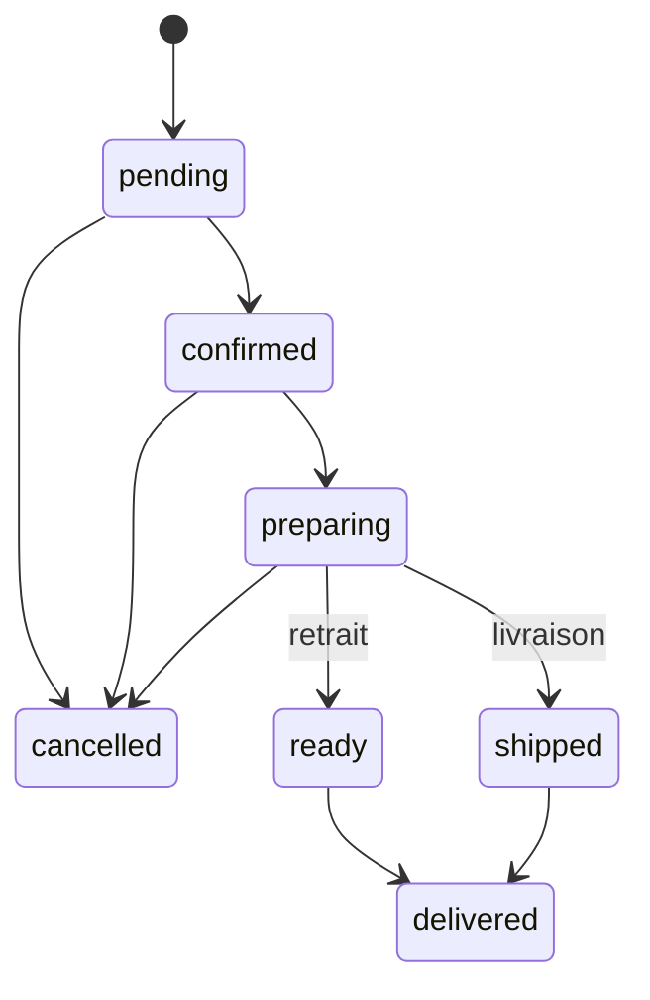

# ÉTAPE 7 — L'ERP d'administration

> **Statut** :
> - **Partie 1 terminée** : l'API d'administration (Laravel).
> - **Partie 2 terminée** : l'interface React de l'ERP (`/admin`), voir §9 à §14.
>
> **Vérification** : 66 tests backend (338 vérifications), dont 15 tests dédiés à l'ERP ; parcours navigateur de l'ERP : 25 vérifications contre la vraie API.
> **Exemple de facture générée** : [exemple-facture.pdf](exemple-facture.pdf)

---

## 1. Ce que permet l'API d'administration

| Domaine | Endpoints (`/api/v1/admin/…`) | Permission exigée |
|---|---|---|
| Tableau de bord du jour | `GET dashboard` | `orders.view` (montants : `analytics.view`) |
| Commandes | `GET orders`, `GET orders/{ref}` | `orders.view` |
| | `PATCH orders/{ref}/status`, `POST orders/{ref}/payments` | `orders.manage` |
| Factures PDF | `GET invoices/{numéro}/pdf` | `invoices.view` |
| Planning | `GET bookings?from&to`, `PATCH bookings/{ref}/status` | `bookings.view`, `bookings.manage` |
| Produits | `GET products`, `PATCH products/{id}` | `products.view`, `products.manage` |
| Stock | `GET products/{id}/movements`, `POST products/{id}/stock-adjustments` | `stock.view`, `stock.adjust` |
| Fabrication | `GET production-batches`, `POST production-batches` | `stock.view`, `production.manage` |
| Clients | `GET customers` | `customers.view` |
| Équipe | `GET/POST users`, `PATCH users/{id}`, `GET roles` | `users.manage` |
| Journal d'audit | `GET audit` | `audit.view` |

Côté client : `GET /api/v1/me/orders/{ref}/invoice` télécharge la facture de **sa** commande, une fois payée.

## 2. Qui peut faire quoi (RBAC)

| Rôle | Permissions principales |
|---|---|
| `super_admin` (propriétaire) | Tout, y compris le chiffre d'affaires, l'équipe et l'audit |
| `manager` | Tout sauf l'analytique financière, l'équipe, les rôles et l'audit |
| `cashier` | Commandes (traiter, encaisser), clients, factures ; **pas** les montants du tableau de bord ni le stock |
| `stock_keeper` | Produits, stock, pertes, fabrication |
| `stylist` | Consulter le planning |
| `customer` | Aucune permission ERP |

> **Leçon : le RBAC s'applique aussi aux DONNÉES.** Un caissier peut ouvrir le tableau de bord, mais les champs `revenue_*` et `margin` lui arrivent à `null`. Masquer un chiffre dans l'interface ne suffit pas : il ne doit **pas quitter le serveur**.

Le code vérifie toujours une **permission** (`permission:orders.manage`), jamais un nom de rôle. Ajouter demain un rôle « livreur » ne demandera aucune modification du code.

## 3. Les machines à états

Une **machine à états** liste les passages autorisés d'un statut à l'autre. Tout autre passage est refusé (422, avec un message clair).



Elles sont écrites **dans les Enums** (`OrderStatus::transitions()`, `BookingStatus::transitions()`). L'API renvoie `allowed_transitions` : l'interface n'affichera que les boutons possibles.

**Règles ajoutées :**
- **Annuler une commande** exige un motif et **remet le stock** (mouvements `sale_cancellation`).
- **Une commande payée** ne s'annule pas : il faut un avoir (RG-FAC-03).
- **Un rendez-vous** ne peut être marqué « terminé » ou « absent » qu'une fois l'heure passée.

## 4. Encaissement et factures

1. `POST orders/{ref}/payments` avec `method` = `cash`, `wave`, `orange_money`, `free_money` ou `card` (et la référence de transaction si besoin).
2. Le **montant vient de la commande**, jamais d'une saisie : impossible d'encaisser un montant faux.
3. Dans la **même transaction**, la facture est émise :
   - numéro `FAC-2026-000001` **sans trou**, grâce au compteur verrouillé `invoice_sequences` ;
   - coordonnées du client et de l'entreprise **figées** (`company_snapshot`) ;
   - la facture est **immuable**.
4. Le PDF est produit à la demande par **dompdf**, à partir d'un gabarit Blade (`resources/views/pdf/invoice.blade.php`). `{{ }}` échappe le HTML : aucune donnée saisie ne peut injecter de code dans le document.

## 5. Fabrication et stock

`POST production-batches` enregistre **en une transaction** :
- le lot (numéro unique, quantité, dates de fabrication et de péremption) ;
- ses **postes de coût** (ingrédients, flacons, étiquettes, main-d'œuvre…) ;
- l'entrée en stock (`production`) dans le grand livre ;
- le **nouveau coût de revient** du produit, calculé par MySQL : 25 000 F ÷ 96 = 260,42 F.

C'est ici que vous saisirez le coût du **spray anti-chute** et les lots de l'**hydratant 100 ml** et du **sérum 15 ml**.

`POST products/{id}/stock-adjustments` traite les pertes, les ajustements d'inventaire et les retours clients :
- un **motif** est obligatoire ;
- une perte est **toujours une sortie**, même si l'on tape « 2 » ;
- chaque opération est enregistrée dans le journal d'audit.

### 5 bis. Ajouter un produit, ses photos, et les réceptions d'achat (16 novembre 2026)

Maquette validée le 16 novembre (canevas, écrans « Nouveau produit » et « Réception d'achat »).

**Deux origines de produit** (`products.origin`) :

| Origine | Exemple | Le stock entre par | Coût de revient |
|---|---|---|---|
| `made` : fabriqué par Dabo Hair | Leave In, sérums | **Fabrication** (lot + postes de coût) | coût du dernier lot |
| `resold` : acheté et revendu | Virgin Hair Fertilizer | **Réceptions d'achat** (fournisseur, prix d'achat, frais) | **moyenne pondérée** du stock |

Les deux chemins sont étanches : l'API refuse un lot de fabrication pour un produit revendu, et une réception d'achat pour un produit fabriqué.

**Créer un produit** (`POST admin/products`, permission `products.manage`) :
- il naît en **brouillon** (`is_active = false`) : invisible sur le site ;
- la **référence** est créée automatiquement : marque (`DAB` pour la maison, sinon les initiales : `VHF`), 3 lettres du nom, numéro libre suivant → `VHF-HUI-001` ;
- l'**adresse** de la fiche aussi : `huile-de-croissance-120-ml` (suffixe `-2` si elle existe déjà) ;
- un doublon (même marque, même nom, même contenance) est refusé ;
- une marque absente se crée depuis le formulaire (« + Nouvelle marque… », `POST admin/brands`).

**Prix d'achat unitaire obligatoire** (18 novembre 2026) : prix payé au fournisseur (revendu) ou coût estimé d'une unité (fabriqué). Il devient le **coût de revient de départ** : la marge est connue dès la création, dans « Produits et stock » et dans les Analyses. L'écran l'affiche en direct (« 3 500 F · 58,3 % du prix de vente »). Ensuite, la première réception d'achat le remplace par le vrai prix payé, puis la moyenne pondérée prend le relais ; pour un produit fabriqué, chaque lot le remplace. **Vente à perte** (prix de vente plus bas) : l'écran avertit en rouge mais n'empêche pas d'enregistrer (produit d'appel, déstockage).

**Publier** (cocher « En vente ») exige **au moins une photo** : une fiche sans photo ne vend pas. Un produit en vente garde toujours au moins une photo.

**Les photos** (`POST admin/products/{id}/images`, 4 au plus) suivent ce chemin :
1. **Le navigateur** réduit la photo à 2 000 px et l'envoie en JPEG (`frontend/src/lib/resizeImage.ts`). Une photo de téléphone de 3 à 8 Mo devient 300 à 800 Ko : l'envoi est rapide, même en 3G. La limite du serveur reste à **2 Mo** (décidée à l'étape 10).
2. **Le serveur** (`app/Services/Catalog/ProductImageService.php`, extension GD) la redresse (photo prise en portrait), la recadre en **carré 1 200 px** et la **ré-encode en WebP**. Seuls les pixels sont recopiés : un fichier piégé perd son contenu caché, et la position GPS du téléphone (EXIF) disparaît.
3. Le fichier va dans `storage/app/public/produits/`, servi sous `/storage/produits/…`. En production, ce dossier est dans `shared/` : il survit aux déploiements, et il est **inclus dans la sauvegarde de chaque nuit** (`deploy/backup.sh`), puisque ces photos n'existent pas sur GitHub.

**Réception d'achat** (`POST admin/purchase-receipts`, permission `purchases.manage` : propriétaire, gérant, magasinier) :
- coût de la réception par unité = (quantité × prix d'achat + frais du lot) ÷ quantité ;
- nouveau coût de revient = **moyenne pondérée** : 10 unités à 2 000 F + 20 unités à 2 600 F = 72 000 F ÷ 30 = **2 400 F** ;
- tout se fait dans une **transaction avec verrou** sur le produit : une vente simultanée ne fausse pas la moyenne ;
- l'entrée passe par le grand livre (mouvement `purchase`) et le journal d'audit.

L'écran affiche le calcul **en direct** avant d'enregistrer (`frontend/src/features/admin/purchaseMath.ts`, même formule que le serveur) et prévient si le produit serait vendu à perte.

> **Pourquoi la moyenne pondérée et pas le dernier prix ?** Si le fournisseur augmente son prix, les 10 premières unités ont quand même coûté 2 000 F. Avec le dernier prix (2 600 F), la marge des Analyses serait sous-estimée tant que ces unités ne sont pas vendues.

### 5 ter. Modifier un produit existant (18 novembre 2026)

Bouton **Modifier** sur chaque ligne de « Produits et stock » → `/admin/produits/:id/modifier` (`EditProductPage.tsx`), `PATCH admin/products/{id}` (permission `products.manage`).

| Élément | Règle | Pourquoi |
|---|---|---|
| Référence (SKU) et adresse (slug) | **ne changent jamais** (le serveur ignore ces champs) | factures, commandes et liens partagés sur les réseaux y renvoient |
| Origine (fabriqué / revendu) | **verrouillée** dès le premier lot fabriqué ou la première réception d'achat | le stock et le coût en dépendent |
| Coût de revient | saisissable **avant** le premier lot ou la première réception ; ensuite en lecture seule | après, c'est la moyenne pondérée qui le calcule |
| Prix, prix barré | modifiables ; la marge s'affiche **avant et après** (3 250 F → 3 750 F), en rouge si vente à perte | voir l'effet avant d'enregistrer |
| Nom, marque, catégorie, contenance | modifiables, sans doublon (même marque + nom + contenance) | |
| Photos | même panneau que « Photos », enregistrées tout de suite | |
| Commandes passées | gardent leur prix | il est **figé** dans `order_items` au moment de l'achat |

Le verrou se calcule avec `Product::hasStockEntries()`. Dans la liste, `withExists(['productionBatches', 'purchaseReceipts'])` charge les deux réponses en **une seule requête** (et non une par produit : c'est le piège « N+1 »).

L'écran n'envoie **que les champs modifiés** : le journal d'audit ne contient que de vrais changements. « Dernières modifications » (`GET admin/products/{id}/history`) affiche les 5 dernières lignes du journal pour ce produit, en phrases courtes (« prix 6 000 → 6 500 F »).

### 5 quater. Promotions en pourcentage (20 novembre 2026)

ERP → **Promotions** (`PromotionsPages.tsx`, `PromotionAdminController`). Maquettes validées le 20 novembre 2026.

| Règle | Où |
|---|---|
| Le **prix initial ne change jamais** (`products.price`) : le serveur calcule le prix promo à la commande, pendant les dates | `PromotionService`, `PlaceOrderAction` |
| Prix promo arrondi à la **dizaine inférieure** (3 500 F à −15 % = 2 975 F → 2 970 F) ; même calcul dans le navigateur | `PromotionService::discounted()`, `discountedPrice()` |
| 5 à 70 % ; au-delà de 50 %, case de confirmation obligatoire | `PromotionAdminController::validated()` |
| Un produit dans **une** promotion à la fois (dates qui se chevauchent refusées) ; la gamme garde son prix membre (exclue) | idem |
| « Membres seulement » : la promotion ne vaut que pour une cliente connectée | `PromotionService::applicable()` |
| Chaque vente garde son prix initial (`regular_unit_price`) et sa promotion (`promotion_id`) | `order_items` |
| En cours : seuls le nom et la date de fin changent ; « Arrêter maintenant » remet le prix initial tout de suite | `update()`, `stop()` |

**Les résultats (savoir quand refaire une promotion).** On compare **les 7 jours avant** le début et **les jours de promotion**, ramenés à une journée (sinon 7 jours contre 3 ne se comparent pas) : unités, chiffre d'affaires, marge (prix payé − coût de revient), remise accordée. Les commandes annulées ne comptent pas. La phrase « Ce que disent les chiffres » n'apparaît qu'à partir de 3 jours : avant, un seul jour de pluie ou de fête fausse tout.

> Concept d'analyse de données : la promotion est réussie quand le **volume** compense la **remise**. Exemple : −20 % sur le spray (5 000 F, coût 350 F) ; la marge par unité passe de 4 650 F à 3 650 F (−21 %). Il faut donc vendre au moins 4 650 / 3 650 = 1,27 fois plus (+27 %) pour gagner autant par jour. À +100 % de ventes, la marge du jour monte de 57 %.

### 5 quinquies. Tarifs de livraison (21 novembre 2026)

ERP → **Livraison** (`DeliveryPage.tsx`, `DeliveryAdminController`). Maquette validée le 21 novembre 2026. Lecture avec `products.view`, modification avec `products.manage` (propriétaire, gérante).

| Règle | Où |
|---|---|
| Chaque zone : nom, frais, **délai annoncé** (« 24 h », « Le jour même »), proposée ou non sur le site | `delivery_zones.delay_label`, `is_active` |
| Une zone **ne se supprime pas** : on la cache. Les anciennes commandes gardent leur zone et leurs frais | `update()` |
| Changer des frais vaut pour les **nouvelles** commandes : les frais sont copiés dans la commande au moment où elle est passée | `orders.delivery_fee`, `PlaceOrderAction` |
| **Livraison offerte** facultative, à partir d'un montant d'achats (hors livraison), dans toutes les zones ; le serveur décide, le navigateur ne fait qu'afficher | `Setting::freeDeliveryThreshold()`, `PlaceOrderAction` |
| Site : « Plus que 3 000 F pour la livraison offerte » au panier et à la commande, « Offerte » dans le récapitulatif, délai sous la zone choisie | `CartPage`, `CheckoutPage`, `missingForFreeDelivery()` |
| Chaque changement passe par le journal d'audit (nom de journal `delivery`) ; les 8 derniers s'affichent sur la page | `DeliveryZone` (`LogsActivity`), `updateSettings()` |

> Concept : un **réglage** (le seuil de livraison offerte) n'est pas une ligne de catalogue ; il vit dans la table `settings` (clé `delivery.free_threshold`), lu par `Setting::get` avec un cache de 10 minutes que `Setting::put` vide aussitôt.

**Bug trouvé par le parcours e2e :** le formulaire est recréé après chaque enregistrement (pour repartir des valeurs du serveur), et il emportait avec lui le message « Tarifs enregistrés » : la gérante n'aurait jamais vu la confirmation. Le message vit maintenant dans le composant parent, qui, lui, n'est pas recréé.

### 5 sexies. Créer une gamme (24 novembre 2026)

ERP → **Produits et stock** → **Nouvelle gamme** (`NewBundlePage.tsx`, `ProductAdminController::storeBundle`, route `POST admin/bundles`, droit `products.manage`). Maquette validée le 24 novembre 2026. Pour les gammes avocat, palme et coco du lancement.

| Règle | Où |
|---|---|
| Au moins 2 produits, 12 au plus, chacun une seule fois (on change la quantité) ; jamais une gamme dans une gamme | `storeBundle()` (validation) |
| Prix membre facultatif, **inférieur** au prix de la gamme, avec le nombre de gammes au prix membre (une par compte) | idem, `MemberPriceService` à la commande |
| Naît en **brouillon** ; « Publier » exige une photo ; référence `DAB-GAM-002…`, catégorie « Gammes », marque maison | `storeBundle()`, `updateProduct()` |
| Pas de stock à elle : **le produit le plus rare limite tout** ; vendre une gamme retire chacun de ses produits | `Product::availableQuantity()`, `PlaceOrderAction` |
| Coût = somme des coûts de ses produits ; inconnu si l'un d'eux n'a pas de coût (la marge n'est pas inventée) | `CatalogAdminController::row()`, `bundleSummary()` |
| La composition ne change plus après création (une cliente garde ce qu'elle a acheté) : pour changer, nouvelle gamme | pas de route de modification de la composition |

**L'écran calcule en direct** (`bundleSummary()`, testé) : prix des produits achetés un par un, économie pour la cliente, marge au prix normal et au prix membre, **gammes possibles aujourd'hui**, produit(s) limitant(s), et ce qu'il faut encore fabriquer pour atteindre l'objectif.

> Concept d'analyse : le stock d'une gamme est un **minimum**, pas une somme. 47 shampooings, 23 masques et 47 sprays ne font que 23 gammes. Pour 200 gammes, il faut 177 masques de plus ; fabriquer des shampooings en plus n'y change rien tant que les masques manquent. C'est la notion de **goulot d'étranglement**.

**Bug évité :** « Gamme à l’avocat » donnait l'adresse `gamme-a-lavocat` (apostrophe typographique supprimée, mots collés) ; l'apostrophe sépare maintenant les mots : `gamme-a-l-avocat` (aussi pour les nouveaux produits).

## 6. Le journal d'audit (RG-SEC-01)

`spatie/laravel-activitylog` enregistre automatiquement, avec l'**auteur**, la **date** et les **valeurs avant et après** :
- les modifications de produits (prix, activation, seuil) ;
- les changements de statut des commandes et des réservations ;
- les lots de fabrication ;
- la création de comptes du personnel et les changements de rôle ;
- les ajustements de stock.

Exemple réel, tiré d'un test : « Awa Ndiaye a passé le prix du Sérum Booster de 3 000 à 3 500 F ».

L'API renvoie pour chaque ligne `subject` (technique : `Product #8`) **et** `subject_label` (lisible : `Masque capillaire`, `CMD-2026-000102`, `Lot LOT-2603-SHA-001`, `Khady Fall`). `subject_label` vaut `null` si l'objet a été supprimé depuis : l'écran affiche alors l'identifiant technique.

## 7. Créer le compte du propriétaire en production

Les comptes de démonstration n'existent qu'en local. En production :

```bash
php artisan app:create-admin
```

La commande demande le prénom, le nom, l'email et le mot de passe (12 caractères minimum, avec des lettres et des chiffres). Le mot de passe n'apparaît ni à l'écran ni dans l'historique du terminal.

**Garde-fou** : un administrateur ne peut pas se retirer à lui-même ses droits, ni désactiver son propre compte. Cela évite de se retrouver sans aucun administrateur.

## 8. Bugs et corrections pendant cette partie
- Le modèle `User` n'importait pas automatiquement le trait d'audit : import ajouté.
- **Facture PDF** : les titres de colonnes chiffrées étaient alignés à gauche. La règle CSS `.items th` était plus spécifique que `.right` ; elle est devenue `.items th.right`.
- Le moyen de paiement s'affichait en minuscules (« orange money ») : ajout de `PaymentMethod::label()`.

---

# Partie 2 — L'interface React de l'ERP

## 9. Où se trouve le code

```
frontend/src/
├── features/auth/permissions.ts      # can(user, "orders.manage"), isStaff(user), useCan(), libellés des rôles
├── types/admin.ts                    # types des réponses de l'API d'administration (contrat)
└── features/admin/
    ├── api.ts                        # hooks TanStack Query : lectures + mutations avec invalidation du cache
    ├── AdminLayout.tsx               # gabarit : menu latéral filtré par permission, gardes d'accès
    ├── components/ui.tsx             # petits composants communs (carte, KPI, tableau, champ, message)
    └── pages/
        ├── AdminPages.ts             # point d'entrée unique (un seul fichier JS téléchargé pour /admin)
        ├── DashboardPage.tsx         # tableau de bord du jour
        ├── OrdersPages.tsx           # liste filtrable + détail (statuts, encaissement, facture PDF)
        ├── PlanningPage.tsx          # planning hebdomadaire du salon
        ├── CatalogPages.tsx          # produits et stock + fabrication
        └── TeamPages.tsx             # clients, équipe et rôles, journal d'audit
```

| URL | Écran | Permission demandée |
|---|---|---|
| `/admin` | Tableau de bord | `orders.view` (sinon redirection vers le premier écran autorisé) |
| `/admin/commandes` et `/admin/commandes/:reference` | Commandes | `orders.view` (actions : `orders.manage`, facture : `invoices.view`) |
| `/admin/planning` | Planning | `bookings.view` (actions : `bookings.manage`) |
| `/admin/clients` | Clients | `customers.view` |
| `/admin/produits` | Produits et stock | `products.view` (prix : `products.manage`, ajustements : `stock.adjust`) |
| `/admin/fabrication` | Fabrication | `stock.view` (formulaire de lot : `production.manage`) |
| `/admin/equipe` | Équipe et rôles | `users.manage` |
| `/admin/audit` | Journal d'audit | `audit.view` |

## 10. Concept : l'interface n'est PAS la sécurité

C'est la notion la plus importante de cette partie. Masquer un bouton ne protège rien : n'importe qui peut ouvrir les outils de développement et appeler l'API à la main. La règle est donc :

1. **Le serveur décide** : chaque route `/api/v1/admin/*` vérifie sa permission (403 sinon). C'est la vraie barrière, testée par les tests PHPUnit.
2. **L'interface s'adapte** : elle masque ce que l'utilisateur ne peut pas faire, uniquement pour le confort (pas de bouton qui mène à une erreur).

Pour que l'interface sache quoi masquer, l'API renvoie la liste des permissions dans `GET /auth/me` (`user.permissions`). Le code React vérifie toujours une **permission** (`useCan('stock.adjust')`), jamais un nom de rôle (ADR-004) : si demain le caissier a le droit d'ajuster le stock, on change le rôle en base, sans toucher au code.

Trois exemples tirés du code :
- Le chiffre d'affaires du tableau de bord : le serveur **n'envoie pas** les montants sans `analytics.view` (valeur `null`). L'écran affiche alors « Réservé au propriétaire ». Le montant n'est jamais dans le navigateur du caissier, même caché.
- Les boutons de statut d'une commande viennent de `allowed_transitions`, calculé par le serveur avec la machine à états (§3). L'interface ne connaît pas les règles : elle affiche ce que le serveur autorise.
- Le parcours de test vérifie qu'un caissier qui appelle `/api/v1/admin/users` à la main reçoit bien **403**.

## 11. Concept : le chargement à la demande de l'ERP

Les routes `/admin` sont déclarées avec `lazy` dans `src/app/router.tsx`. Résultat du `npm run build` :

| Fichier | Taille (gzip) | Téléchargé par |
|---|---|---|
| `AdminLayout-….js` | 2,6 Ko | le personnel uniquement |
| `AdminPages-….js` | 11,4 Ko | le personnel uniquement |

Une cliente qui visite la boutique ne télécharge **jamais** le code de l'ERP : le site reste léger en 4G, et la structure de l'administration n'est pas exposée inutilement. Les pages sont regroupées dans un seul fichier (`AdminPages.ts`) : une fois dans l'ERP, on navigue sans nouveau téléchargement.

L'ERP est placé **hors** du gabarit public (`PublicLayout`) : il a son propre menu latéral et un thème clair, plus reposant pour un usage prolongé derrière un comptoir.

## 12. Concept : garder l'écran à jour après une action (invalidation du cache)

TanStack Query garde les réponses en mémoire. Après une action, il faut lui dire quelles données sont devenues fausses. Exemple dans `api.ts` : encaisser une commande invalide le détail de la commande, la liste des commandes **et** le tableau de bord (le CA a changé). Le hook générique `useAdminMutation(fn, [clés à invalider])` évite d'oublier une invalidation.

Le tableau de bord se rafraîchit aussi tout seul chaque minute (`refetchInterval: 60_000`) : une commande passée en ligne apparaît sans recharger la page.

Les filtres de la liste des commandes sont dans l'URL (`/admin/commandes?status=confirmed&search=Mariama`) : on peut partager le lien, utiliser le bouton Retour, ou mettre la page en favori.

## 13. La connexion du personnel

- Un membre du personnel qui se connecte sans destination précise arrive sur `/admin` ; un client arrive sur `/compte` (fonction `isStaff` : avoir au moins une permission).
- Le personnel voit un lien **ERP** dans l'en-tête du site.
- Un client qui tape `/admin` voit la page « Accès réservé au personnel » (et l'API lui répondrait 403 de toute façon).
- Un coiffeur (seulement `bookings.view`) qui ouvre `/admin` est redirigé vers le planning.

Comptes de démonstration (local uniquement) : `admin@dabohair.test` / `admin-dabo-2026` (propriétaire). Pour tester un autre rôle, créez un compte dans **Équipe et rôles** (exemple : caissier).

## 14. Le parcours de test de l'ERP

`frontend/e2e/parcours-admin.cjs` pilote un vrai navigateur (Playwright) contre la vraie API Laravel. Base remise à zéro avant : `php artisan migrate:fresh --seed`.

| # | Vérification |
|---|---|
| 1-5 | Redirection sans session, arrivée sur `/admin`, CA visible, alerte de rupture de la crème, menu complet |
| 6-10 | Filtre dans l'URL ; commande de retrait confirmée → en préparation → prête ; encaissement Wave ; facture FAC-2026-000001 téléchargeable en PDF ; état final « livrée » |
| 11-12 | Planning : navigation par semaine, annulation d'un rendez-vous avec motif |
| 13-15 | Nouveau prix visible dans la boutique ; perte de 2 shampooings (48 → 46) ; lot du spray anti-chute : 25 000 F / 96 = **260,42 F** de coût de revient |
| 16-18 | Valeur vie client mise à jour ; création d'un caissier ; actions présentes dans le journal d'audit |
| 19-22 | Caissier : CA masqué, menu réduit, lots visibles sans formulaire, API `/admin/users` → 403 |
| 23-25 | Cliente : pas de lien ERP, page « accès refusé » sur mobile ; aucune erreur JavaScript |

## 15. Bugs et corrections pendant la partie 2

- **Requêtes API du test refusées (401)** : Sanctum ne traite une requête comme venant du site (cookie de session) que si elle porte l'en-tête `Referer` ou `Origin` du site. Un navigateur l'envoie toujours ; un appel direct de Playwright non. Le test ajoute l'en-tête, comme le ferait le navigateur. Ce n'est pas une faille : c'est la protection qui fonctionne.
- **Faux succès du filtre** : le test attendait une commande déjà affichée avant la nouvelle recherche. Il attend maintenant la *disparition* de la commande filtrée.
- **Journal d'audit illisible** (« Product #8 », « updated ») : ajout de `subject_label` côté API et traduction des actions (« Modification », « Mouvement de stock »).
- **Bouton désactivé noir sur fond clair** : le style « désactivé » commun était prévu pour le site sombre ; la variante `subtle` a désormais son propre style désactivé.
- **Caissier et fabrication** : le caissier a `stock.view` et voit donc l'historique des lots, mais pas le formulaire (`production.manage`). C'est voulu : il peut renseigner un client sur la date de péremption d'un lot.
