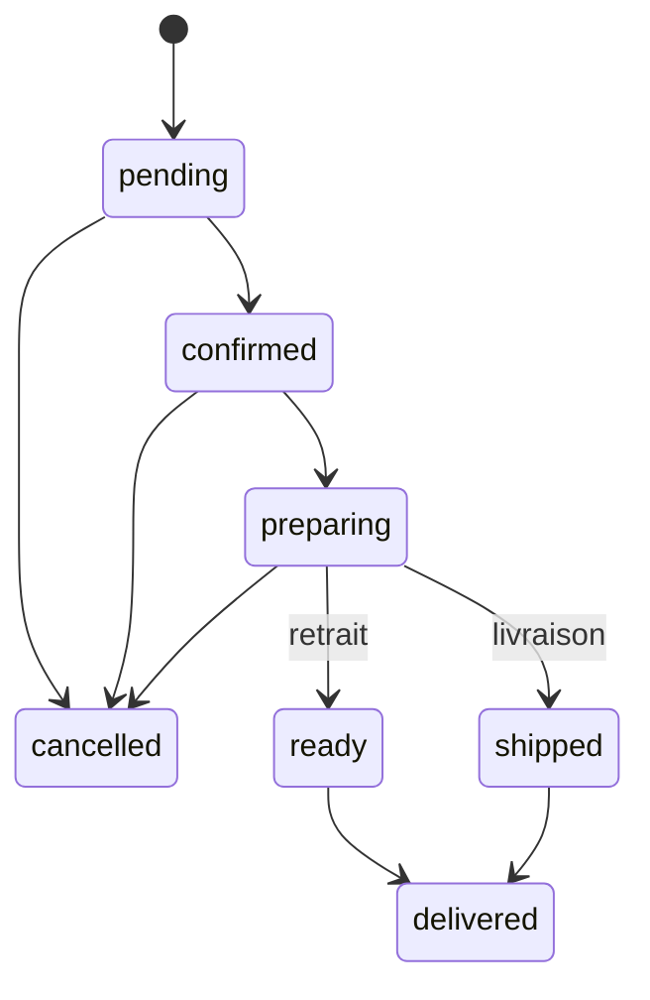

# ÉTAPE 7 — L'ERP d'administration

> **Statut** :
> - **Partie 1 terminée** : l'API d'administration (Laravel).
> - **Partie 2 (à venir)** : l'interface React de l'ERP (`/admin`).
>
> **Vérification** : 66 tests backend (337 vérifications), dont 15 tests dédiés à l'ERP.
> **Exemple de facture générée** : [exemple-facture.pdf](exemple-facture.pdf)

---

## 1. Ce que permet l'API d'administration

| Domaine | Endpoints (`/api/v1/admin/…`) | Permission exigée |
|---|---|---|
| Tableau de bord du jour | `GET dashboard` | `orders.view` (montants : `analytics.view`) |
| Commandes | `GET orders`, `GET orders/{ref}` | `orders.view` |
| | `PATCH orders/{ref}/status`, `POST orders/{ref}/payments` | `orders.manage` |
| Factures PDF | `GET invoices/{numéro}/pdf` | `invoices.view` |
| Planning | `GET bookings?from&to`, `PATCH bookings/{ref}/status` | `bookings.view`, `bookings.manage` |
| Produits | `GET products`, `PATCH products/{id}` | `products.view`, `products.manage` |
| Stock | `GET products/{id}/movements`, `POST products/{id}/stock-adjustments` | `stock.view`, `stock.adjust` |
| Fabrication | `GET production-batches`, `POST production-batches` | `stock.view`, `production.manage` |
| Clients | `GET customers` | `customers.view` |
| Équipe | `GET/POST users`, `PATCH users/{id}`, `GET roles` | `users.manage` |
| Journal d'audit | `GET audit` | `audit.view` |

Côté client : `GET /api/v1/me/orders/{ref}/invoice` télécharge la facture de **sa** commande, une fois payée.

## 2. Qui peut faire quoi (RBAC)

| Rôle | Permissions principales |
|---|---|
| `super_admin` (propriétaire) | Tout, y compris le chiffre d'affaires, l'équipe et l'audit |
| `manager` | Tout sauf l'analytique financière, l'équipe, les rôles et l'audit |
| `cashier` | Commandes (traiter, encaisser), clients, factures ; **pas** les montants du tableau de bord ni le stock |
| `stock_keeper` | Produits, stock, pertes, fabrication |
| `stylist` | Consulter le planning |
| `customer` | Aucune permission ERP |

> **Leçon : le RBAC s'applique aussi aux DONNÉES.** Un caissier peut ouvrir le tableau de bord, mais les champs `revenue_*` et `margin` lui arrivent à `null`. Masquer un chiffre dans l'interface ne suffit pas : il ne doit **pas quitter le serveur**.

Le code vérifie toujours une **permission** (`permission:orders.manage`), jamais un nom de rôle. Ajouter demain un rôle « livreur » ne demandera aucune modification du code.

## 3. Les machines à états

Une **machine à états** liste les passages autorisés d'un statut à l'autre. Tout autre passage est refusé (422, avec un message clair).



Elles sont écrites **dans les Enums** (`OrderStatus::transitions()`, `BookingStatus::transitions()`). L'API renvoie `allowed_transitions` : l'interface n'affichera que les boutons possibles.

**Règles ajoutées :**
- **Annuler une commande** exige un motif et **remet le stock** (mouvements `sale_cancellation`).
- **Une commande payée** ne s'annule pas : il faut un avoir (RG-FAC-03).
- **Un rendez-vous** ne peut être marqué « terminé » ou « absent » qu'une fois l'heure passée.

## 4. Encaissement et factures

1. `POST orders/{ref}/payments` avec `method` = `cash`, `wave`, `orange_money`, `free_money` ou `card` (et la référence de transaction si besoin).
2. Le **montant vient de la commande**, jamais d'une saisie : impossible d'encaisser un montant faux.
3. Dans la **même transaction**, la facture est émise :
   - numéro `FAC-2026-000001` **sans trou**, grâce au compteur verrouillé `invoice_sequences` ;
   - coordonnées du client et de l'entreprise **figées** (`company_snapshot`) ;
   - la facture est **immuable**.
4. Le PDF est produit à la demande par **dompdf**, à partir d'un gabarit Blade (`resources/views/pdf/invoice.blade.php`). `{{ }}` échappe le HTML : aucune donnée saisie ne peut injecter de code dans le document.

## 5. Fabrication et stock

`POST production-batches` enregistre **en une transaction** :
- le lot (numéro unique, quantité, dates de fabrication et de péremption) ;
- ses **postes de coût** (ingrédients, flacons, étiquettes, main-d'œuvre…) ;
- l'entrée en stock (`production`) dans le grand livre ;
- le **nouveau coût de revient** du produit, calculé par MySQL : 25 000 F ÷ 96 = 260,42 F.

C'est ici que vous saisirez le coût du **spray anti-chute** et les lots de l'**hydratant 100 ml** et du **sérum 15 ml**.

`POST products/{id}/stock-adjustments` traite les pertes, les ajustements d'inventaire et les retours clients :
- un **motif** est obligatoire ;
- une perte est **toujours une sortie**, même si l'on tape « 2 » ;
- chaque opération est enregistrée dans le journal d'audit.

## 6. Le journal d'audit (RG-SEC-01)

`spatie/laravel-activitylog` enregistre automatiquement, avec l'**auteur**, la **date** et les **valeurs avant et après** :
- les modifications de produits (prix, activation, seuil) ;
- les changements de statut des commandes et des réservations ;
- les lots de fabrication ;
- la création de comptes du personnel et les changements de rôle ;
- les ajustements de stock.

Exemple réel, tiré d'un test : « Awa Ndiaye a passé le prix du Sérum Booster de 3 000 à 3 500 F ».

## 7. Créer le compte du propriétaire en production

Les comptes de démonstration n'existent qu'en local. En production :

```bash
php artisan app:create-admin
```

La commande demande le prénom, le nom, l'email et le mot de passe (12 caractères minimum, avec des lettres et des chiffres). Le mot de passe n'apparaît ni à l'écran ni dans l'historique du terminal.

**Garde-fou** : un administrateur ne peut pas se retirer à lui-même ses droits, ni désactiver son propre compte. Cela évite de se retrouver sans aucun administrateur.

## 8. Bugs et corrections pendant cette partie
- Le modèle `User` n'importait pas automatiquement le trait d'audit : import ajouté.
- **Facture PDF** : les titres de colonnes chiffrées étaient alignés à gauche. La règle CSS `.items th` était plus spécifique que `.right` ; elle est devenue `.items th.right`.
- Le moyen de paiement s'affichait en minuscules (« orange money ») : ajout de `PaymentMethod::label()`.
