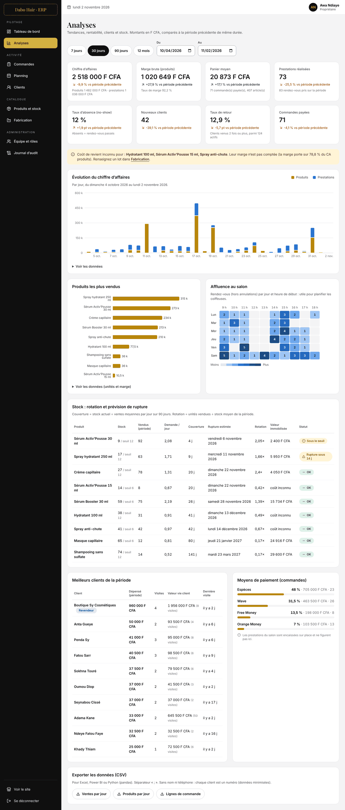

# ÉTAPE 8 — Data Analytics : le tableau de bord décisionnel (BI)

> **Statut** : terminée.
> **Vérification** : 93 tests backend (dont 12 pour l’analytique), 44 tests frontend, parcours navigateur de l'ERP (29 vérifications, dont 5 sur les analyses), script Python exécuté sur 180 jours d'historique.
> **Capture** : [captures/08_analyses.png](captures/08_analyses.png)



---

## 1. Ce qui a été construit

| Élément | Où | Rôle |
|---|---|---|
| Agrégats quotidiens | `app/Services/Analytics/SnapshotBuilder.php` | Mini entrepôt de données : une ligne par jour (et par produit) |
| Job nocturne | `php artisan analytics:snapshot` (planifié à 00 h 30) | Calcule hier et aujourd'hui ; `--all` recalcule tout |
| Service des KPI | `app/Services/Analytics/AnalyticsService.php` | Une méthode par indicateur du dictionnaire (§3) |
| API | `GET /api/v1/admin/analytics?from=&to=` | Tout le tableau de bord en une réponse |
| Exports CSV | `GET /api/v1/admin/analytics/export/{jeu}` | Pour Excel, Power BI, pandas |
| Écran | ERP → **Analyses** (`/admin/analyses`) | KPI comparés, graphiques, stock, clients, exports |
| Historique fictif | `php artisan app:demo-history` (local uniquement) | 180 jours de ventes et de rendez-vous réalistes, pour s'entraîner |
| Prévisions | `analytics/prevision_ventes.py` | Premier pas vers le Machine Learning |

Accès : permission `analytics.view`, donc **le propriétaire uniquement**. Le gérant, le caissier et les coiffeuses reçoivent 403, même en tapant l'URL.

---

## 2. Concepts de Business Intelligence

### 2.1 OLTP et OLAP : deux façons d'utiliser une base
| | OLTP (tables métier) | OLAP (agrégats) |
|---|---|---|
| Exemple | `orders`, `bookings`, `stock_movements` | `daily_sales_snapshots`, `daily_product_stats` |
| Optimisé pour | **Écrire** vite et sans erreur (une commande à la fois) | **Lire** vite des mois d'historique |
| Une ligne = | un événement (une commande, un mouvement) | un jour (déjà additionné) |

Un graphique sur 12 mois lit 365 lignes d'agrégats au lieu de milliers de commandes et de lignes. C'est le principe d'un **entrepôt de données** (*data warehouse*), en version simplifiée (ADR-008).

### 2.2 Table de faits et dimension
- **Faits** : les mesures que l'on additionne (CA, unités vendues, rendez-vous). Ici : `daily_sales_snapshots` et `daily_product_stats`.
- **Dimension** : ce par quoi on regroupe ou filtre. Ici : `calendar_dates` (année, mois, semaine ISO, jour de la semaine, week-end) et `products`.

La dimension calendrier sert aussi à faire apparaître les **jours sans vente** avec la valeur 0. Sans elle, ces jours disparaîtraient du graphique et fausseraient les moyennes.

### 2.3 Encaissé ou demandé : deux points de vue
| Table | Date utilisée | Question |
|---|---|---|
| `daily_sales_snapshots` | date de **paiement** | Combien a-t-on **encaissé** ? (finance) |
| `daily_product_stats` | date de **commande** (sortie de stock) | Combien les clientes ont-elles **demandé** ? (stock) |

Une commande passée le 30 et payée le 2 compte dans le CA du 2, mais dans la demande du 30. Pour prévoir une rupture, c'est la demande qui compte.

### 2.4 Idempotence et fraîcheur
- **Idempotent** : recalculer un jour donne toujours le même résultat (`upsert`). On peut relancer le job sans risque, après une correction par exemple.
- **Fraîcheur** : les jours passés sont définitifs. Le jour en cours est recalculé à la demande s'il date de plus de 5 minutes.
- **Filet de sécurité** : si un jour manque (serveur éteint pendant la nuit), l'API le calcule au moment de l'affichage.

### 2.5 Reconstruire le stock d'une date passée
`products.stock_quantity` ne donne que le stock **actuel**. Le stock du 15 août se reconstruit à partir du grand livre :

```
stock au début de la période = SOMME(quantity) des mouvements antérieurs
stock fin de journée J        = stock de la veille + SOMME(quantity) des mouvements du jour J
```

C'est l'intérêt du grand livre (étape 3) : il permet de rejouer l'histoire. Pour que ce calcul soit juste, **chaque mouvement doit porter la date réelle de l'événement**. Cela a révélé un défaut dans les données de démonstration (§7).

---

## 3. Dictionnaire des KPI (définitions exactes)

Toutes les périodes sont comparées à la **période précédente de même durée**. Exemple : du 1er au 30 octobre comparé au 1er au 30 septembre.

| KPI | Formule | Requête de référence |
|---|---|---|
| Chiffre d'affaires | commandes **payées** (total, livraison comprise) + prestations **terminées** | Q02 |
| Panier moyen | CA produits ÷ nombre de commandes payées | Q03 |
| Marge brute | Σ (prix − coût de revient) × quantité, **uniquement sur les lignes au coût connu** | Q04 |
| Taux de marge | marge brute ÷ CA des lignes au coût connu | Q04 |
| Nouveaux clients | clients dont la **première** activité (commande ou rendez-vous non annulés) tombe dans la période | Q05 |
| Taux de retour | clients venus au moins 2 fois ÷ clients actifs de la période | Q06 |
| Valeur vie client (CLV) | total dépensé depuis la première visite (produits + prestations) | Q07 |
| Heatmap d'affluence | rendez-vous non annulés, par jour de la semaine et heure de début | Q08 |
| Taux d'absence (no-show) | absents ÷ (terminés + absents) ; les annulés n'en font pas partie | Q09 |
| Rotation du stock | unités vendues ÷ **stock moyen** de la période (moyenne des stocks de fin de journée) | Q10 |
| Couverture | stock actuel ÷ demande moyenne par jour sur 90 jours | Q11 |
| Date de rupture estimée | aujourd'hui + couverture | Q11 |
| Faible rotation | en stock, mais 2 ventes ou moins sur la période | Q12 |
| Valeur immobilisée | stock × coût de revient (argent « dormant » sur les étagères) | Q12 |

**Lecture des variations** : la couleur suit l'objectif, pas le signe. Un taux d'absence qui **monte** s'affiche en rouge. Une flèche et le signe `+` ou `−` accompagnent toujours la couleur. Pour un taux, la variation est en **points** (`+1,9 pt`), pas en pourcentage.

> **Amélioration par rapport à Q10** : la requête de l'étape 3 estimait le stock moyen par (début + fin) ÷ 2. Avec les agrégats, on a le stock de **chaque** jour : la moyenne réelle est plus juste, notamment quand un lot arrive au milieu de la période.

---

## 4. Qualité des données : ne jamais inventer un chiffre

Le coût de revient de l'hydratant 100 ml, du sérum 15 ml et du spray anti-chute n'est pas encore connu.

| Mauvaise pratique | Ce que fait le projet |
|---|---|
| Compter un coût inconnu comme 0 F : marge de 100 %, totalement fausse | La marge ne porte que sur les ventes au coût connu (`costed_revenue`) |
| Masquer le problème | Bandeau : « Coût de revient inconnu pour… la marge porte sur 78,8 % du CA produits » |
| Afficher 0 pour un produit sans coût | « coût inconnu » dans les tableaux, `null` dans l'API |

Dès que vous saisirez un lot avec ses coûts dans **Fabrication**, le coût de revient sera mis à jour. Les **nouvelles** ventes auront alors une marge. Les anciennes gardent leur instantané (`unit_cost` figé à la vente, RG-COM-03).

---

## 5. La visualisation : des règles, pas du goût

| Règle | Application |
|---|---|
| La forme suit la question | Évolution → colonnes empilées ; classement → barres horizontales ; jour × heure → heatmap ; un chiffre → tuile KPI |
| La couleur porte l'identité, attribuée dans un ordre fixe | Produits = **or** `#b8860b` (la marque), prestations = **bleu** `#2a78d6` |
| Couleurs vérifiées par calcul | Script de validation : séparation pour les 3 formes de daltonisme et contraste ≥ 3:1, tous deux réussis |
| Magnitude = une seule teinte, du clair au foncé | Heatmap en bleu, jamais d'arc-en-ciel |
| Un seul axe vertical | Pas de graphique à deux échelles (il invente des corrélations) |
| Encre discrète | Barres de 24 px maximum, grille en traits pleins très clairs, coins arrondis côté donnée |
| Jamais la couleur seule | Légende pour 2 séries, libellés, et une version **tableau** de chaque graphique (« Voir les données ») |
| Changer de période sans flash | L'ancien écran reste affiché, estompé, pendant le chargement (`keepPreviousData`) |

**Performance** : Recharts pèse environ 110 Ko compressés. La page Analyses est un fichier JavaScript **séparé** : le caissier, qui n'y a pas accès, ne le télécharge jamais. Le code commun de l'ERP reste à 8 Ko.

---

## 6. Exports CSV et préparation du Machine Learning

### 6.1 Les trois jeux de données
| Jeu | Une ligne = | Usage typique |
|---|---|---|
| `daily_sales` | un jour, avec les attributs du calendrier | Prévoir le CA (série temporelle) |
| `product_daily` | un produit × un jour (demande, stock de fin de journée) | Prévoir les ruptures, la rotation |
| `order_lines` | un article commandé | Analyse du panier, des moyens de paiement |

Format : séparateur `;` et UTF-8 avec BOM, pour qu'Excel affiche correctement les accents. Dans pandas :

```python
df = pd.read_csv("ventes_par_jour.csv", sep=";", encoding="utf-8-sig", parse_dates=["date"])
```

### 6.2 Sécurité des exports
- **Minimisation des données** : aucun nom, téléphone ni adresse. Le client est un numéro (pseudonyme). Un analyste a besoin de savoir *comment* on achète, pas *qui* achète. C'est l'esprit de la loi sénégalaise sur les données personnelles (loi 2008-12, CDP).
- **Injection de formule** (OWASP *CSV Injection*) : une cellule commençant par `=`, `+`, `-` ou `@` serait exécutée par Excel. Elle est préfixée d'une apostrophe. Les nombres négatifs restent des nombres.
- Permission `analytics.view` et limite de 20 exports par minute.

### 6.3 Le script `analytics/prevision_ventes.py`
Il suit la démarche d'un vrai projet de Machine Learning :

1. **Explorer** : CA moyen par jour de la semaine (le samedi est le jour le plus fort), tendance mensuelle.
2. **Découper dans le temps** : on apprend sur le passé et on évalue sur les 28 derniers jours. Sur une série temporelle, on ne mélange **jamais** au hasard : ce serait tricher en utilisant le futur.
3. **Comparer des modèles simples** (*baselines*) avec une métrique :
   - **MAE** (erreur absolue moyenne) : « en moyenne, on se trompe de X F par jour » ;
   - **WAPE** : l'erreur en % du total (préféré au MAPE, qui devient infini les jours à 0 vente).
4. **Prévoir** les 14 prochains jours avec le meilleur modèle, avec une fourchette égale à ± l'erreur moyenne. Les résultats sont écrits au format de la table `forecasts`.

Résultat sur l'historique de démonstration :

```
moyenne_globale                  MAE   59 596 F/jour   WAPE  66.6 %
moyenne_mobile_28j               MAE   71 159 F/jour   WAPE  79.6 %
moyenne_par_jour_semaine_8sem    MAE   62 188 F/jour   WAPE  69.5 %
mediane_par_jour_semaine_8sem    MAE   55 250 F/jour   WAPE  61.8 %   <- retenu
```

**Lecture d'analyste** :
- La **médiane** gagne parce que les grosses commandes rares des revendeurs faussent les moyennes. C'est une valeur aberrante (*outlier*) typique.
- Un WAPE de 60 % au **jour** près est normal pour une petite boutique. À la **semaine**, l'erreur relative baisse fortement. Choisir le bon niveau d'agrégation fait partie du métier.
- Un modèle avancé (Prophet, gradient boosting) n'a d'intérêt que s'il **bat ces baselines**. Sans baseline, impossible de savoir si un modèle complexe apporte quelque chose.

```bash
cd analytics
```

```bash
pip install -r requirements.txt
```

```bash
python prevision_ventes.py ventes_par_jour.csv produits_par_jour.csv
```

---

## 7. L'historique de démonstration

```bash
cd backend && php artisan migrate:fresh --seed && php artisan app:demo-history
```

Environ 45 secondes pour 180 jours : environ 400 commandes, 480 rendez-vous et 17 lots de fabrication.

**Comment ça marche** : la commande « remonte le temps » jour par jour (`Carbon::setTestNow`) et rejoue l'activité avec les **vraies** classes métier : `PlaceOrderAction`, `RecordPaymentAction`, `CreateBookingAction`, `RecordProductionBatchAction`. Toutes les règles s'appliquent donc : stock jamais négatif, prix lus en base, factures sans trou, créneaux libres uniquement. C'est aussi un **test d'intégration à grande échelle**.

| Effet simulé | Modèle |
|---|---|
| Nombre de commandes par jour | Loi de Poisson (événements aléatoires autour d'une moyenne) |
| Saisonnalité | Coefficient par jour (samedi × 1,45, dimanche × 0,6) |
| Tendance | Croissance de +85 % sur la période |
| Fidélité | 65 % de clients déjà venus, surtout les plus anciens (loi de Pareto) |
| Revendeurs | Commandes à la douzaine, environ 1 jour sur 20 |
| Imprévus | 5 % d'annulations, 7 % d'absences, 8 % de rendez-vous annulés |
| Réapprovisionnement | L'atelier fabrique un lot quand le stock manque |

**Reproductible** : la graine du hasard est fixe (`--seed=2026`). Deux exécutions donnent exactement les mêmes données, ce qui est indispensable pour comparer des modèles.

**Garde-fous** :
- la commande est refusée hors environnement local ;
- elle est refusée si l'historique existe déjà ;
- elle est refusée si la base contient des mouvements de stock **postérieurs** au début de l'historique (§8, bug 8) ;
- elle ne pollue pas le journal d'audit, qui trace les actions **humaines**.

---

## 8. Bugs trouvés et corrigés pendant cette étape

1. **Mouvements de stock mal datés (seeders)** : la fabrication du 20 mars et la vente en gros du 24 mars étaient datées du jour où l'on remplit la base. Le stock historique reconstruit était donc faux. Les mouvements portent désormais la date réelle de l'événement.
2. **Grand livre dans le désordre (historique fictif)** : les commandes d'une même journée étaient simulées dans un ordre aléatoire (15 h puis 9 h), ce qui donnait 158 mouvements dont le solde ne suivait pas l'horloge. Les commandes d'un jour se suivent maintenant dans l'ordre chronologique, et un lot est daté juste avant la vente qui le déclenche. Le contrôle SQL (fonction de fenêtrage `SUM() OVER`) donne désormais 0 anomalie.
3. **`tax_total` null après création d'une commande** : `PlaceOrderAction` ne renseignait pas `tax_total`. MySQL appliquait bien sa valeur par défaut, mais l'objet PHP gardait `null`. Encaisser une commande juste après l'avoir créée faisait échouer la facture. Ça n'arrivait pas via l'API, qui relit la commande avant de l'encaisser. Les tests l'ont révélé ; c'est le même piège que `payment_status` à l'étape 6. Corrigé : valeurs explicites.
4. **ERP illisible sur mobile** : avec `flex-wrap` et `flex: 1` (base 0), le contenu tenait « en théorie » sur la même ligne que le menu et se retrouvait écrasé. Le menu est désormais au-dessus du contenu sur mobile (`flex-col`), côte à côte sur grand écran.
5. **Page plus large que l'écran** : un élément de grille ne peut pas, par défaut, être plus étroit que son contenu (`min-width: auto`). Un tableau de 560 px élargissait donc toute la page. `min-w-0` sur les cartes : c'est le tableau qui défile, pas la page.
6. **Recharts dans le code commun de l'ERP** : le fichier partagé était passé de 11 à 125 Ko. La page Analyses est maintenant chargée à part.
7. **Test qui lisait l'ancien écran** : pendant un changement de période, l'ancien écran reste affiché. Le test attend désormais la réponse de l'API avant de lire un chiffre.
8. **Stock consommé avant d'être fabriqué** : l'historique avait été généré sur une base où le test du navigateur venait d'enregistrer un lot daté d'**aujourd'hui**. La simulation voyait ce stock et le vendait dans le **passé** : le stock reconstruit devenait négatif, puis ramené à 0, d'où une rotation aberrante de 30× sur le spray anti-chute. La commande refuse désormais une base qui contient des mouvements postérieurs au début de l'historique. Leçon d'analyste : un indicateur aberrant signale souvent un problème dans les **données**, pas dans la formule.
